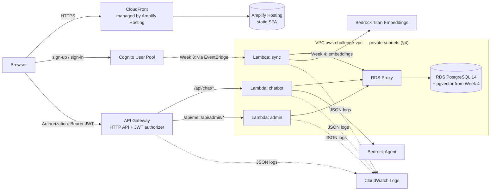

# ARCHITECTURE.md — AWS Challenge

Status: **draft v0.6 (2026-11-12)**. This file holds the system-wide principles, components and ADRs. Decisions
marked *Proposed* need the owner's confirmation and are not implemented before that. Feature-level detail lives in
[design/](design/) (one doc per feature, written before coding), behaviour in [specs/](specs/), open decisions and
risks in [RISKS.md](RISKS.md), work in [PLAN.md](PLAN.md).

> 2026-11-12: Week 1 was built **manually in the AWS console** by the owner and accepted; the known facts are in
> §4. Agents have no AWS access: the owner makes every AWS change in the console from a devops runbook until a
> dedicated IaC task exists ([Q-12](RISKS.md#q-12), option C; CLAUDE.md §3.11). All server-side code is Python
> Lambda functions (ADR-015). Sections below describe the target; where a week is not planned yet, the curriculum
> wins and the detail is decided when that week is planned.

---

## 0. Principles

1. **Serverless and pay-per-use first;** always-on resources (RDS, RDS Proxy, NAT) only where a goal needs them, and
   the environment can be stopped or removed when idle.
2. **Private by default:** no public IP for backend resources; the database is reachable only through RDS Proxy.
3. **Least privilege:** one IAM role per function, scoped to exact resource ARNs.
4. **Secrets never leave Secrets Manager:** not in code, env var values, logs or Git.
5. **Reproducible changes:** every AWS change is a console runbook in its task Notes now, IaC later
   ([Q-02](RISKS.md#q-02), T00-03); schema through versioned SQL migrations ([Q-16](RISKS.md#q-16)); code from Git.
6. **Observable:** one JSON log line per event, correlated across the chain (G8).
7. **Decide before building:** ADR or design doc first, alternatives with trade-offs, the owner decides.

## 1. Context and goals

A learning-but-real project: a SPA with authentication, a personal page, an admin user table and an AI query page
(semantic search and NL→SQL over users). Everything runs on serverless AWS services and is observable in CloudWatch.
Principle: **You Build It, You Run It** — the team owns code, infrastructure and operations.

| # | Goal |
|------|------|
| G1 | SPA automatically deployed from a Git repository to AWS Amplify Hosting |
| G2 | Global content delivery through Amazon CloudFront; isolated VPC |
| G3 | User authentication with an Amazon Cognito User Pool |
| G4 | HTTP API Gateway with JWT authorization and protected access to Lambda functions in private subnets |
| G5 | Server functions connected to PostgreSQL through Amazon RDS Proxy |
| G6 | pgvector extension and HNSW / IVFFlat indexes for semantic search over embeddings |
| G7 | Embeddings produced by Titan Text Embeddings on Amazon Bedrock |
| G8 | Logging of the whole request chain as structured JSON in Amazon CloudWatch |

### 1.1 Curriculum overview (as given by the owner, 2026-11-12)

Only the current week is planned ([PLAN.md](PLAN.md)); later rows are input for their planning, not designs.

| Week | Topic (as given) | State |
|---|---|---|
| 1 | Environment: Amplify Hosting + CloudFront; VPC; RDS PostgreSQL **14** + RDS Proxy; three Lambdas (Admin, Chatbot, Sync); `SELECT 1` from Admin; log groups | [requirements](requirements/week-01-environment.md); built manually, accepted by the owner 2026-11-12 |
| 2 | Authorization: Cognito User Pool with Amplify Auth; HTTP API Gateway with JWT authorizer | [requirements](requirements/week-02-authorization.md); planned |
| 3 | REST API + data: Admin Lambda ↔ RDS Proxy; Sync chain Cognito → **EventBridge** → Lambda | not planned |
| 4 | Create the `pgvector` extension; a function generates **1536-dimensional** vectors stored in `users.embedding`; similarity query `ORDER BY embedding <-> $1 LIMIT 5`; the Sync Lambda calls Bedrock Titan Embeddings (or Claude 3.5 Sonnet) on insert/update; `ivfflat` or `hnsw` index; check latency on 1000 records | not planned; conflict with ADR-007 → [Q-15](RISKS.md#q-15) |
| 5 | SPA search component → Chatbot Lambda → Bedrock Agent (NL→SQL if the query contains the keyword "sql", otherwise embedding similarity). Goals: results < 1 s; "users similar to …" returns the correct TOP-5; API Gateway timeout 29 s, Lambda 30 s; log latency and token count | not planned |
| 6 | JSON logs (Powertools Logger, Lambda advanced logging controls), CloudWatch Logs Insights, X-Ray service map | not planned |

Notes for later planning:
- Week 3 says "REST API", while G4 and Week 2 say "HTTP API Gateway": ADR-003 (HTTP API) is kept; "REST" is read as
  the API style, not the API Gateway product.
- Week 3 requires EventBridge in the sync chain (ADR-011 rejected). Cognito invokes Lambda triggers directly and has
  no native delivery of the PostConfirmation event to EventBridge; candidate wirings (trigger → `PutEvents` → rule →
  Sync Lambda; EventBridge rule on CloudTrail events) are compared when Week 3 is planned, together with R-02 / R-11.
- Week 4 stores embeddings in the users table, so the chatbot searches users, not a separate document corpus
  ([Q-05](RISKS.md#q-05)).

### Out of scope (first stage)
- Multi-account / multi-region, disaster recovery, blue/green deployments.
- Mobile clients, social logins, MFA (can be enabled later).

---

## 2. System overview

Target after Week 6 (Week 3–6 parts are curriculum input, not designs yet):

Deviations from the curriculum or the challenge diagram:

| Curriculum / diagram | Design | Why |
|---|---|---|
| Week 3 title "REST API" | **HTTP API** with native JWT authorizer | G4 and Week 2 say HTTP API; cheaper, native Cognito JWT (ADR-003) |
| CloudFront "inside a VPC" | CloudFront managed by Amplify Hosting; Lambda, Proxy and RDS in the VPC | CloudFront is a global edge service; decided by the Week 1 build (Q-01 closed) |

---

## 3. Components

### 3.1 Frontend (`frontend/`)
- React 19 + TypeScript + Vite; routing with React Router; server state with TanStack Query.
- Authentication with Amplify Auth v6 (`aws-amplify/auth` APIs) and own screens (ADR-014).
- Configuration only through `VITE_*` environment variables (User Pool id, App Client id, API URL, region), set in
  Amplify Hosting.
- Pages: Home (the signed-in user's read-only profile), sign-up / sign-in (no code confirmation, the owner confirms
  users in the console — design [authentication](design/authentication.md)), later the admin user table and the AI
  query page.
- Delivery: Amplify Hosting builds on every push to `main` (`amplify.yml`, monorepo `appRoot: frontend`), SPA rewrite
  to `index.html`.

### 3.2 Lambda functions (ADR-015)
All server-side code is Python 3.13 Lambda functions, deployed as zip files; there is no backend application.
Function names `aws-challenge-<function>` (§4).

| Function | Trigger | Responsibility | From |
|---|---|---|---|
| `admin` | HTTP API | `/api/me`, `/api/admin/*`; Week 1 `SELECT 1` probe on a direct invoke | Week 1 (probe), Week 3 (API) |
| `chatbot` | HTTP API | `/api/chat/*`: similarity search, Bedrock Agent | Week 5 |
| `sync` | Cognito → EventBridge chain | copy of the user into PostgreSQL, embedding on insert/update | Week 3, Week 4 |

Source layout (one directory per function under `lambdas/`) and packaging are fixed by the Week 3 task that brings
`admin` into Git, with its skill file. The Week 1 code of all three functions exists only in the AWS console until
their weeks bring it into Git
([R-15](RISKS.md#2-risk-register)).

### 3.3 API Gateway (HTTP API)
Week 2 as built (design [api-gateway-auth](design/api-gateway-auth.md), values in [ENVIRONMENT.md](ENVIRONMENT.md)):
JWT authorizer on `GET /admin` and `POST /chat`, CORS for the Amplify origin only, no access log, no endpoint contract.
The bullets below are the target; Week 3 decides how the built API reaches it.
- JWT authorizer: issuer `https://cognito-idp.<region>.amazonaws.com/<userPoolId>`, audience `<appClientId>`
  (for access tokens API Gateway matches `client_id`, because they carry no `aud`).
- Only explicit `METHOD /path` routes, no `ANY` / `$default` route, so CORS preflight is answered by API Gateway
  without the authorizer.
- The `admin` group check is done in the handler, because HTTP API cannot authorise on group claims without OAuth
  scopes.
- 401 responses produced by the authorizer have the fixed body `{"message":"Unauthorized"}` (HTTP API has no
  gateway responses) — a known exception to the problem+json rule of CLAUDE.md §6.
- CORS: only the Amplify app domain and `http://localhost:5173`.
- Access logs as JSON in CloudWatch; `requestId` equals `apiRequestId` in Lambda logs.
- Stage throttling: 50 rps / burst 100 (learning workload). Integration timeout 29 s (Week 5).

### 3.4 Cognito User Pool
- E-mail as the sign-in (username) attribute, new accounts confirmed by the owner in the console (no code in the
  SPA, 2026-11-13), default password policy. Registration
  attributes and their validation: [spec 04](specs/04-user-registration-and-sign-in.md) ([Q-14](RISKS.md#q-14)
  option C: validation only in the SPA, custom attributes without min/max); they are immutable once the pool exists.
- Public app client (no secret), SRP flow. Tokens: access/ID 60 min, refresh 5 days (as built, T02-01).
- Group `admin` (Week 3), members added manually by the owner in the Cognito console.
- Week 2 uses Cognito as the only profile store (ADR-013); the copy in PostgreSQL arrives with the Week 3 sync chain.

### 3.5 Data: RDS PostgreSQL + RDS Proxy
- RDS PostgreSQL **14** (Week 1 curriculum and build; standard support deadline in [R-14](RISKS.md#2-risk-register)),
  single-AZ, encrypted; instance class and backups as built (not recorded yet, §4).
- RDS Proxy: credentials from Secrets Manager, TLS.
- Lambda connects **only** to the proxy endpoint, one connection per invocation, opened lazily (not at init).
- Schema through versioned SQL migrations ([Q-16](RISKS.md#q-16)); the first schema (users table) comes in Week 3.
- Extension `vector` and the similarity index from Week 4 (ADR-007, [Q-15](RISKS.md#q-15)).

### 3.6 Amazon Bedrock
- Week 4: embedding model per [Q-15](RISKS.md#q-15) (the curriculum asks for 1536 dimensions). Week 5: Bedrock Agent.
  IAM allows `bedrock:InvokeModel` / `InvokeAgent` on exact ARNs, only for the function that needs it.

---

## 4. Network

### 4.1 Environment as built

Identifiers and settings of the manually built resources live in [ENVIRONMENT.md](ENVIRONMENT.md).

### 4.2 Design

The design and the security-group matrix live in [design/backend-foundation.md](design/backend-foundation.md).
Developer access to the database (manual checks): through a Lambda function, or AWS CloudShell in a VPC
environment (by the owner), if ever needed.

---

## 5. Key flows

### 5.1 Sign-up (Week 2)
SPA → Cognito `SignUp` (e-mail, password, profile attributes) → the owner confirms the account in the Cognito
console → `SignIn` (SRP).
No trigger in Week 2; Week 3 adds the sync chain to PostgreSQL.

### 5.2 Authenticated request
1. SPA obtains tokens via Amplify (`fetchAuthSession`, automatic refresh).
2. `Authorization: Bearer <access token>` (ADR-004) → API Gateway validates signature, `iss`, `exp`, `client_id`.
3. Lambda reads claims from `requestContext.authorizer.jwt.claims`, rejects tokens whose `token_use` is not
   `access`, puts correlation ids into the log line and checks the group where required.

### 5.3 Semantic search and NL→SQL (Weeks 4–5)
Curriculum: query embedding → `ORDER BY embedding <-> $1 LIMIT 5` over `users.embedding`; Bedrock Agent turns a
query containing "sql" into SQL. Designed when Weeks 4 and 5 are planned.

---

## 6. API contract

| Method | Path | Auth | Body / parameters | Response | Week |
|---|---|---|---|---|---|
| ANY | `/admin`, `/chat` | JWT | — | no contract; proves the authorizer only — [spec 05](specs/05-protected-api.md) | 2 (as built) |
| GET | `/api/me` | JWT | — | caller's token claims | 3 (to be specified; moved from Week 2) |
| GET | `/api/admin/ping` | JWT + `admin` | — | admin probe | 3 (to be specified; moved from Week 2) |
| GET | `/api/admin/users` | JWT + `admin` | `page`, `size(1..100)` | `{items[], page, size, total}` | 3 (to be specified) |
| POST | `/api/chat/search` | JWT | to be specified | to be specified | 5 |

Conventions (auth header, pagination, filtering, errors): CLAUDE.md §6. 502 is used for Bedrock failures.

---

## 7. Data model

No application table exists yet. Week 3 creates the users table (copy of the Cognito profile, key = Cognito `sub`);
Week 4 adds `users.embedding`. Columns, constraints and indexes are specified in those weeks' specs.

---

## 8. Security

- **IAM least privilege, one role per function:** VPC access + `secretsmanager:GetSecretValue` on the DB secret;
  Bedrock permissions only for the function that calls Bedrock, on exact ARNs.
- **Secrets** only in Secrets Manager; never in code, plain env vars, logs or Git.
- **Transport:** HTTPS everywhere; Lambda → Proxy TLS; Proxy → RDS TLS.
- **Authentication** at the edge (API Gateway); Lambda trusts claims only from `requestContext`, never from headers.
  Role-based authorisation in the handler.
- **Input:** every field validated in the handler against its spec; parameterised SQL only.
- **CORS** explicit origin list. **Logs** contain no tokens, passwords or PII beyond `sub`.
- Optional (stretch): AWS WAF, Cognito threat protection, IAM auth to RDS Proxy.

---

## 9. Observability (G8)

- **Format:** one line = one JSON object on Lambda stdout → CloudWatch Logs; API Gateway access logs in JSON.
  Week 6 standardises on Powertools Logger with Lambda advanced logging controls (ADR-012).
- **Correlation:** `apiRequestId` (API GW `$context.requestId`) → `awsRequestId` (Lambda) → `userSub`; X-Ray trace id
  from Week 6.
- **What is logged:** one line per request (route, status, duration); Bedrock calls (model, tokens, latency — Week 5);
  vector search (latency, result count); errors with the error class.
- **Retention:** ≥ 7 days (curriculum); 14 days proposed for every log group.
- Logs Insights queries and the X-Ray service map: Week 6.

---

## 10. Non-functional requirements (targets)

| Attribute | Target |
|---|---|
| Latency | `/api/admin/*` p95 < 300 ms warm; search results < 1 s (Week 5) |
| Timeouts | API Gateway integration 29 s, chatbot Lambda 30 s (Week 5); other functions as built |
| Lambda | Python 3.13, zip; memory and architecture as built (§4), tuned by measurement |
| Cost | learning budget; figures in each design doc's Cost section (Week 1: [backend-foundation](design/backend-foundation.md)); stop or remove idle resources ([R-06](RISKS.md#2-risk-register)) |

---

## 11. Architecture decisions (ADR)

| ID | Topic | Status | Decision (short) |
|---|---|---|---|
| ADR-001 | IaC | **Deferred** | Tool chosen by Q-02 for the later IaC task T00-03; until then console runbooks executed by the owner (Q-12 C) |
| ADR-002 | Compute model | **Superseded** by ADR-015 | (was: Spring Boot 4 in Lambda) |
| ADR-003 | API type | **Accepted** (2026-11-12) | HTTP API + JWT authorizer (payload v2) |
| ADR-004 | Token sent to the API | **Accepted** (2026-11-12) | Access token, not ID token |
| ADR-005 | Network | **Superseded** by the Week 1 build | (was: isolated subnets only); layout as built, §4 |
| ADR-006 | Database access | **Proposed** | RDS Proxy + Secrets Manager secret, TLS; IAM auth later |
| ADR-007 | Vectors | **Proposed**, challenged by [Q-15](RISKS.md#q-15) | Titan v2, 1024 dims, cosine; HNSW primary, IVFFlat for comparison |
| ADR-008 | Migrations | **Superseded** by [Q-16](RISKS.md#q-16) | (was: Flyway in a Java `migrate` function) |
| ADR-009 | Region | **Decided by the Week 1 build** | `eu-west-1` (Ireland), single region (§4) |
| ADR-010 | LLM chatbot | **Superseded** by the curriculum (Week 5) | (was: semantic search only, Agent as stretch); Bedrock Agent designed in Week 5 |
| ADR-011 | User synchronisation | **Rejected** (2026-11-12) | (was: PostConfirmation trigger without EventBridge); the curriculum requires EventBridge, wiring decided in Week 3 |
| ADR-012 | Log format | **Proposed** | Powertools Logger + Lambda advanced logging controls (JSON), confirmed in Week 6 |
| ADR-013 | User profile store | **Accepted** (2026-11-12) | Week 2: Cognito attributes are the only store, the personal page reads them in the SPA; Week 3 adds the PostgreSQL copy |
| ADR-014 | SPA auth UI | **Accepted** (2026-11-12) | Own screens on `aws-amplify/auth` APIs; `@aws-amplify/ui-react` removed |
| ADR-015 | Server code | **Accepted** (2026-11-12) | Python 3.13 Lambda functions, zip deploys, no backend application |

**ADR-001 — IaC (Deferred).** Week 1 was built in the console and Week 2 is built by the owner from console runbooks
(Q-12 C; agents have no AWS access, so IaC code will be deployed by the owner too). A dedicated task (T00-03) codifies the existing resources once the tool is chosen in
[Q-02](RISKS.md#q-02); importing, not recreating, keeps the Cognito pool and its users.

**ADR-003 — HTTP API (Accepted).** Native Cognito JWT authorizer, ~3.5× cheaper than REST, lower latency. Missing:
API keys / usage plans, request validation, direct WAF association. The Week 3 wording "REST API" is read as API
style.

**ADR-004 — Access token (Accepted 2026-11-12, owner).** Meant for API authorisation; carries `sub`, `cognito:groups`, `scope`,
`client_id`, `username`, `token_use=access`, but no `aud`, `email` or custom attributes. The JWT authorizer's audience
(= app client id) is matched against `aud` of an ID token and `client_id` of an access token, so **both token types
pass the authorizer**; the handler therefore rejects `token_use ≠ access` with 401. *Alternative:* ID token — profile
claims available to the API, but the API accepts a token meant for the client and couples to the attribute schema.
*Consequence:* the draft `frontend/src/api/client.ts` sends the ID token — fixed by T02-05.

**ADR-006 — Database access (Proposed).** Lambda reads the secret from Secrets Manager on first use (cached per
execution environment) and connects to the proxy over TLS. Later: IAM authentication to the proxy removes the
password from Lambda.

**ADR-007 — Vectors (Proposed).** 1024 is Titan v2's maximum; HNSW needs no training step; IVFFlat needs data before
building and is kept for the comparison. Challenged by the Week 4 curriculum (1536 dimensions, `<->` operator) —
[Q-15](RISKS.md#q-15), decided when Week 4 is planned.

**ADR-012 — Logs (Proposed).** Week 6 names Powertools Logger and Lambda advanced logging controls (ALC). To confirm
then: how ALC JSON format combines with Powertools JSON without double wrapping ([R-10](RISKS.md#2-risk-register)).
Until Week 6 handlers print one JSON line per invocation with the standard library.

**ADR-013 — User profile store (Accepted 2026-11-12, owner).** Week 2: registration data lives only in Cognito
(standard + custom attributes); the personal page reads it in the SPA with `fetchUserAttributes`; `GET /api/me`
returns the caller's token claims and proves the protected API, not the profile. Week 3 copies users into
PostgreSQL through the EventBridge sync chain (curriculum); whether the personal page then switches to the database
copy is decided in Week 3. *Amended 2026-11-13 (owner):* `GET /api/me` moved to Week 3; in Week 2 the SPA calls no
API. *Alternatives considered:* `app_user` read model behind `GET /api/me` already in Week 2
(moved to Week 3 by the curriculum); PostgreSQL only with Cognito for credentials (duplicates Cognito sign-up).
*Consequence:* the user can change own attributes through `UpdateUserAttributes` ([R-12](RISKS.md#2-risk-register)).

**ADR-014 — SPA auth UI (Accepted 2026-11-12, owner).** The Amplify `Authenticator` ships ~317 kB of CSS and needs workarounds for the `DD/MM/YYYY` date, the country list
and numeric ranges. Own sign-up, confirm and sign-in screens call `signUp`, `confirmSignUp`, `resendSignUpCode`,
`signIn`, `signOut`, `fetchAuthSession`, `fetchUserAttributes` from `aws-amplify/auth`; `@aws-amplify/ui-react` is
removed. *Alternatives:* Authenticator without its stylesheet; Authenticator with styles and a raised budget.

**ADR-015 — Lambda functions in Python, no backend application (Accepted 2026-11-12, owner; supersedes ADR-002).**
*Context:* the three Week 1 functions were created manually and run on Python; the Spring Boot draft never compiled
and was deleted. *Decision:* all server-side code is the Lambda functions `admin`, `chatbot`, `sync` (further
functions only by a later decision, e.g. Q-16), written in Python 3.13, deployed as zip files from the repository.
*Library proposal (the owner may adjust; fixed per function in `requirements.txt` by the task that adds it):*
`boto3` from the Lambda runtime; `pg8000` (pure-Python PostgreSQL driver, no native build, so a zip built on Windows
runs on Lambda); Powertools for AWS Lambda (Python) Logger from Week 6 (ADR-012); `pytest` for tests; no linter (owner, 2026-11-12). *Alternatives:* Spring Boot in Lambda (ADR-002: 4–8 s cold start, SnapStart, never
compiled); plain Java 21 handlers (rewrite of working code, JVM cold start against the 5 s Cognito trigger limit);
Node.js/TypeScript (same language as the SPA, but the existing code is Python). *Consequences:* no Gradle, Spring or
Java tests for server code; `psycopg` binary wheels are avoided (they need a Linux build); database integration
tests and migrations are decided with the first schema ([Q-16](RISKS.md#q-16)).

---

## 12. Goal traceability and acceptance criteria

| Goal | Components | Covered by | Acceptance criterion |
|---|---|---|---|
| G1 | Amplify Hosting, `amplify.yml` | Week 1 — [spec 01](specs/01-spa-delivery.md) | push to `main` → new SPA version live without manual steps |
| G2 | CloudFront (Amplify), VPC | Week 1 — [spec 01](specs/01-spa-delivery.md), [spec 02](specs/02-database-connectivity.md) | SPA served by CloudFront (`x-cache`, `via`); backend has no public IPs |
| G3 | Cognito, Amplify Auth | Week 2 — [spec 04](specs/04-user-registration-and-sign-in.md); Week 3 — user copy in PostgreSQL | sign-up → owner confirms → sign-in → tokens in SPA → personal page |
| G4 | HTTP API, JWT authorizer, Lambda in VPC | Week 1 (Lambda in VPC, [spec 02](specs/02-database-connectivity.md)); Week 2 — [spec 05](specs/05-protected-api.md); Week 3 — endpoints, `admin` group | Week 2: no/invalid token → 401, valid access token passes the authorizer; Week 3: access token → 200, non-admin on `/api/admin` → 403 |
| G5 | RDS Proxy, RDS | Week 1 — [spec 02](specs/02-database-connectivity.md); Week 3 — Admin Lambda data | Lambda connects only to the proxy endpoint |
| G6 | pgvector, HNSW / IVFFlat | Week 4 | similarity query uses the index; latency on 1000 records recorded |
| G7 | Bedrock embeddings | Week 4 ([Q-15](RISKS.md#q-15)) | embedding computed by the Sync Lambda on insert/update |
| G8 | CloudWatch, JSON logs, X-Ray | Week 1 (log groups); Week 3 (API access log, handler log lines — moved from Week 2); Week 6 | one request traced by `apiRequestId` through API GW → Lambda → DB/Bedrock |
