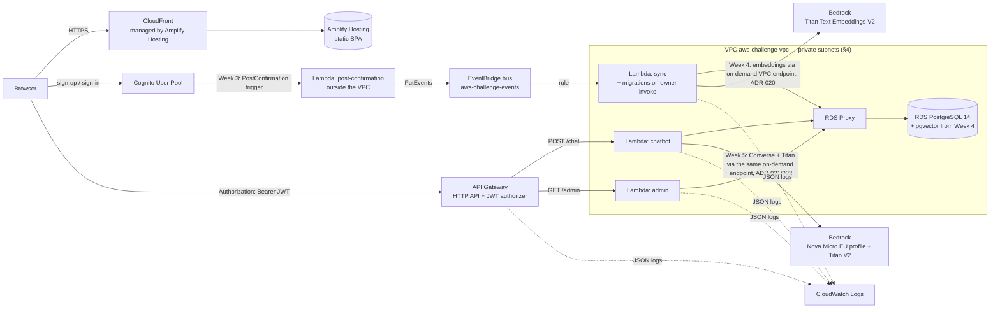

# ARCHITECTURE.md — AWS Challenge

Status: **draft v0.14 (2026-11-25, owner: ADR-021 direct model call and ADR-022 Nova Micro Accepted; v0.13 2026-11-25: Week 5 planned; v0.12 2026-11-18: ADR-019, ADR-020 Accepted)**. This file holds the system-wide principles, components and ADRs. Decisions
marked *Proposed* need the owner's confirmation and are not implemented before that. Feature-level detail lives in
[design/](design/) (one doc per feature, written before coding), behaviour in [specs/](specs/), open decisions and
risks in [RISKS.md](RISKS.md), work in [PLAN.md](PLAN.md).

> 2026-11-12: Week 1 was built **manually in the AWS console** by the owner and accepted; the known facts are in
> §4. Agents have no AWS access: the owner makes every AWS change in the console from a devops runbook until a
> dedicated IaC task exists ([Q-12](RISKS.md#q-12), option C; CLAUDE.md §3.11). All server-side code is Python
> Lambda functions (ADR-015). Sections below describe the target; where a week is not planned yet, the curriculum
> wins and the detail is decided when that week is planned.

---

## 0. Principles

1. **Serverless and pay-per-use first;** always-on resources (RDS, RDS Proxy, NAT) only where a goal needs them, and
   the environment can be stopped or removed when idle.
2. **Private by default:** no public IP for backend resources; the database is reachable only through RDS Proxy.
3. **Least privilege:** one IAM role per function, scoped to exact resource ARNs.
4. **Secrets never leave Secrets Manager:** not in code, env var values, logs or Git.
5. **Reproducible changes:** every AWS change is a console runbook in its task Notes now, IaC later
   ([Q-02](RISKS.md#q-02), T00-03); schema through versioned SQL migrations (ADR-017); code from Git.
6. **Observable:** one JSON log line per event, correlated across the chain (G8).
7. **Decide before building:** ADR or design doc first, alternatives with trade-offs, the owner decides.

## 1. Context and goals

A learning-but-real project: a SPA with authentication, a personal page, an admin user table and an AI query page
(semantic search and NL→SQL over users). Everything runs on serverless AWS services and is observable in CloudWatch.
Principle: **You Build It, You Run It** — the team owns code, infrastructure and operations.

| # | Goal |
|------|------|
| G1 | SPA automatically deployed from a Git repository to AWS Amplify Hosting |
| G2 | Global content delivery through Amazon CloudFront; isolated VPC |
| G3 | User authentication with an Amazon Cognito User Pool |
| G4 | HTTP API Gateway with JWT authorization and protected access to Lambda functions in private subnets |
| G5 | Server functions connected to PostgreSQL through Amazon RDS Proxy |
| G6 | pgvector extension and HNSW / IVFFlat indexes for semantic search over embeddings |
| G7 | Embeddings produced by Titan Text Embeddings on Amazon Bedrock |
| G8 | Logging of the whole request chain as structured JSON in Amazon CloudWatch |

### 1.1 Curriculum overview (as given by the owner, 2026-11-12)

Only the current week is planned ([PLAN.md](PLAN.md)); later rows are input for their planning, not designs.

| Week | Topic (as given) | State |
|---|---|---|
| 1 | Environment: Amplify Hosting + CloudFront; VPC; RDS PostgreSQL **14** + RDS Proxy; three Lambdas (Admin, Chatbot, Sync); `SELECT 1` from Admin; log groups | [requirements](requirements/week-01-environment.md); built manually, accepted by the owner 2026-11-12 |
| 2 | Authorization: Cognito User Pool with Amplify Auth; HTTP API Gateway with JWT authorizer | [requirements](requirements/week-02-authorization.md); done 2026-11-13 |
| 3 | REST API + data: Admin Lambda ↔ RDS Proxy; Sync chain Cognito → **EventBridge** → Lambda | [requirements](requirements/week-03-rest-api-data.md); done 2026-11-17 — designs [user-sync](design/user-sync.md), [admin-api](design/admin-api.md) |
| 4 | Create the `pgvector` extension; a function generates **1536-dimensional** vectors stored in `users.embedding`; similarity query `ORDER BY embedding <-> $1 LIMIT 5`; the Sync Lambda calls Bedrock Titan Embeddings (or Claude 3.5 Sonnet) on insert/update; `ivfflat` or `hnsw` index; check latency on 1000 records | [requirements](requirements/week-04-vectorisation.md); planned 2026-11-17 — design [vectorisation](design/vectorisation.md) (Accepted 2026-11-18; ADR-019, ADR-020) |
| 5 | SPA search component → Chatbot Lambda → Bedrock Agent (NL→SQL if the query contains the keyword "sql", otherwise embedding similarity). Goals: results < 1 s; "users similar to …" returns the correct TOP-5; API Gateway timeout 29 s, Lambda 30 s; log latency and token count | [requirements](requirements/week-05-semantic-search.md); planned 2026-11-25 — design [semantic-search](design/semantic-search.md) (Accepted 2026-11-25; ADR-021, ADR-022) |
| 6 | JSON logs (Powertools Logger, Lambda advanced logging controls), CloudWatch Logs Insights, X-Ray service map | not planned |

Notes for later planning:
- Week 3 says "REST API", while G4 and Week 2 say "HTTP API Gateway": ADR-003 (HTTP API) is kept; "REST" is read as
  the API style, not the API Gateway product.
- Week 3 requires EventBridge in the sync chain (ADR-011 rejected). The wirings are compared in
  [design/user-sync](design/user-sync.md); decided as ADR-016 ([Q-17](RISKS.md#q-17) A).
- Week 4 stores embeddings in the users table, so the chatbot searches users, not a separate document corpus
  ([Q-05](RISKS.md#q-05), closed 2026-11-17).
- Week 4 names "Titan Embeddings" and 1536 dimensions; the 1536-dimension Titan model is not offered in eu-west-1
  and Claude is not an embedding model — the owner chose Titan V2 with 1024 dimensions (ADR-019, deviation in §2).

### Out of scope (first stage)
- Multi-account / multi-region, disaster recovery, blue/green deployments.
- Mobile clients, social logins, MFA (can be enabled later).

---

## 2. System overview

Target after Week 6 (Week 3–6 parts are curriculum input, not designs yet):

Deviations from the curriculum or the challenge diagram:

| Curriculum / diagram | Design | Why |
|---|---|---|
| Week 3 title "REST API" | **HTTP API** with native JWT authorizer | G4 and Week 2 say HTTP API; cheaper, native Cognito JWT (ADR-003) |
| CloudFront "inside a VPC" | CloudFront managed by Amplify Hosting; Lambda, Proxy and RDS in the VPC | CloudFront is a global edge service; decided by the Week 1 build (Q-01 closed) |
| Week 4 W4-G2: 1536-dimensional vectors | **1024** dimensions, Titan Text Embeddings V2 in eu-west-1 | the only 1536-dim Titan model is not offered in eu-west-1 (NAT + cross-region ≈ $39/month); Titan as named by G7; cheapest (ADR-019, owner 2026-11-18) |
| Week 5 task: NL → SQL / vector "through a Bedrock Agent" | `chatbot` calls the model directly (`bedrock-runtime` `Converse`), no agent | step S2 says "Bedrock LLM → SQL"; one call instead of an agent loop; no second endpoint or agent resources; cheaper and faster (ADR-021, owner 2026-11-25) |
| Week 5 materials: Claude 3 Sonnet | Amazon Nova Micro through the EU inference profile `eu.amazon.nova-micro-v1:0` | Claude 3 Sonnet / Haiku not usable in eu-west-1 (lifecycle); cheapest model without Marketplace; the curriculum sets no model requirement (ADR-022, owner 2026-11-25) |
| Week 5 W5-G1: results < 1 s | < 1 s targeted for the vector path (warm); the `sql` path (one LLM call) ≈ 1–4 s, no < 1 s target | an LLM call alone takes longer than 1 s (design semantic-search §6) |

---

## 3. Components

### 3.1 Frontend (`frontend/`)
- React 19 + TypeScript + Vite; routing with React Router; server state with TanStack Query.
- Authentication with Amplify Auth v6 (`aws-amplify/auth` APIs) and own screens (ADR-014).
- Configuration only through `VITE_*` environment variables (User Pool id, App Client id, API URL, region), set in
  Amplify Hosting.
- Pages: Home (the signed-in user's read-only profile), sign-up / sign-in (no code confirmation, the owner confirms
  users in the console — design [authentication](design/authentication.md)), later the admin user table and the AI
  query page.
- Delivery: Amplify Hosting builds on every push to `main` (`amplify.yml`, monorepo `appRoot: frontend`), SPA rewrite
  to `index.html`.

### 3.2 Lambda functions (ADR-015)
All server-side code is Python 3.12 Lambda functions (runtime of the existing functions; code stays 3.12-compatible
while local tests run on 3.13), deployed as zip files; there is no backend application. Function names
`aws-challenge-<function>` (§4). Only the curriculum's three functions plus the trigger exist (owner, 2026-11-16).

| Function | Trigger | Responsibility | From |
|---|---|---|---|
| `admin` | HTTP API | `GET /admin`: paginated users list for the group `admin` (Week 1 `SELECT 1` probe dropped in Week 3) | Week 1 (probe), Week 3 (API) |
| `chatbot` | HTTP API | `POST /chat` for the group `admin`: NL → SQL (LLM + SQL guard, read-only transaction) when the query contains "sql", else Titan V2 embedding + top-5 `<->` ([spec 12](specs/12-chat-api.md)); timeout 30 s | Week 5 |
| `sync` | EventBridge rule (`UserConfirmed`); direct invoke by the owner (`{"action":…}`: `status`, `migrate`; Week 4: `embed-missing`, `seed`, `similar` — dispatch in [spec 06](specs/06-users-table-and-migrations.md)) | copy of the user into PostgreSQL, embedding on insert/update (Week 4, [spec 10](specs/10-embeddings.md)); applies versioned SQL migrations on the owner's invoke (ADR-017); seed and similarity check ([spec 11](specs/11-similarity-check.md)) | Week 3, Week 4 |
| `post-confirmation` | Cognito PostConfirmation trigger | puts `UserConfirmed` on the bus; outside the VPC | Week 3 (ADR-016) |

Source layout, packaging (shared DB helper copied into each zip) and tests: [design/user-sync](design/user-sync.md)
§5 and the `python-lambda` skill (T03-02). `chatbot` code stays only in the AWS console until Week 5
([R-15](RISKS.md#2-risk-register)); Week 5 moves the Titan helper and the HTTP claim/problem helpers to `lambdas/shared/`
(design [semantic-search](design/semantic-search.md) §9).

### 3.3 API Gateway (HTTP API)
Week 2 as built (design [api-gateway-auth](design/api-gateway-auth.md), values in [ENVIRONMENT.md](ENVIRONMENT.md)):
JWT authorizer on `GET /admin` and `POST /chat`, CORS for the Amplify origin only, no access log, no endpoint contract.
The bullets below are the target. Week 3 keeps the two routes of the curriculum diagram (ADR-018), gives `GET /admin`
its contract and adds localhost CORS ([design/admin-api](design/admin-api.md) §3); the access log and stage
throttling are deferred to Week 6 (owner, 2026-11-17).
- JWT authorizer: issuer `https://cognito-idp.<region>.amazonaws.com/<userPoolId>`, audience `<appClientId>`
  (for access tokens API Gateway matches `client_id`, because they carry no `aud`).
- Only explicit `METHOD /path` routes, no `ANY` / `$default` route, so CORS preflight is answered by API Gateway
  without the authorizer.
- The `admin` group check is done in the handler, because HTTP API cannot authorise on group claims without OAuth
  scopes.
- 401 responses produced by the authorizer have the fixed body `{"message":"Unauthorized"}` (HTTP API has no
  gateway responses) — a known exception to the problem+json rule of CLAUDE.md §6.
- CORS: only the Amplify app domain and `http://localhost:5173`.
- Access logs as JSON in CloudWatch; `requestId` equals `apiRequestId` in Lambda logs (Week 6).
- Stage throttling: 50 rps / burst 100 (learning workload; Week 6). Integration timeout of `POST /chat` 29 s (Week 5, T05-01).

### 3.4 Cognito User Pool
- E-mail as the sign-in (username) attribute, new accounts confirmed by the owner in the console (no code in the
  SPA, 2026-11-13), default password policy. Registration
  attributes and their validation: [spec 04](specs/04-user-registration-and-sign-in.md) ([Q-14](RISKS.md#q-14)
  option C: validation only in the SPA, custom attributes without min/max); they are immutable once the pool exists.
- Public app client (no secret), SRP flow. Tokens: access/ID 60 min, refresh 5 days (as built, T02-01).
- Group `admin` (Week 3, T03-01), members added manually by the owner in the Cognito console.
- Week 2 uses Cognito as the only profile store (ADR-013); the copy in PostgreSQL arrives with the Week 3 sync chain
  (PostConfirmation trigger, ADR-016); the personal page keeps reading Cognito in Week 3 ([Q-19](RISKS.md#q-19) A).

### 3.5 Data: RDS PostgreSQL + RDS Proxy
- RDS PostgreSQL **14** (Week 1 curriculum and build; standard support deadline in [R-14](RISKS.md#2-risk-register)),
  single-AZ, encrypted; instance class and backups as built (not recorded yet, §4).
- RDS Proxy: credentials towards RDS from Secrets Manager, TLS; the functions authenticate with IAM auth tokens
  (ADR-006 revised, [Q-18](RISKS.md#q-18) A).
- Lambda connects **only** to the proxy endpoint, one connection per invocation, opened lazily (not at init).
- Schema through versioned SQL migrations (ADR-017, [Q-16](RISKS.md#q-16) A); the first schema (users table)
  comes in Week 3.
- Extension `vector` (pgvector 0.8.0 on 14.18), column `users.embedding` and an HNSW index from Week 4 (migration V2,
  [design/vectorisation](design/vectorisation.md), ADR-019).

### 3.6 Amazon Bedrock
- Week 4: Titan Text Embeddings V2, 1024 dimensions (ADR-019), called by `sync` through the `bedrock-runtime`
  interface endpoint that exists only during working sessions (ADR-020, [R-18](RISKS.md#2-risk-register)).
  Week 5 (ADR-021, ADR-022): `chatbot` calls Titan V2 (query embedding) and Amazon Nova Micro through the EU
  inference profile (`Converse`, NL → SQL) over the same on-demand endpoint; no Bedrock Agent
  ([design/semantic-search](design/semantic-search.md)).
  IAM allows `bedrock:InvokeModel` on exact ARNs (for an inference profile: the profile ARN plus the model ARN in each
  destination region, conditioned on the profile), only for the function that needs it.

---

## 4. Network

### 4.1 Environment as built

Identifiers and settings of the manually built resources live in [ENVIRONMENT.md](ENVIRONMENT.md).

### 4.2 Design

The design and the security-group matrix live in [design/backend-foundation.md](design/backend-foundation.md).
Developer access to the database (manual checks): through a Lambda function, or AWS CloudShell in a VPC
environment (by the owner), if ever needed.

---

## 5. Key flows

### 5.1 Sign-up (Week 2)
SPA → Cognito `SignUp` (e-mail, password, profile attributes) → the owner confirms the account in the Cognito
console → `SignIn` (SRP).
No trigger in Week 2. Week 3 (ADR-016): the confirmation fires the PostConfirmation trigger → `UserConfirmed` on
EventBridge → Sync Lambda → upsert into `users` ([spec 07](specs/07-user-sync.md)).

### 5.2 Authenticated request
1. SPA obtains tokens via Amplify (`fetchAuthSession`, automatic refresh).
2. `Authorization: Bearer <access token>` (ADR-004) → API Gateway validates signature, `iss`, `exp`, `client_id`.
3. Lambda reads claims from `requestContext.authorizer.jwt.claims`, rejects tokens whose `token_use` is not
   `access`, puts correlation ids into the log line and checks the group where required.

### 5.3 Semantic search and NL→SQL (Weeks 4–5)
Curriculum: query embedding → `ORDER BY embedding <-> $1 LIMIT 5` over `users.embedding`; Bedrock Agent turns a
query containing "sql" into SQL. Week 4: vectors and the example query run from the sync Test tab
([design/vectorisation](design/vectorisation.md)). Week 5: SPA `/chat` (admin) → `POST /chat` → `chatbot`: `sql` keyword →
LLM → SQL guard → read-only transaction; otherwise Titan V2 → top-5 `<->` — sequence in
[design/semantic-search](design/semantic-search.md).

---

## 6. API contract

| Method | Path | Auth | Body / parameters | Response | Week |
|---|---|---|---|---|---|
Routes exactly as in the curriculum architecture diagram (ADR-018); no other route exists.

| Method | Path | Auth | Body / parameters | Response | Week |
|---|---|---|---|---|---|
| GET | `/admin` | JWT + `admin` | `page`, `size(1..100)`, `sort` | `{items[], page, size, total}` of users — [spec 08](specs/08-admin-api.md) | 2 (route, no contract); 3 (contract) |
| POST | `/chat` | JWT + `admin` | `{ "query": string(1..500) }` | `{mode, columns, rows, rowCount, truncated, sql, timings, tokens, modelId}` — [spec 12](specs/12-chat-api.md) | 2 (route, no contract); 5 (contract) |

The SPA reads the caller's identity and role from the access token (`cognito:groups`), not from the API
([spec 09](specs/09-admin-page-and-role.md)). Conventions (auth header, pagination, filtering, errors): CLAUDE.md §6.
502 is used for Bedrock failures.

---

## 7. Data model

Week 3 creates `users` (copy of the Cognito profile, key = Cognito `sub`) and the runner's `schema_migrations`;
columns: [spec 06](specs/06-users-table-and-migrations.md) §Outputs (single home). Week 4 adds `users.embedding`
and its HNSW index (V2, [spec 10](specs/10-embeddings.md)).

---

## 8. Security

- **IAM least privilege, one role per function:** VPC access + database access per ADR-006 (`rds-db:connect` on the
  proxy `dbuser` ARN; no `secretsmanager:GetSecretValue` in function roles); `events:PutEvents` only for
  the trigger, on the bus ARN; Bedrock permissions only for the function that calls Bedrock, on exact ARNs.
- **Secrets** only in Secrets Manager; never in code, plain env vars, logs or Git.
- **Transport:** HTTPS everywhere; Lambda → Proxy TLS; Proxy → RDS TLS.
- **Authentication** at the edge (API Gateway); Lambda trusts claims only from `requestContext`, never from headers.
  Role-based authorisation in the handler.
- **Input:** every field validated in the handler against its spec; parameterised SQL only.
- **CORS** explicit origin list. **Logs** contain no tokens, passwords or PII beyond `sub`.
- Optional (stretch): AWS WAF, Cognito threat protection, per-function DB roles (R-16).

---

## 9. Observability (G8)

- **Format:** one line = one JSON object on Lambda stdout → CloudWatch Logs; API Gateway access logs in JSON.
  Week 6 standardises on Powertools Logger with Lambda advanced logging controls (ADR-012).
- **Correlation:** `apiRequestId` (API GW `$context.requestId`) → `awsRequestId` (Lambda) → `userSub`; X-Ray trace id
  from Week 6.
- **What is logged:** one line per request (route, status, duration); Bedrock calls (model, tokens, latency — Week 5);
  vector search (latency, result count); errors with the error class.
- **Retention:** ≥ 7 days (curriculum); 14 days proposed for every log group.
- Logs Insights queries and the X-Ray service map: Week 6.

---

## 10. Non-functional requirements (targets)

| Attribute | Target |
|---|---|
| Latency | `GET /admin` p95 < 300 ms warm; search results < 1 s for the vector path, warm (Week 5, AC-12.8); `sql` path no < 1 s target |
| Timeouts | API Gateway integration 29 s, chatbot Lambda 30 s (Week 5); other functions as built |
| Lambda | Python 3.12, zip; memory and architecture as built (§4), tuned by measurement |
| Cost | learning budget; figures in each design doc's Cost section (Week 1: [backend-foundation](design/backend-foundation.md)); stop or remove idle resources ([R-06](RISKS.md#2-risk-register)) |

---

## 11. Architecture decisions (ADR)

| ID | Topic | Status | Decision (short) |
|---|---|---|---|
| ADR-001 | IaC | **Deferred** | Tool chosen by Q-02 for the later IaC task T00-03; until then console runbooks executed by the owner (Q-12 C) |
| ADR-002 | Compute model | **Superseded** by ADR-015 | (was: Spring Boot 4 in Lambda) |
| ADR-003 | API type | **Accepted** (2026-11-12) | HTTP API + JWT authorizer (payload v2) |
| ADR-004 | Token sent to the API | **Accepted** (2026-11-12) | Access token, not ID token |
| ADR-005 | Network | **Superseded** by the Week 1 build | (was: isolated subnets only); layout as built, §4 |
| ADR-006 | Database access | **Accepted** (2026-11-13, revised; [Q-18](RISKS.md#q-18) A) | RDS Proxy, TLS; functions authenticate with IAM auth tokens (no secret in functions) |
| ADR-007 | Vectors | **Superseded** by ADR-019 (2026-11-18) | (was: Titan v2, 1024 dims, cosine; HNSW primary, IVFFlat for comparison) |
| ADR-008 | Migrations | **Superseded** by ADR-017 (2026-11-13) | (was: Flyway in a Java `migrate` function) |
| ADR-009 | Region | **Decided by the Week 1 build** | `eu-west-1` (Ireland), single region (§4) |
| ADR-010 | LLM chatbot | **Superseded** by the curriculum (Week 5) | (was: semantic search only, Agent as stretch); Week 5 design: ADR-021, ADR-022 |
| ADR-011 | User synchronisation | **Rejected** (2026-11-12) | (was: PostConfirmation trigger without EventBridge); the curriculum requires EventBridge, wiring per ADR-016 |
| ADR-012 | Log format | **Proposed** | Powertools Logger + Lambda advanced logging controls (JSON), confirmed in Week 6 |
| ADR-013 | User profile store | **Accepted** (2026-11-12) | Week 2: Cognito attributes are the only store, the personal page reads them in the SPA; Week 3 adds the PostgreSQL copy |
| ADR-014 | SPA auth UI | **Accepted** (2026-11-12) | Own screens on `aws-amplify/auth` APIs; `@aws-amplify/ui-react` removed |
| ADR-015 | Server code | **Accepted** (2026-11-12; revised 2026-11-16, owner) | Python 3.12 Lambda functions `admin`, `chatbot`, `sync` + trigger `post-confirmation`, zip deploys, no backend application |
| ADR-016 | User sync wiring | **Accepted** (2026-11-13, [Q-17](RISKS.md#q-17) A) | PostConfirmation trigger (outside the VPC) → `PutEvents` → custom bus → rule → Sync Lambda |
| ADR-017 | Migrations | **Accepted** (2026-11-13, [Q-16](RISKS.md#q-16) A; revised 2026-11-16, owner) | Versioned SQL files applied by a Python runner module inside `aws-challenge-sync`, on the owner's direct invoke |
| ADR-018 | API routes | **Accepted** (2026-11-17, owner) | Routes exactly as in the curriculum diagram: `GET /admin` (users list, group `admin`) and `POST /chat`; no `/api` prefix, no `/api/me` (role from the token) |
| ADR-019 | Embedding model and vectors | **Accepted** (2026-11-18, owner; [Q-15](RISKS.md#q-15)) | Titan Text Embeddings V2 (`amazon.titan-embed-text-v2:0`) on Bedrock eu-west-1, 1024 dims (deviation from W4-G2's 1536), normalised; `vector(1024)`, HNSW `vector_l2_ops`, query `<->`; supersedes ADR-007 |
| ADR-020 | Network path to Bedrock | **Accepted** (2026-11-18, owner; [Q-20](RISKS.md#q-20)) | Interface VPC endpoint `bedrock-runtime` in one private subnet, private DNS, SG 443 from the Lambda SG, **created on demand** per working session; `sync` fails fast without it; no NAT |
| ADR-021 | Week 5 orchestration | **Accepted** (2026-11-25, owner; [Q-21](RISKS.md#q-21) A) | `chatbot` calls Bedrock directly (`bedrock-runtime` `Converse` for NL → SQL, Titan V2 for vectors); no Bedrock Agent — deviation from the task line |
| ADR-022 | Week 5 LLM model | **Accepted** (2026-11-25, owner; [Q-22](RISKS.md#q-22)) | Amazon Nova Micro through the EU geo inference profile `eu.amazon.nova-micro-v1:0`, temperature 0, ≤ 300 output tokens; Nova Lite as fallback |

**ADR-001 — IaC (Deferred).** Week 1 was built in the console and Week 2 is built by the owner from console runbooks
(Q-12 C; agents have no AWS access, so IaC code will be deployed by the owner too). A dedicated task (T00-03) codifies the existing resources once the tool is chosen in
[Q-02](RISKS.md#q-02); importing, not recreating, keeps the Cognito pool and its users.

**ADR-003 — HTTP API (Accepted).** Native Cognito JWT authorizer, ~3.5× cheaper than REST, lower latency. Missing:
API keys / usage plans, request validation, direct WAF association. The Week 3 wording "REST API" is read as API
style.

**ADR-004 — Access token (Accepted 2026-11-12, owner).** Meant for API authorisation; carries `sub`, `cognito:groups`, `scope`,
`client_id`, `username`, `token_use=access`, but no `aud`, `email` or custom attributes. The JWT authorizer's audience
(= app client id) is matched against `aud` of an ID token and `client_id` of an access token, so **both token types
pass the authorizer**; the handler therefore rejects `token_use ≠ access` with 401. *Alternative:* ID token — profile
claims available to the API, but the API accepts a token meant for the client and couples to the attribute schema.
*Consequence:* the draft `frontend/src/api/client.ts` sends the ID token — fixed by T02-05.

**ADR-006 — Database access (Accepted 2026-11-13, owner, in the revised form).** *Original (Proposed, not built):*
Lambda reads the secret from Secrets Manager on first use and connects to the proxy over TLS; IAM authentication
later. *Revision (Q-18 A):* the
private subnets have no egress (R-09), so a Secrets Manager call needs an interface endpoint (≈ $8/AZ-month) or a NAT
(≈ $39/month). Instead each function generates an RDS IAM auth token locally (SigV4, no network call) and connects
to the proxy with TLS; the proxy requires IAM authentication and keeps its own secret towards RDS; roles get
`rds-db:connect` on the proxy `dbuser` ARN. *Alternatives:* Secrets Manager interface endpoint; NAT gateway.
*Consequences:* no secret in any function, $0; all functions share the proxy's DB user (R-16, accepted by the owner);
password logins to the proxy stop (the Week 1 probe is replaced). Detail: [design/user-sync](design/user-sync.md) §1.

**ADR-016 — User sync wiring (Accepted 2026-11-13, owner; Q-17 A).** *Context:* the curriculum requires Cognito → EventBridge
→ Lambda; Cognito publishes no "user confirmed" event to EventBridge; the owner confirms users in the console
(`AdminConfirmSignUp`, which invokes the PostConfirmation trigger per the Cognito docs). *Decision:* a minimal
function `aws-challenge-post-confirmation` outside the VPC is the PostConfirmation trigger and puts one
`UserConfirmed` event with the allow-listed attributes on the custom bus `aws-challenge-events`; rule
`aws-challenge-user-confirmed` invokes `aws-challenge-sync` (VPC), which upserts the row. The trigger never fails the
confirmation; gaps are closed by a re-sync runbook (R-11). *Alternatives:* CloudTrail trail + default-bus rule +
`AdminGetUser` (trail required, delayed, Sync needs Cognito egress); trigger → SQS → Pipes. *Consequences:* a fourth
function besides the curriculum's three (amends ADR-015's list; kept by the owner 2026-11-16 as the free and instant
option over CloudTrail + NAT/endpoint); personal data in the event (no archive); no egress needed. Detail:
[design/user-sync](design/user-sync.md) §3.

**ADR-017 — Migrations (Accepted 2026-11-13, owner; Q-16 A; replaces ADR-008; revised 2026-11-16, owner).**
Versioned SQL files `lambdas/sync/migrations/V<n>__<description>.sql` applied by a small Python runner module of the
VPC function `aws-challenge-sync`; the sync handler dispatches on the event: an EventBridge `UserConfirmed` event →
upsert (spec 07), a direct invoke `{"action":"status"|"migrate"}` from the console Test tab (owner) → the runner,
anything else → `UNSUPPORTED_EVENT`. Runner rules unchanged: `schema_migrations` with checksums, one transaction per
file, advisory lock, fix-forward. *Revision 2026-11-16:* the original decision placed the runner in a separate
function `aws-challenge-migrate`; the owner wants only the curriculum's functions (plus the ADR-016 trigger), so the
runner moved into `sync` before `migrate` was ever created. *Alternatives:* separate `aws-challenge-migrate` (original
form: one more function, role and log group; rejected by the owner 2026-11-16); the runner inside `admin` (DDL path in
the API-facing function); Flyway from CloudShell (no egress); Alembic. *Consequences:* the sync timeout rises to 60 s
(migration socket timeout 55 s); every sync zip ships the migration files, but a file is applied only by an explicit
`migrate` invoke; EventBridge cannot start a migration (the rule pattern matches only `UserConfirmed`, and an
EventBridge envelope never carries a top-level `action` key); DDL rights were already shared through the one proxy DB
user (R-16). Detail: [design/user-sync](design/user-sync.md) §2, [spec 06](specs/06-users-table-and-migrations.md).

**ADR-018 — API routes follow the curriculum diagram (Accepted 2026-11-17, owner).** *Context:* the Week 3 design
(admin-api, 2026-11-13) replaced the as-built Week 2 routes `GET /admin`, `POST /chat` with `GET /api/me` and
`GET /api/admin/users` under the `/api` prefix of the then CLAUDE.md §6; the curriculum architecture diagram names
only `GET /admin` → Admin Lambda and `POST /chat` → Chatbot Lambda. *Decision:* the HTTP API has exactly these two
routes, both with the JWT authorizer. `GET /admin` returns the paginated users list to members of the group `admin`
(403 otherwise; `page`/`size`/`sort`, `{items,page,size,total}`, problem+json — spec 08); `POST /chat` stays without
a contract until Week 5. No `/api` prefix and no `/api/me`: the SPA takes the role from `cognito:groups` of the access
token it already holds (spec 09). *Alternatives:* `/api/me` + `/api/admin/users` (the 2026-11-13 design: CLAUDE.md §6
style, one role source on the server, but routes beyond the diagram and one extra request per session); keep
`GET /admin` and add `GET /api/me` (role from the server, but a second path style). *Consequences:* the routes the
owner created on 2026-11-17 under `/api` are deleted; the SPA's Admin link and role line are display only (the
handler enforces the group); a user added to `admin` sees the role after the next sign-in or token refresh (as
before); `/admin` is both an SPA page and an API path on different hosts (no conflict); the derived Week 3 step S4
("routes under `/api`") is superseded; the API access log and stage throttling (S8, ARCHITECTURE §3.3) move to Week 6
(owner, 2026-11-17). Detail: [design/admin-api](design/admin-api.md).

**ADR-007 — Vectors (Superseded by ADR-019, 2026-11-18).** Was: Titan v2, 1024 dims (its maximum), cosine; HNSW
primary, IVFFlat for comparison. Challenged by the Week 4 curriculum (1536 dimensions, `<->` operator); ADR-019 keeps
its model and dimension and replaces the distance (L2 on normalised vectors) and the index choice (HNSW only).

**ADR-019 — Embedding model and vector settings (Accepted 2026-11-18, owner; Q-15 c).** *Context:* the curriculum
asks for 1536-dimensional vectors from "Titan Embeddings or Claude 3.5 Sonnet" and the query `<->`; G7 names Titan
Text Embeddings; Claude produces no embeddings; Titan G1 Text (the only 1536-dim Titan) is not offered in eu-west-1;
the owner's priority is the lowest cost. *Decision:* Amazon Titan Text Embeddings V2 (`amazon.titan-embed-text-v2:0`)
on Bedrock in eu-west-1, in-region, `dimensions` **1024**, `normalize` true (unit length, so L2 ranks like cosine);
`users.embedding vector(1024)`, HNSW `vector_l2_ops` (buildable on an empty table); the curriculum query `<->`. **This
deviates from W4-G2 (1536) on purpose** (§2 deviations). 1024 equals the value ADR-007 originally proposed.
*Alternatives:* Cohere Embed v4 at 1536 in eu-west-1 (meets 1536, but not Titan, third-party Marketplace model);
Titan G1 1536 in eu-central-1 (cross-region, needs a NAT gateway ≈ $39/month); IVFFlat (needs data before the build).
*Consequences:* one text per `InvokeModel` call (1000 rows = 1000 calls, ≈ $0.001); no Marketplace step;
re-embedding needed if the model or the text template changes. Detail: [design/vectorisation](design/vectorisation.md).

**ADR-020 — Network path to Bedrock (Accepted 2026-11-18, owner; Q-20 A on demand).** *Context:* the private subnets
have no egress (R-09); `sync` (Week 4) and `chatbot` (Week 5) call Bedrock; the owner's priority is the lowest cost.
*Decision:* one interface endpoint `com.amazonaws.eu-west-1.bedrock-runtime` in one private subnet, private DNS on,
own security group (kept permanently, free) with TCP 443 from the Lambda security group; the **endpoint is created by
the owner for a working session and deleted afterwards** (≈ $0.011/h). Without it, `sync` fails fast (short connect
timeout, one attempt), stores the row with `embedding` NULL and does not raise; `embed-missing` fills the gaps in the
next session. *Alternatives:* the same endpoint always on (≈ $8/month); NAT gateway (≈ $39/month, any region);
embedding outside the VPC in `post-confirmation` (contradicts S2, 5 s Cognito limit). *Consequences:* cents per month;
vectors of users confirmed between sessions arrive late ([R-18](RISKS.md#2-risk-register)); in-region models only;
Bedrock Agent (Week 5) needs its own endpoint. Detail: [design/vectorisation](design/vectorisation.md) §2, §4.

**ADR-021 — Direct model call instead of a Bedrock Agent (Accepted 2026-11-25, owner; [Q-21](RISKS.md#q-21) A).** *Context:* the
Week 5 task line says the Chatbot Lambda converts the query "through a Bedrock Agent"; step S2 says "Bedrock LLM →
SQL" for queries with the keyword "sql", otherwise embedding + pgvector; the private subnets reach Bedrock only through
the on-demand `bedrock-runtime` endpoint (ADR-020); the owner wants the cheapest option with the least console work.
*Decision:* `aws-challenge-chatbot` calls `Converse` once per `sql` question (system prompt = schema + rules)
and Titan V2 `InvokeModel` otherwise; the generated SQL is validated and executed by the function (design
semantic-search §5). No agent, action group, alias, agent role or `bedrock-agent-runtime` endpoint; no
`bedrock:InvokeAgent`. *Alternatives:* Bedrock Agent with an action-group Lambda; agent with return of control (both:
second on-demand endpoint, several model calls per question, agent resources, same guard still needed); Knowledge Base
structured-data text-to-SQL (Redshift only). *Consequences:* one model call (≈ 1–3 s) and the fewest tokens; the
deviation from the task line is listed in §2; switching to an agent later adds resources, not code in the guard.
Detail: [design/semantic-search](design/semantic-search.md) §1.

**ADR-022 — LLM for NL → SQL (Accepted 2026-11-25, owner; [Q-22](RISKS.md#q-22)).** *Context:* the materials name Claude 3
Sonnet, which is not usable from eu-west-1 (Claude 3 Haiku EOL there 2026-09-10; no active eu-west-1 entry for Claude 3
Sonnet); the task needs one short SQL statement per question; cost first; the curriculum sets no model requirement. *Decision:* Amazon Nova Micro via
the EU geo cross-region inference profile `eu.amazon.nova-micro-v1:0` (destinations eu-central-1, eu-north-1,
eu-west-1, eu-west-3), `Converse`, temperature 0, `maxTokens` 300; model id as a code constant, confirmed by the owner
in the console. IAM: `bedrock:InvokeModel` on the profile ARN and on `amazon.nova-micro-v1:0` in each destination
region, conditioned on `bedrock:InferenceProfileArn`. *Alternatives:* Nova Lite (≈ 2×, fallback); Claude Haiku 4.5
(≈ 25–35×, Marketplace + use-case form); Claude Sonnet 4.x (≈ 100×). *Consequences:* ≈ $0.00004 per question, no
Marketplace; requests may be served in another EU region (data stays in the EU geography); an SCP blocking a
destination region breaks the `sql` mode (R-20). Detail: [design/semantic-search](design/semantic-search.md) §2.

**ADR-012 — Logs (Proposed).** Week 6 names Powertools Logger and Lambda advanced logging controls (ALC). To confirm
then: how ALC JSON format combines with Powertools JSON without double wrapping ([R-10](RISKS.md#2-risk-register)).
Until Week 6 handlers print one JSON line per invocation with the standard library.

**ADR-013 — User profile store (Accepted 2026-11-12, owner).** Week 2: registration data lives only in Cognito
(standard + custom attributes); the personal page reads it in the SPA with `fetchUserAttributes`; `GET /api/me`
returns the caller's token claims and proves the protected API, not the profile. Week 3 copies users into
PostgreSQL through the EventBridge sync chain (curriculum); the personal page does not switch to the database copy
([Q-19](RISKS.md#q-19) A, owner 2026-11-13). *Amended 2026-11-13 (owner):* `GET /api/me` moved to Week 3; in Week 2 the SPA calls no
API. *Amended 2026-11-17 (owner, ADR-018):* there is no `GET /api/me`; the SPA reads the role from the access
token's `cognito:groups`. *Alternatives considered:* `app_user` read model behind `GET /api/me` already in Week 2
(moved to Week 3 by the curriculum); PostgreSQL only with Cognito for credentials (duplicates Cognito sign-up).
*Consequence:* the user can change own attributes through `UpdateUserAttributes` ([R-12](RISKS.md#2-risk-register)).

**ADR-014 — SPA auth UI (Accepted 2026-11-12, owner).** The Amplify `Authenticator` ships ~317 kB of CSS and needs workarounds for the `DD/MM/YYYY` date, the country list
and numeric ranges. Own sign-up, confirm and sign-in screens call `signUp`, `confirmSignUp`, `resendSignUpCode`,
`signIn`, `signOut`, `fetchAuthSession`, `fetchUserAttributes` from `aws-amplify/auth`; `@aws-amplify/ui-react` is
removed. *Alternatives:* Authenticator without its stylesheet; Authenticator with styles and a raised budget.

**ADR-015 — Lambda functions in Python, no backend application (Accepted 2026-11-12, owner; supersedes ADR-002;
revised 2026-11-16, owner).**
*Context:* the three Week 1 functions were created manually and run on Python 3.12; the Spring Boot draft never
compiled and was deleted. *Decision:* all server-side code is the Lambda functions `admin`, `chatbot`, `sync` (further
functions only by a later decision — ADR-016 adds `post-confirmation`; no other function, owner 2026-11-16), written
for the **Python 3.12** runtime, deployed as zip files from the repository. *Revision 2026-11-16:* the runtime was
3.13 in the original decision; the owner keeps 3.12, the runtime of the existing functions, so no runtime switch is
part of any deploy. Local tests and packaging run on Python 3.13 (the owner's `py` launcher has 3.13 and 3.8 only);
code must stay 3.12-compatible (no 3.13-only API) and every pinned package must support 3.12 (python-lambda skill).
*Library proposal (the owner may adjust; fixed per function in `requirements.txt` by the task that adds it):*
`boto3` from the Lambda runtime; `pg8000` (pure-Python PostgreSQL driver, no native build, so a zip built on Windows
runs on Lambda); Powertools for AWS Lambda (Python) Logger from Week 6 (ADR-012); `pytest` for tests; no linter (owner, 2026-11-12). *Alternatives:* Spring Boot in Lambda (ADR-002: 4–8 s cold start, SnapStart, never
compiled); plain Java 21 handlers (rewrite of working code, JVM cold start against the 5 s Cognito trigger limit);
Node.js/TypeScript (same language as the SPA, but the existing code is Python). *Consequences:* no Gradle, Spring or
Java tests for server code; `psycopg` binary wheels are avoided (they need a Linux build); database integration
tests and migrations are decided with the first schema (ADR-017).

---

## 12. Goal traceability and acceptance criteria

| Goal | Components | Covered by | Acceptance criterion |
|---|---|---|---|
| G1 | Amplify Hosting, `amplify.yml` | Week 1 — [spec 01](specs/01-spa-delivery.md) | push to `main` → new SPA version live without manual steps |
| G2 | CloudFront (Amplify), VPC | Week 1 — [spec 01](specs/01-spa-delivery.md), [spec 02](specs/02-database-connectivity.md) | SPA served by CloudFront (`x-cache`, `via`); backend has no public IPs |
| G3 | Cognito, Amplify Auth | Week 2 — [spec 04](specs/04-user-registration-and-sign-in.md); Week 3 — user copy in PostgreSQL ([spec 07](specs/07-user-sync.md)) | sign-up → owner confirms → sign-in → tokens in SPA → personal page; Week 3: confirmed user → row in `users` |
| G4 | HTTP API, JWT authorizer, Lambda in VPC | Week 1 (Lambda in VPC, [spec 02](specs/02-database-connectivity.md)); Week 2 — [spec 05](specs/05-protected-api.md); Week 3 — [spec 08](specs/08-admin-api.md), [spec 09](specs/09-admin-page-and-role.md); Week 5 — [spec 12](specs/12-chat-api.md), [spec 13](specs/13-chat-page.md) | Week 2: no/invalid token → 401, valid access token passes the authorizer; Week 3: admin's access token on `GET /admin` → 200, non-admin → 403 |
| G5 | RDS Proxy, RDS | Week 1 — [spec 02](specs/02-database-connectivity.md); Week 3 — [spec 06](specs/06-users-table-and-migrations.md), [spec 08](specs/08-admin-api.md) | Lambda connects only to the proxy endpoint (Week 3: IAM auth, no secret in the function) |
| G6 | pgvector, HNSW / IVFFlat | Week 4 — [spec 10](specs/10-embeddings.md), [spec 11](specs/11-similarity-check.md); Week 5 — search from the SPA, [spec 12](specs/12-chat-api.md) | similarity query uses the index; latency on 1000 records recorded |
| G7 | Bedrock embeddings | Week 4 — [spec 10](specs/10-embeddings.md) (Titan Text Embeddings V2, 1024 dims — ADR-019); Week 5 — query embedding in `chatbot`, [spec 12](specs/12-chat-api.md) | embedding computed by the Sync Lambda on insert/update |
| G8 | CloudWatch, JSON logs, X-Ray | Week 1 (log groups); Week 3 (API access log, handler log lines — [spec 07](specs/07-user-sync.md), [spec 08](specs/08-admin-api.md)); Week 5 (latency and tokens — [spec 12](specs/12-chat-api.md)); Week 6 | one request traced by `apiRequestId` through API GW → Lambda → DB/Bedrock |
