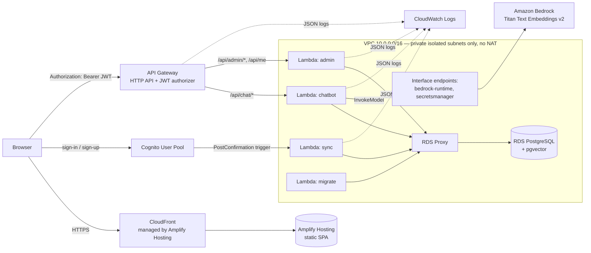

# ARCHITECTURE.md — AWS Challenge

Status: **draft v0.3 (2026-11-05)**. This file holds the system-wide principles, components and ADRs. Decisions
marked *Proposed* need the owner's confirmation and are not implemented before that. Feature-level detail lives in
[design/](design/) (one doc per feature, written before coding), behaviour in [specs/](specs/), open decisions and
risks in [RISKS.md](RISKS.md), work in [PLAN.md](PLAN.md).

---

## 0. Principles

1. **Serverless and pay-per-use first;** always-on resources (RDS, RDS Proxy, NAT/endpoints) only where a goal needs
   them, and the stack can be destroyed when idle.
2. **Private by default:** no public IP for backend resources; the database is reachable only through RDS Proxy.
3. **Least privilege:** one IAM role per function, scoped to exact resource ARNs.
4. **Secrets never leave Secrets Manager:** not in code, env var values, logs or Git.
5. **Everything as code:** infrastructure through IaC, schema through Flyway, deploys from Git.
6. **Observable:** one JSON log line per event, correlated across the chain (G8).
7. **Decide before building:** ADR or design doc first, alternatives with trade-offs, the owner decides.

> Week 1 note: sections §2–§4 and §10 describe the target design. If Q-08 and Q-10 option A are accepted, the
> Week 1 network (public subnet + NAT) and the three plain-Java functions in
> [design/backend-foundation.md](design/backend-foundation.md) supersede the "no NAT" and "four Spring functions"
> statements below until those sections are updated.

## 1. Context and goals

A learning-but-real project: a SPA with authentication, a chatbot (semantic search over documents) and an admin
panel. Everything runs on serverless AWS services, is deployed from Git and is observable in CloudWatch.
Principle: **You Build It, You Run It** — the team owns code, infrastructure and operations.

| # | Goal |
|---|------|
| G1 | SPA automatically deployed from a Git repository to AWS Amplify Hosting |
| G2 | Global content delivery through Amazon CloudFront; isolated VPC |
| G3 | User authentication with an Amazon Cognito User Pool |
| G4 | HTTP API Gateway with JWT authorization and protected access to Lambda functions in private subnets |
| G5 | Server functions connected to PostgreSQL through Amazon RDS Proxy |
| G6 | pgvector extension and HNSW / IVFFlat indexes for semantic search over embeddings |
| G7 | Embeddings produced by Titan Text Embeddings on Amazon Bedrock |
| G8 | Logging of the whole request chain as structured JSON in Amazon CloudWatch |

Traceability goal → component → task → acceptance criterion: §12.

### Out of scope (first stage)
- Multi-account / multi-region, disaster recovery, blue/green deployments.
- Mobile clients, social logins, MFA (can be enabled later).
- Bedrock Agent / NL→SQL — stretch, see [Q-06](RISKS.md#q-06) and ADR-010.

---

## 2. System overview



Deviations from the diagram in the challenge description:

| Original diagram | Design | Why |
|---|---|---|
| API Gateway **REST** | **HTTP API** with native JWT authorizer | goal G4 says HTTP API; cheaper and simpler (ADR-003) |
| Cognito → **EventBridge** → Sync Lambda | Cognito **PostConfirmation trigger** → Lambda directly | Cognito has no native delivery of this event to EventBridge (ADR-011) |
| CloudFront "inside a VPC" | CloudFront is a global edge service outside any VPC; Lambda, Proxy and RDS are in the VPC | pending [Q-01](RISKS.md#q-01) |
| Bedrock Agent (Claude 3), NL→SQL | Stage 1: semantic search (Titan + pgvector). Stage 2 (stretch): Claude via Converse or Agent | ADR-010, [Q-06](RISKS.md#q-06) |

---

## 3. Components

### 3.1 Frontend (`frontend/`)
- React 19 + TypeScript + Vite; routing with React Router; server state with TanStack Query.
- Authentication with Amplify Auth v6 (`aws-amplify`) and the `Authenticator` UI component.
- Configuration only through `VITE_*` environment variables (User Pool id, App Client id, API URL, region),
  set in the Amplify console from IaC outputs.
- Pages: Home (status, profile), Chat (search), Admin (visible to group `admin` only).
- Delivery: Amplify Hosting builds on every push to `main` (`amplify.yml`, monorepo `appRoot: frontend`),
  SPA rewrite to `index.html`.

### 3.2 Backend (`backend/`)
One Gradle module → one artifact (`backend-lambda.zip`) → **four Lambda functions** with different handlers (ADR-002):

| Function | Handler | Trigger | Routes / event |
|---|---|---|---|
| `chatbot` | `lambda.ApiLambdaHandler` | API Gateway | `POST /api/chat/search` |
| `admin` | `lambda.ApiLambdaHandler` | API Gateway | `GET /api/me`, `/api/admin/**` |
| `sync` | `lambda.PostConfirmationHandler` | Cognito PostConfirmation | upsert into `app_user` |
| `migrate` | `lambda.MigrationHandler` (planned) | manual / pipeline | Flyway migrate (ADR-008) |

Stack: Spring Boot 4.0.x, Spring MVC through `aws-serverless-java-container-springboot4` (HTTP API payload v2),
Spring Data JPA + Hibernate 7 (`hibernate-vector`), Flyway, AWS SDK v2 (`bedrockruntime`, `url-connection-client`).

Packages are organised by feature: `lambda` (entry points) → `web` (controllers, correlation filter, error handling)
→ feature services (`user`, `document`, `ai`) → repositories. `security` extracts the claims API Gateway already
validated.

### 3.3 API Gateway (HTTP API)
- JWT authorizer: issuer `https://cognito-idp.<region>.amazonaws.com/<userPoolId>`, audience `<appClientId>`.
- `GET /api/health` is public; every other route uses the JWT authorizer. The `admin` group check is done in code,
  because HTTP API cannot authorise on group claims without OAuth scopes.
- CORS: only the Amplify app domain (+ `http://localhost:5173` for development).
- Access logs as JSON in CloudWatch; `requestId` equals `apiRequestId` in Lambda logs.
- Stage throttling: 50 rps / burst 100 (learning workload).

### 3.4 Cognito User Pool
- Email sign-in, email verification by code, default password policy (≥ 8 characters, mixed classes).
- Public app client (no secret), SRP flow. Tokens: access/id 60 min, refresh 30 days.
- Group `admin`, assigned manually.
- PostConfirmation trigger → `sync` function (published alias).

### 3.5 Data: RDS PostgreSQL + RDS Proxy
- RDS PostgreSQL (major version per [Q-09](RISKS.md#q-09)), `db.t4g.micro`,
  single-AZ (learning setup), encrypted with KMS, 7-day backups.
- RDS Proxy: credentials from Secrets Manager, **TLS required**, idle client timeout 30 min.
- Lambda connects **only** to the proxy endpoint. Hikari in Lambda: max pool 2, min idle 0.
- Extension `vector`; HNSW (primary) and IVFFlat (comparison) indexes — ADR-007.

### 3.6 Amazon Bedrock
- Embedding model `amazon.titan-embed-text-v2:0`, `dimensions=1024`, `normalize=true`.
- Reached from the VPC through the `bedrock-runtime` interface endpoint. IAM allows `bedrock:InvokeModel` on this
  model ARN only, for `chatbot` only.

---

## 4. Network

| Resource | Value |
|---|---|
| VPC | `10.0.0.0/16`, 2 AZs |
| Subnets | 2 × `PRIVATE_ISOLATED` for Lambda (`/24`), 2 × `PRIVATE_ISOLATED` for RDS/Proxy (`/24`). No public subnets, no NAT |
| VPC endpoints | Interface: `bedrock-runtime`, `secretsmanager`. No gateway endpoints needed (no S3/DynamoDB) |
| Lambda logs | delivered by the Lambda service; no CloudWatch Logs endpoint required |

Security groups (allow only what is needed):

| SG | Inbound | Outbound |
|---|---|---|
| `sg-lambda` | — | 5432 → `sg-proxy`; 443 → `sg-endpoints` |
| `sg-proxy` | 5432 ← `sg-lambda` | 5432 → `sg-db` |
| `sg-db` | 5432 ← `sg-proxy` | — |
| `sg-endpoints` | 443 ← `sg-lambda` | — |

Developer access to the database (manual checks): through the `migrate` function, or a temporary bastion via SSM
Session Manager (no SSH, no public IPs) if ever needed.

---

## 5. Key flows

### 5.1 Sign-up
1. SPA → Cognito `SignUp` (email + password) → email with code → `ConfirmSignUp`.
2. Cognito invokes `sync` (PostConfirmation) → idempotent upsert into `app_user` by `sub` (Cognito may retry).
   A failure or a timeout (> 5 s) fails the confirmation for the user — see [R-02](RISKS.md#2-risk-register).

### 5.2 Authenticated request
1. SPA obtains tokens via Amplify (`fetchAuthSession`, automatic refresh).
2. `Authorization: Bearer <access token>` (ADR-004) → API Gateway validates signature, `iss`, `exp`, `client_id`.
3. Lambda reads claims from `requestContext.authorizer.jwt.claims`; a filter puts correlation ids into MDC;
   controllers check the group where required.

### 5.3 Semantic search (chatbot)
`POST /api/chat/search {query, limit}` → Titan embedding (one Bedrock call) → `ORDER BY embedding <=> :q LIMIT k`
using HNSW → documents with `distance`. Logged: query length, token count, Bedrock latency, SQL latency, result count.

### 5.4 Knowledge base ingestion
`POST /api/admin/documents` (admin) or a batch loader: text → chunks → embeddings → insert.
Details depend on [Q-05](RISKS.md#q-05).

---

## 6. API contract (v1)

| Method | Path | Auth | Body / parameters | Response |
|---|---|---|---|---|
| GET | `/api/health` | none | — | `{status}` |
| GET | `/api/me` | JWT | — | `{sub, email, groups[]}` |
| POST | `/api/chat/search` | JWT | `{query: string(1..2000), limit?: 1..50}` | `[{id, title, content, distance}]` |
| GET | `/api/admin/users` | JWT + `admin` | `page`, `size(1..100)`, `email?` | `{items[], page, size, total}` |
| GET | `/api/admin/documents` | JWT + `admin` | `page`, `size` | `{items[], page, size, total}` |
| POST | `/api/admin/documents` | JWT + `admin` | `{title, content}` | `{id}` |

Conventions (auth header, pagination, filtering, errors): CLAUDE.md §6. 502 is used for Bedrock failures.
A machine-readable OpenAPI spec is produced when the API is built.

---

## 7. Data model

```
app_user                                   document
---------                                  --------
id           bigserial PK                  id          bigserial PK
cognito_sub  varchar(64) UNIQUE NOT NULL   title       varchar(512) NOT NULL
email        varchar(320) NOT NULL         content     text NOT NULL
username     varchar(128)                  embedding   vector(1024)
created_at   timestamptz                   created_at  timestamptz
updated_at   timestamptz
```

Indexes: `app_user(created_at desc)`; `document USING hnsw (embedding vector_cosine_ops) WITH (m=16, ef_construction=64)`;
IVFFlat `(lists ≈ rows/1000)` built after data load, for the comparison experiment (ADR-007).

---

## 8. Security

- **IAM least privilege, one role per function:** `chatbot` — InvokeModel (one model) + DB secret; `admin`, `sync`,
  `migrate` — DB secret only; all — `AWSLambdaVPCAccessExecutionRole`.
- **Secrets** only in Secrets Manager (rotation enabled); never in code, plain env vars, logs or Git.
- **Transport:** HTTPS everywhere; Lambda → Proxy TLS (`sslmode=require`); Proxy → RDS TLS.
- **Authentication** at the edge (API Gateway); Lambda trusts claims only from `requestContext`, never from headers.
  Role-based authorisation in code.
- **Input:** Bean Validation on all DTOs; parameterised SQL only.
- **CORS** explicit origin list. **Logs** contain no tokens, passwords or PII beyond `sub`.
- Optional (stretch): AWS WAF, Cognito advanced security, IAM auth to RDS Proxy.

---

## 9. Observability (G8)

- **Format:** one line = one JSON object (ECS) on Lambda stdout → CloudWatch Logs. API Gateway access logs in JSON.
- **Correlation:** `apiRequestId` (API GW `$context.requestId`) → `awsRequestId` (Lambda) → `userSub`, plus
  `traceId` from `_X_AMZN_TRACE_ID` when X-Ray is on.
- **What is logged:** one access line per request (method, path, status, duration); Bedrock calls (model, tokens,
  latency); vector search (k, latency, result count); errors with stack traces.
- **Retention:** 14 days for every log group, set in IaC.
- **Logs Insights saved queries:** trace by `apiRequestId`, p95 latency, errors by status.
- Metrics/alarms (stretch): API 5xx, Lambda errors/throttles, Proxy `DatabaseConnections`.

---

## 10. Non-functional requirements (targets)

| Attribute | Target |
|---|---|
| Latency p95 (warm) | `/api/admin/*` < 300 ms, `/api/chat/search` < 1.5 s |
| Cold start (with SnapStart) | < 2 s |
| Timeouts | API GW 30 s (HTTP API limit), API Lambdas 25 s, `sync` 5 s |
| Lambda | Java 21, arm64, 1536 MB (to be tuned by measurement), SnapStart on published versions |
| Cost | learning budget; figures in each design doc's Cost section (Week 1: [backend-foundation](design/backend-foundation.md)); stop the stack when idle ([R-06](RISKS.md#2-risk-register)) |

---

## 11. Architecture decisions (ADR)

| ID | Topic | Status | Decision (short) |
|---|---|---|---|
| ADR-001 | IaC | **Proposed** | AWS CDK in Java, `infra/` module in the same Gradle build — [Q-02](RISKS.md#q-02) |
| ADR-002 | Compute model | **Proposed** | Spring Boot 4.0.x in Lambda via aws-serverless-java-container + SnapStart; 1 artifact → 4 functions |
| ADR-003 | API type | **Proposed** | HTTP API + JWT authorizer (payload v2) |
| ADR-004 | Token sent to the API | **Proposed** | Access token, not ID token |
| ADR-005 | Network | **Proposed** | Isolated subnets only, no NAT, interface endpoints |
| ADR-006 | Database access | **Proposed** | RDS Proxy + Secrets Manager secret, TLS; IAM auth in stage 2 |
| ADR-007 | Vectors | **Proposed** | Titan v2, 1024 dims, cosine; HNSW primary, IVFFlat for comparison |
| ADR-008 | Migrations | **Proposed** | Flyway in a dedicated `migrate` function, not on cold start |
| ADR-009 | Region | **Open** | [Q-03](RISKS.md#q-03) |
| ADR-010 | LLM chatbot | **Proposed** | Stage 1 semantic search only; Claude/Agent as stretch — [Q-06](RISKS.md#q-06) |
| ADR-011 | User synchronisation | **Proposed** | PostConfirmation trigger directly, no EventBridge |
| ADR-012 | Log format | **Proposed** | Spring structured logging (ECS JSON) + Lambda log format to be confirmed by a spike |

**ADR-001 — IaC with AWS CDK (Java).** Same language as the backend, type-safe constructs, good L2 constructs for
VPC, RDS Proxy, Lambda, HTTP API and Cognito; cdk-nag for automated checks. *Alternatives:* Terraform (industry
standard, second language), SAM (good for Lambda, weak for VPC/RDS), console (not reproducible).
*Consequences:* `cdk bootstrap` per account/region; Node.js required for the CDK CLI.

**ADR-002 — Spring Boot inside Lambda.** *Pros:* familiar stack, testability, runs locally as a normal app.
*Cons:* 4–8 s cold start without SnapStart, larger package. *Mitigation:* SnapStart, arm64, lazy beans, priming.
*Alternatives:* plain Java handlers without Spring (faster start, more hand-written code); Quarkus/Micronaut.
*Constraint:* `aws-serverless-java-container` 3.0.x targets Spring Boot 4.0.x, so 4.1 is not used ([R-03](RISKS.md#2-risk-register)).

**ADR-003 — HTTP API.** Native Cognito JWT authorizer, ~3.5× cheaper than REST, lower latency. Missing: API keys /
usage plans, request validation, direct WAF association.

**ADR-004 — Access token.** Meant for API authorisation; carries `cognito:groups`, `scope`, `client_id`. The ID token
is for the client. The API reads the email from `app_user` by `sub`. *Consequence:* the draft code uses the ID token —
fixed when authentication is built.

**ADR-005 — Isolated network.** No path to the internet → smaller attack surface, no NAT. Price: one interface
endpoint per AWS service and no calls to external APIs ([R-09](RISKS.md#2-risk-register)). Challenged by the Week 1
curriculum (public subnet + NAT) — see [Q-08](RISKS.md#q-08) for options and cost.

**ADR-006 — Database access.** Lambda reads the secret from Secrets Manager at init (cached, refreshed after
SnapStart restore) and connects to the proxy over TLS. Stage 2: IAM authentication to the proxy removes the password
from Lambda.

**ADR-007 — Vectors.** 1024 is Titan v2's maximum and best accuracy; 512 is a fallback if storage grows.
HNSW: no training step, good recall, can be built on an empty table. IVFFlat: smaller, but needs data before building
and tuning of `lists`/`probes` — kept for the learning comparison.

**ADR-008 — Migrations.** Flyway on every cold start adds latency and lock contention on parallel starts. A dedicated
`migrate` function is invoked by the pipeline before traffic moves to the new alias.

**ADR-010 — LLM.** G1–G8 require embeddings and vector search, not generated answers. A Bedrock Agent adds action
groups and a streaming-only async client. Stage 2 option: Claude through the synchronous Bedrock Converse API with
RAG over search results; the Agent only if the owner wants it.

**ADR-012 — Logs.** Need to confirm how Lambda advanced logging (format = JSON) combines with application JSON lines
without double wrapping ([R-10](RISKS.md#2-risk-register)). The spike decides the final setup.

---

## 12. Goal traceability and acceptance criteria

| Goal | Components | Covered by | Acceptance criterion |
|---|---|---|---|
| G1 | Amplify Hosting, `amplify.yml` | Week 1 — [spec 01](specs/01-spa-delivery.md) | push to `main` → new SPA version live without manual steps |
| G2 | CloudFront (Amplify), VPC | Week 1 — [spec 01](specs/01-spa-delivery.md), [spec 02](specs/02-database-connectivity.md) | SPA served by CloudFront (`x-cache`, `via`); backend has no public IPs (outbound path per [Q-08](RISKS.md#q-08)) |
| G3 | Cognito, Amplify Auth | later week | sign-up → email code → sign-in → tokens in SPA; user present in DB |
| G4 | HTTP API, JWT authorizer, Lambda in VPC | Week 1 (Lambda in VPC, [spec 02](specs/02-database-connectivity.md)); API — later week | no token → 401, token → 200, non-admin on `/api/admin` → 403 |
| G5 | RDS Proxy, RDS | Week 1 — [spec 02](specs/02-database-connectivity.md) | Lambda connects only to the proxy endpoint; proxy metrics show client connections |
| G6 | pgvector, HNSW, IVFFlat | later week | `EXPLAIN` shows an HNSW index scan; HNSW vs IVFFlat comparison recorded |
| G7 | Bedrock Titan | later week | 1024-dim embedding computed from Lambda inside the VPC |
| G8 | CloudWatch, JSON logs | Week 1 (log groups, [spec 02](specs/02-database-connectivity.md)); tracing — later week | one request traced by `apiRequestId` through API GW → Lambda → Bedrock/DB |
