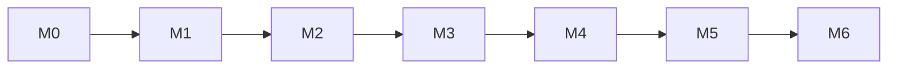

# PLAN.md — Delivery Plan

Related: [CLAUDE.md](../CLAUDE.md) (working rules) · [ARCHITECTURE.md](ARCHITECTURE.md) (design, ADRs) ·
[RISKS.md](RISKS.md) (open decisions, risks) · [tasks/](tasks/) (one file per task)
Last updated: 2026-11-05

This file is the **overview**: milestones, parallel lanes, critical path and the task index.
Every task is described in its own file `tasks/<ID>.md` — that file is the source of truth for scope,
Definition of Done and notes.

## How the plan works

- **Task ID** `<EPIC>-<NN>`. Epics: `ARCH`, `OPS`, `INF`, `DB`, `BE`, `FE`, `OBS`, `QA`.
- **Statuses:** `Todo` · `In progress` · `Review` · `Done` · `Blocked`.
  `Blocked` is used **only** when an open item in [RISKS.md](RISKS.md) stops the task (see the blocking rules there).
  Waiting for a dependency is still `Todo`.
- **Sizes:** S ≤ 0.5 day · M ≤ 2 days · L ≤ 4 days (L is a candidate for splitting).
- **Roles:** `ARCH` architect · `BE` Java backend · `FE` frontend · `OPS` DevOps / infrastructure · `QA` quality ·
  `OWNER` project owner.
- A task starts only when all dependencies are `Done` and it is not `Blocked`. Code is written only within a task.
- A status change is made in the task file **and** in the index below, in the same commit as the work.
- New work = new task file + a row in the index. Never extend a task's scope silently.

## Delegation

- Tasks in the same milestone without mutual dependencies can run in parallel by different people or agents
  (see *Parallel lanes*).
- A delegate receives the task file only; it must be self-sufficient: goal, scope, dependencies, references to
  ARCHITECTURE.md sections, DoD.
- `ARCH` reviews the result of every `INF`, `BE` and `DB` task before it becomes `Done`.
- Anything that changes an ADR or the API contract (ARCHITECTURE.md §6) goes through `ARCH` and the owner.

## Milestones

| Milestone | Outcome | Tasks | Goals |
|---|---|---|---|
| **M0** Foundation | decisions made, draft reviewed, repository and IaC skeleton exist | [ARCH-01](tasks/ARCH-01.md), [ARCH-02](tasks/ARCH-02.md), [ARCH-03](tasks/ARCH-03.md), [OPS-01](tasks/OPS-01.md), [INF-00](tasks/INF-00.md), [BE-00](tasks/BE-00.md), [FE-00](tasks/FE-00.md) | — |
| **M1** Walking skeleton | SPA on Amplify calls `GET /api/health` through API Gateway → Lambda in a private subnet; Cognito exists; JSON logs decided; Lambda → RDS Proxy → PostgreSQL `SELECT 1` (Week 1) | [OPS-02](tasks/OPS-02.md), [OPS-05](tasks/OPS-05.md), [INF-01](tasks/INF-01.md), [INF-02](tasks/INF-02.md), [INF-03](tasks/INF-03.md), [INF-04](tasks/INF-04.md), [INF-05](tasks/INF-05.md), [INF-06](tasks/INF-06.md), [INF-08](tasks/INF-08.md), [BE-01](tasks/BE-01.md), [BE-13](tasks/BE-13.md), [FE-01](tasks/FE-01.md), [FE-06](tasks/FE-06.md), [OBS-01](tasks/OBS-01.md), [QA-01](tasks/QA-01.md) | G1, G2, G4 (partly), G5 (partly) |
| **M2** Authentication end to end | sign-up/sign-in in the SPA; `/api/me` 200 with token, 401 without; correlated logs | [BE-02](tasks/BE-02.md), [FE-02](tasks/FE-02.md), [FE-03](tasks/FE-03.md), [OBS-02](tasks/OBS-02.md) | G3, G4 |
| **M3** Data | Lambda ↔ RDS Proxy ↔ PostgreSQL through Spring; user synced after sign-up; admin sees users; backend CD | [OPS-03](tasks/OPS-03.md), [DB-01](tasks/DB-01.md), [BE-03](tasks/BE-03.md), [BE-04](tasks/BE-04.md), [BE-05](tasks/BE-05.md), [BE-06](tasks/BE-06.md), [FE-05](tasks/FE-05.md) | G5 |
| **M4** Semantic search | Titan embeddings, pgvector search via HNSW, HNSW vs IVFFlat report | [INF-07](tasks/INF-07.md), [DB-02](tasks/DB-02.md), [DB-03](tasks/DB-03.md), [BE-07](tasks/BE-07.md), [BE-08](tasks/BE-08.md), [BE-09](tasks/BE-09.md), [FE-04](tasks/FE-04.md) | G6, G7 |
| **M5** Observability & hardening | dashboards and saved queries, security checklist, cold start, cost control | [OPS-04](tasks/OPS-04.md), [BE-10](tasks/BE-10.md), [BE-12](tasks/BE-12.md), [OBS-03](tasks/OBS-03.md), [QA-03](tasks/QA-03.md) | G8 |
| **M6** Acceptance | end-to-end smoke test and demo of G1–G8 | [QA-02](tasks/QA-02.md), [QA-04](tasks/QA-04.md) | all |
| **Stretch** Stretch | LLM answers, alarms, IAM auth to the database | [INF-09](tasks/INF-09.md), [BE-11](tasks/BE-11.md), [OBS-04](tasks/OBS-04.md) | — |

## Parallel lanes

| Milestone | Lane A (infrastructure) | Lane B (backend) | Lane C (frontend / ops) |
|---|---|---|---|
| M0 | INF-00 | BE-00 | FE-00, OPS-01 |
| M1 | INF-01 → INF-02 → INF-03 ∥ INF-05 → INF-04 → INF-06 | BE-13, BE-01, OBS-01, QA-01 | OPS-05; INF-08 → FE-06; FE-01, OPS-02 |
| M2 | — | BE-02, OBS-02 | FE-02 → FE-03 |
| M3 | OPS-03 | DB-01; BE-03 → BE-04, BE-05, BE-06 | FE-05 |
| M4 | INF-07 | BE-07 → BE-08 → DB-02 → DB-03, BE-09 | FE-04 |
| M5 | OBS-03, OPS-04 | BE-12, BE-10 | QA-03 |
| M6 | — | — | QA-02 → QA-04 |

ARCH-01 (owner decisions) precedes everything; ARCH-02 and ARCH-03 run alongside M0.

## Curriculum weeks

The challenge is delivered in weekly assignments. Each week has a spec in [specs/](specs/) that maps the assignment to
tasks; the tasks stay the source of truth.

| Week | Spec | Tasks | Status |
|---|---|---|---|
| 1 — Environment setup | [week-01-environment.md](specs/week-01-environment.md) | ARCH-01, ARCH-02, OPS-05, OPS-01, INF-00, INF-01, INF-02, INF-03, INF-05, BE-13, FE-00, INF-08, FE-06 | Blocked on ARCH-01 (Q-01…Q-04, Q-07…Q-11) |

## Critical path

`ARCH-01 → INF-00 → INF-01 → INF-02 → INF-03 → INF-05 → BE-13 (Week 1) → INF-04 → INF-06 → BE-03 → INF-07 → BE-07 → BE-08 → QA-02 → QA-04`

(The infrastructure part of the path is sequential because one person owns lane A.)

Items on the critical path that are currently **Blocked**: INF-00 ([Q-02](RISKS.md#q-02)), INF-01 ([Q-03](RISKS.md#q-03), [Q-07](RISKS.md#q-07)), INF-02 ([Q-08](RISKS.md#q-08)), INF-03 ([Q-08](RISKS.md#q-08), [Q-09](RISKS.md#q-09)), INF-05 ([Q-08](RISKS.md#q-08), [Q-10](RISKS.md#q-10)), BE-13 ([Q-10](RISKS.md#q-10)), BE-08 ([Q-05](RISKS.md#q-05)). Answering these in ARCH-01 is the first priority.

## Task index

### ARCH — decisions & preparation

| ID | Task | Milestone | Role | Size | Depends on | Blocked by | Status |
|---|---|---|---|---|---|---|---|
| [ARCH-01](tasks/ARCH-01.md) | Resolve open decisions and confirm ADRs | M0 | OWNER + ARCH | S | — | — | Todo |
| [ARCH-02](tasks/ARCH-02.md) | Prepare the AWS account | M0 | OWNER | S | ARCH-01 | Q-03 | Blocked |
| [ARCH-03](tasks/ARCH-03.md) | Define engineering conventions | M0 | ARCH | S | ARCH-01 | — | Todo |

### OPS — repository, CI/CD, cost

| ID | Task | Milestone | Role | Size | Depends on | Blocked by | Status |
|---|---|---|---|---|---|---|---|
| [OPS-01](tasks/OPS-01.md) | Put the project under Git and push to the remote | M0 | OPS | S | ARCH-01 | Q-04 | Blocked |
| [OPS-02](tasks/OPS-02.md) | CI pipeline: build, test, synth on every PR | M1 | OPS | M | OPS-01, BE-00, FE-00, INF-00 | Q-04 | Blocked |
| [OPS-03](tasks/OPS-03.md) | Continuous delivery of the backend | M3 | OPS | M | OPS-02, INF-05, BE-05 | Q-07 | Blocked |
| [OPS-04](tasks/OPS-04.md) | Cost control: estimate, stop and start the stack | M5 | OPS | S | INF-03, INF-07 | — | Todo |
| [OPS-05](tasks/OPS-05.md) | Local AWS CLI and SDK setup check | M0 | OPS | S | ARCH-02 | Q-11 | Blocked |

### INF — infrastructure as code

| ID | Task | Milestone | Role | Size | Depends on | Blocked by | Status |
|---|---|---|---|---|---|---|---|
| [INF-00](tasks/INF-00.md) | CDK application skeleton (`infra` module) | M0 | OPS + ARCH | M | ARCH-01 | Q-02 | Blocked |
| [INF-01](tasks/INF-01.md) | Environment configuration | M1 | OPS | S | INF-00 | Q-03, Q-07 | Blocked |
| [INF-02](tasks/INF-02.md) | NetworkStack: isolated VPC, security groups, VPC endpoints | M1 | OPS | M | INF-01 | Q-08 | Blocked |
| [INF-03](tasks/INF-03.md) | DataStack: RDS PostgreSQL, secret, RDS Proxy | M1 | OPS | M | INF-02 | Q-08, Q-09 | Blocked |
| [INF-04](tasks/INF-04.md) | AuthStack: Cognito User Pool | M1 | OPS | S | INF-01 | — | Todo |
| [INF-05](tasks/INF-05.md) | ComputeStack: Lambda functions | M1 | OPS + BE | M | INF-02, BE-00 | Q-08, Q-10 | Blocked |
| [INF-06](tasks/INF-06.md) | ApiStack: HTTP API with JWT authorizer | M1 | OPS | M | INF-04, INF-05 | — | Todo |
| [INF-07](tasks/INF-07.md) | Bedrock access from the VPC | M4 | OPS | S | INF-02, INF-05, ARCH-02 | — | Todo |
| [INF-08](tasks/INF-08.md) | Hosting: Amplify app and CloudFront | M1 | OPS | M | OPS-01, FE-00 | Q-01, Q-04 | Blocked |
| [INF-09](tasks/INF-09.md) | IAM authentication to RDS Proxy (stretch) | Stretch | OPS + BE | M | BE-03, INF-03 | — | Todo |

### DB — schema & vector search

| ID | Task | Milestone | Role | Size | Depends on | Blocked by | Status |
|---|---|---|---|---|---|---|---|
| [DB-01](tasks/DB-01.md) | Finalise the initial schema migration | M3 | BE + ARCH | S | BE-00 | — | Todo |
| [DB-02](tasks/DB-02.md) | Tune the HNSW index | M4 | BE | M | BE-08, INF-03 | Q-05 | Blocked |
| [DB-03](tasks/DB-03.md) | IVFFlat experiment and comparison | M4 | BE | M | DB-02 | Q-05 | Blocked |

### BE — backend

| ID | Task | Milestone | Role | Size | Depends on | Blocked by | Status |
|---|---|---|---|---|---|---|---|
| [BE-00](tasks/BE-00.md) | Review the draft backend and get a green build | M0 | ARCH + BE | M | ARCH-01 | — | Review |
| [BE-01](tasks/BE-01.md) | Web layer skeleton: health, errors, validation | M1 | BE | S | BE-00 | — | Todo |
| [BE-02](tasks/BE-02.md) | Security: claims, current user, admin check | M2 | BE | S | BE-00 | — | Todo |
| [BE-03](tasks/BE-03.md) | Database connectivity through RDS Proxy | M3 | BE | M | INF-03 | — | Todo |
| [BE-04](tasks/BE-04.md) | Sync function: Cognito PostConfirmation → app_user | M3 | BE | S | BE-03, INF-04 | — | Todo |
| [BE-05](tasks/BE-05.md) | Migrate function: Flyway on demand | M3 | BE | S | BE-03 | — | Todo |
| [BE-06](tasks/BE-06.md) | Admin API: users and documents with pagination | M3 | BE | M | BE-02, BE-03 | — | Todo |
| [BE-07](tasks/BE-07.md) | Embedding service (Titan Text Embeddings v2) | M4 | BE | S | INF-07 | — | Todo |
| [BE-08](tasks/BE-08.md) | Document ingestion and chunking | M4 | BE | M | BE-07, BE-06 | Q-05 | Blocked |
| [BE-09](tasks/BE-09.md) | Chat search endpoint | M4 | BE | S | BE-07, DB-01 | — | Todo |
| [BE-10](tasks/BE-10.md) | OpenAPI specification | M5 | BE + FE | S | BE-06, BE-09 | — | Todo |
| [BE-11](tasks/BE-11.md) | LLM answers with Claude / Bedrock Agent (stretch) | Stretch | BE + ARCH | L | BE-09 | Q-06 | Blocked |
| [BE-12](tasks/BE-12.md) | Cold start optimisation | M5 | BE + OPS | M | INF-05 | — | Todo |
| [BE-13](tasks/BE-13.md) | Week 1 connectivity probe: `SELECT 1` through RDS Proxy | M1 | BE | S | INF-03, INF-05 | Q-10 | Blocked |

### FE — frontend

| ID | Task | Milestone | Role | Size | Depends on | Blocked by | Status |
|---|---|---|---|---|---|---|---|
| [FE-00](tasks/FE-00.md) | Review the draft frontend and get a green build | M0 | ARCH + FE | S | ARCH-01 | — | Review |
| [FE-01](tasks/FE-01.md) | Application shell | M1 | FE | S | FE-00 | — | Todo |
| [FE-02](tasks/FE-02.md) | Authentication UI | M2 | FE | S | INF-04, FE-01 | — | Todo |
| [FE-03](tasks/FE-03.md) | API client | M2 | FE | S | FE-02, BE-01 | — | Todo |
| [FE-04](tasks/FE-04.md) | Chat page | M4 | FE | S | FE-03, BE-09 | — | Todo |
| [FE-05](tasks/FE-05.md) | Admin panel | M3 | FE | M | FE-03, BE-06 | — | Todo |
| [FE-06](tasks/FE-06.md) | Deploy the SPA via Amplify Hosting | M1 | FE + OPS | S | OPS-01, INF-08 | — | Todo |

### OBS — observability

| ID | Task | Milestone | Role | Size | Depends on | Blocked by | Status |
|---|---|---|---|---|---|---|---|
| [OBS-01](tasks/OBS-01.md) | Logging spike: structured JSON in Lambda | M1 | BE + OPS | S | INF-05 | — | Todo |
| [OBS-02](tasks/OBS-02.md) | Request correlation across the chain | M2 | BE + OPS | S | OBS-01, INF-06 | — | Todo |
| [OBS-03](tasks/OBS-03.md) | Logs Insights queries and dashboard | M5 | OPS | S | OBS-02 | — | Todo |
| [OBS-04](tasks/OBS-04.md) | Alarms (stretch) | Stretch | OPS | S | OBS-03 | — | Todo |

### QA — quality & acceptance

| ID | Task | Milestone | Role | Size | Depends on | Blocked by | Status |
|---|---|---|---|---|---|---|---|
| [QA-01](tasks/QA-01.md) | Test strategy and baseline tests | M1 | QA + BE | S | BE-00 | — | Todo |
| [QA-02](tasks/QA-02.md) | End-to-end smoke test against dev | M6 | QA | M | FE-04, FE-05, BE-08 | — | Todo |
| [QA-03](tasks/QA-03.md) | Security checklist | M5 | QA + ARCH | S | BE-09, FE-05, INF-08 | — | Todo |
| [QA-04](tasks/QA-04.md) | Acceptance of goals G1–G8 | M6 | OWNER + ARCH | S | QA-02, QA-03, OBS-03 | — | Todo |

## Change log

| Date | Change |
|---|---|
| 2026-10-22 | First version (Russian) with 48 tasks inline |
| 2026-10-23 | Moved to `docs/`, translated to English, one file per task in `docs/tasks/`, open questions moved to RISKS.md with blocking rules |
| 2026-11-05 | Week 1 spec added (`docs/specs/`); new tasks OPS-05, BE-13; INF-03 moved M3 → M1; INF-08 no longer depends on INF-04/INF-06; Q-08…Q-11 block INF-02, INF-03, INF-05, BE-13, OPS-05 |
