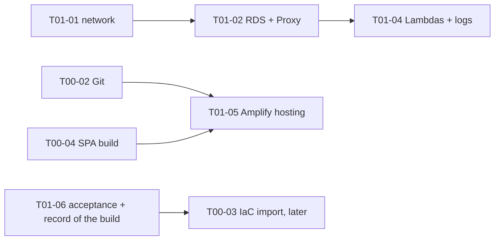
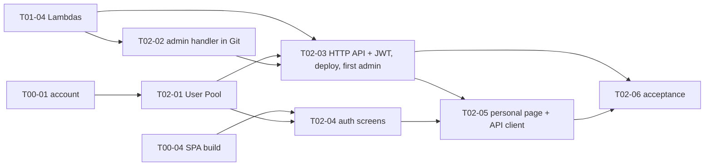

# PLAN.md — Delivery Plan

Related: [CLAUDE.md](../CLAUDE.md) · [ARCHITECTURE.md](ARCHITECTURE.md) · [RISKS.md](RISKS.md) ·
[requirements/](requirements/) · [design/](design/) · [specs/](specs/) · [tasks/](tasks/)
Last updated: 2026-11-12

## How the plan works

- **Flow per curriculum week:** requirements export (`requirements/`) → feature design doc (`design/`, Accepted by the
  owner) → specs (`specs/NN-name.md`) → tasks (`tasks/P<n>-<phase>/T<nn>-<mm>-<name>.md`) → this index.
  Only the current week is planned; nothing is written for weeks whose requirements have not arrived.
- **Task file** = YAML front matter (`id`, `title`, `phase`, `status`, `agent`, `skills`, `depends_on`, `blocked_by`,
  `design`, `spec`, `acceptance`) + three layers `// BUSINESS CONTEXT`, `// TECHNICAL CONSTRAINTS`, `// SCOPE`
  + Definition of Done + Notes. The front matter is the source of truth; this index mirrors it.
- **Statuses:** `Todo` · `In progress` · `Review` · `Done` · `Blocked`. `Blocked` only for an open item in
  [RISKS.md](RISKS.md); waiting for a dependency is `Todo`.
- **Start gate:** a task starts when its `blocked_by` is empty, all `depends_on` are `Done` and its design doc is
  `Accepted`. The `agent` named in the task does the work with the listed `skills`; `architect` reviews every
  `devops` and `backend` result before `Done`.
- **AWS changes** are made only by the owner in the console from a devops console runbook in the task; agents have
  no AWS access and AWS evidence comes from the owner (Q-12 C, CLAUDE.md §3.11); IaC comes with T00-03.
- A status change goes to the task file and this index in the same commit. New work = new task file + a row here.

## Phases

| Phase | Week | Outcome | Design | Specs |
|---|---|---|---|---|
| **P0-foundation** | 1 | account and local access, Git repository, SPA that builds and renders without config; later: IaC import (T00-03) | [spa-hosting](design/spa-hosting.md), [backend-foundation](design/backend-foundation.md) | [01](specs/01-spa-delivery.md), [02](specs/02-database-connectivity.md), [03](specs/03-local-aws-access.md) |
| **P1-environment** | 1 | SPA on Amplify/CloudFront; VPC, RDS, RDS Proxy; three Python Lambdas with logs; `SELECT 1` through the proxy — built manually by the owner, accepted 2026-11-12 | same | same |
| **P2-authorization** | 2 | Cognito User Pool + own Amplify Auth screens, personal page from Cognito attributes, HTTP API with JWT authorizer, `admin` group, Admin Lambda code in Git | [authentication](design/authentication.md), [api-gateway-auth](design/api-gateway-auth.md) | [04](specs/04-user-registration-and-sign-in.md), [05](specs/05-protected-api.md) |
| P3+ | 3+ | planned when the next week's requirements arrive (curriculum overview: ARCHITECTURE §1.1) | — | — |

Week 1 (built manually; accepted by the owner 2026-11-12):

Week 2:

Lanes: **devops** T02-01 → T02-03 · **backend** T02-02 · **frontend** T02-04 → T02-05 · **tester** T02-06 at the end.

## Current state (2026-11-12)

**Week 1** is `Done`: built manually in the AWS console by the owner and accepted on 2026-11-12 (T00-01, T00-02,
T00-04, T01-01, T01-02, T01-04, T01-05, T01-06; design docs spa-hosting and backend-foundation `Accepted`). The known
facts of the build (region `eu-west-1`, VPC, subnets) are in [ARCHITECTURE §4](ARCHITECTURE.md#4-network); no NAT
gateway is shown ([R-09](RISKS.md#2-risk-register), not blocking Week 2). IaC ACs (AC-01.4, AC-02.9) stay with
T00-03 (`Blocked` by Q-02). Agents have no AWS access (CLAUDE.md §3.11).

**Week 2** (authorization, 6 tasks in P2-authorization): design docs and ADR-004 `Accepted`, no task blocked.
**Startable now:** T02-01 (In progress — pool and app client created by the owner, ids in [ENVIRONMENT.md](ENVIRONMENT.md); waiting for the schema evidence) and T02-02 (backend — needs the owner's
export of the `admin` deployment package). T02-04 in `Review` and T02-05 `In progress` (started early on the owner's
request; API part waits for T02-03). Next: T02-03 after T02-01 and T02-02. User sync to
PostgreSQL, the users table and migrations are Week 3.

## Task index

### P0-foundation

| ID | Task | Agent | Skills | Depends on | Blocked by | Design | Spec | Status |
|---|---|---|---|---|---|---|---|---|
| [T00-01](tasks/P0-foundation/T00-01-aws-account-and-local-access.md) | AWS account, budget and local CLI/SDK access | devops | cloud-architect | — | — | — | 03 | Done |
| [T00-02](tasks/P0-foundation/T00-02-git-repository.md) | Put the project under Git and push to the remote | devops | devops-engineer | — | — | spa-hosting | 01 | Done |
| [T00-03](tasks/P0-foundation/T00-03-iac-skeleton.md) | Codify the manually built resources in IaC | devops | cloud-architect, devops-engineer | T01-06 | Q-02 | backend-foundation | 01, 02 | Blocked |
| [T00-04](tasks/P0-foundation/T00-04-spa-build.md) | SPA builds and renders without Cognito/API configuration | frontend | react-expert | — | — | spa-hosting | 01 | Done |

### P1-environment

| ID | Task | Agent | Skills | Depends on | Blocked by | Design | Spec | Status |
|---|---|---|---|---|---|---|---|---|
| [T01-01](tasks/P1-environment/T01-01-network.md) | Network stack: VPC, subnets, NAT, security groups | devops | cloud-architect | — | — | backend-foundation | 02 | Done |
| [T01-02](tasks/P1-environment/T01-02-database-and-proxy.md) | Data stack: RDS PostgreSQL, secret, RDS Proxy | devops | cloud-architect, postgres-pro | T01-01 | — | backend-foundation | 02 | Done |
| [T01-04](tasks/P1-environment/T01-04-lambda-functions.md) | Compute: three functions, roles, log groups | devops | cloud-architect | T01-02 | — | backend-foundation | 02 | Done |
| [T01-05](tasks/P1-environment/T01-05-spa-hosting.md) | Hosting stack: Amplify app connected to Git | devops | cloud-architect, devops-engineer | T00-02, T00-04 | — | spa-hosting | 01 | Done |
| [T01-06](tasks/P1-environment/T01-06-week-1-acceptance.md) | Week 1 acceptance check and record of the manual build | tester | test-master | — | — | — | 01, 02, 03 | Done |

### P2-authorization

| ID | Task | Agent | Skills | Depends on | Blocked by | Design | Spec | Status |
|---|---|---|---|---|---|---|---|---|
| [T02-01](tasks/P2-authorization/T02-01-cognito-user-pool.md) | Cognito User Pool, SPA app client and group admin | devops | cloud-architect | T00-01 | — | authentication | 04 | In progress |
| [T02-02](tasks/P2-authorization/T02-02-admin-api-handler.md) | Admin Lambda in Git (Python): GET /api/me and GET /api/admin/ping | backend | test-master | T01-04 | — | api-gateway-auth | 05 | Todo |
| [T02-03](tasks/P2-authorization/T02-03-http-api-jwt.md) | HTTP API with Cognito JWT authorizer, routes, CORS, access logs; deploy admin; first admin | devops | cloud-architect | T01-04, T02-01, T02-02 | — | api-gateway-auth | 05, 04 | Todo |
| [T02-04](tasks/P2-authorization/T02-04-auth-screens.md) | Amplify Auth config, sign-up / confirm / sign-in / sign-out screens, route guard | frontend | react-expert | T00-04, T02-01 | — | authentication | 04 | Review |
| [T02-05](tasks/P2-authorization/T02-05-personal-page.md) | Personal page from Cognito attributes; API client with the access token; role from GET /api/me | frontend | react-expert | T02-03, T02-04 | — | authentication | 04, 05 | In progress |
| [T02-06](tasks/P2-authorization/T02-06-week-2-acceptance.md) | Week 2 acceptance check | tester | test-master | T02-03, T02-05 | — | — | 04, 05 | Todo |

## Change log

| Date | Change |
|---|---|
| 2026-10-22 | First version with 48 tasks inline |
| 2026-10-23 | One file per task in `docs/tasks/`, open questions moved to RISKS.md |
| 2026-11-05 | Restructured to the Agentic Coding layout (requirements → design → specs → phased tasks). Only Week 1 is planned: 10 tasks in P0/P1. The 48 speculative tasks for later milestones were deleted; backup of the old `docs/` in `%TEMP%\aws_challenge_backup_2026-11-05\docs-before-restructure.zip` |
| 2026-11-12 | Week 2 (Authorization) planned: design docs authentication, api-gateway-auth; specs 04–06; 9 tasks in P2-authorization; Q-12…Q-14, R-11…R-13, ADR-013, ADR-014 added |
| 2026-11-12 | Owner decisions applied. **D1** ADR-015 (Accepted): Python 3.13 Lambdas, no backend application; ADR-002 superseded; Q-10, Q-13 closed. **D2** backend draft deleted by the owner; R-04 closed; CLAUDE.md, README, agents updated. **D3** Q-12 = C (AWS CLI runbooks, IaC later in T00-03); Week 1 recorded as built manually: Q-01, Q-03, Q-04, Q-07, Q-08, Q-09, Q-10, Q-11 closed "decided by the build" (values recorded by T01-06), Q-02 deferred; Week 1 build tasks → `Review`; T01-03 deleted; T00-03 re-scoped to the IaC import. **D4** curriculum Weeks 3–6 recorded in ARCHITECTURE §1.1; ADR-011 rejected (EventBridge required), ADR-010 superseded, Q-06 closed; Q-15 (1536 dims) and Q-16 (migrations) added; R-14, R-15 added. **D5** Week 2 re-scoped: spec 06 and the sync/migrate/schema tasks deleted (moved to Week 3); tasks renumbered T02-01…T02-06; ADR-003, ADR-013 (revised), ADR-014 Accepted |
| 2026-11-12 | Owner decisions applied. Q-14 answered with option C (custom attributes without min/max in Cognito, validation only in the SPA, ranges unchanged) and closed; the field table's single home is spec 04 §Inputs (AC-04.1 and AC-04.4 updated, edge case for out-of-range stored values added); R-11, R-12 reworded. Design docs authentication and api-gateway-auth `Accepted`; ADR-004 Accepted. T02-01, T02-04 unblocked → `Todo` |
| 2026-11-12 | Owner decisions applied. **Week 1 accepted:** T00-01, T00-02, T00-04, T01-01, T01-02, T01-04, T01-05, T01-06 → `Done` (owner); design docs spa-hosting, backend-foundation `Accepted`; T00-03 unchanged (`Blocked`, Q-02). **No AWS access for agents:** CLAUDE.md §3.11 added; Q-12 C amended (owner executes devops console runbooks, AWS evidence from the owner); devops/tester agents, T02-01, T02-02, T02-03, T02-06, specs 04/05 updated. **Facts of the build** recorded once in ARCHITECTURE §4 (region `eu-west-1`, VPC, subnets, route tables, IGW, S3 endpoint); Q-03 value set (ADR-009); R-09 reworded (no NAT gateway shown). **Naming** `aws-challenge-<name>` (CLAUDE.md §7); Week 2 names aligned (`aws-challenge-users`, `aws-challenge-frontend-spa`, `aws-challenge-api`, `aws-challenge-admin`). Start gate holds for T02-01, T02-02 |
| 2026-11-12 | On the owner's request, before the start gate held (T02-01 In progress, T02-03 Todo): T02-04 → `Review` (auth screens, env names aligned to `VITE_USER_POOL_ID` / `VITE_USER_POOL_CLIENT_ID`, `@aws-amplify/ui-react` removed, Vitest added); T02-05 → `In progress` (personal page without the API part); skills `amplify-auth`, `spa-api-client` added |
| 2026-11-12 | `docs/ENVIRONMENT.md` added as the single home of the as-built resource identifiers (moved from ARCHITECTURE §4.1); Cognito pool and app client ids recorded; `lambdas/admin`, `lambdas/chatbot`, `lambdas/sync` created for the function code. T02-01 → `In progress` |
| 2026-11-13 | Owner decisions after testing the deployed SPA: **no code confirmation in the SPA** (the owner confirms new users in the Cognito console; `/confirm` removed; sign-up shows "activated by an administrator", unconfirmed sign-in shows "not activated yet"); **profile on Home `/`** (`/me` and "My page" removed); **no API request without `VITE_API_URL`** (draft health/claims blocks removed from Home, `/chat` and `/admin` show "Not available yet", Chat/Admin links only when signed in). Spec 04, design authentication, ARCHITECTURE §3.1, skills `amplify-auth` and `spa-api-client`, T02-04 and T02-05 Notes updated. Statuses unchanged: T02-04 `Review`, T02-05 `In progress` |
