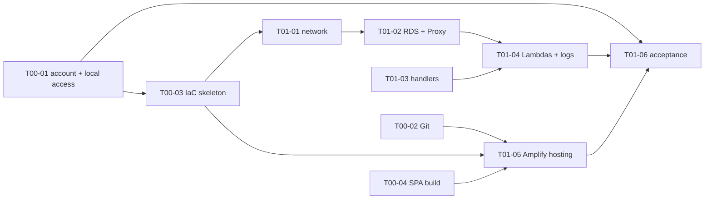

# PLAN.md — Delivery Plan

Related: [CLAUDE.md](../CLAUDE.md) · [ARCHITECTURE.md](ARCHITECTURE.md) · [RISKS.md](RISKS.md) ·
[requirements/](requirements/) · [design/](design/) · [specs/](specs/) · [tasks/](tasks/)
Last updated: 2026-11-05

## How the plan works

- **Flow per curriculum week:** requirements export (`requirements/`) → feature design doc (`design/`, Accepted by the
  owner) → specs (`specs/NN-name.md`) → tasks (`tasks/P<n>-<phase>/T<nn>-<mm>-<name>.md`) → this index.
  Only the current week is planned; nothing is written for weeks whose requirements have not arrived.
- **Task file** = YAML front matter (`id`, `title`, `phase`, `status`, `agent`, `skills`, `depends_on`, `blocked_by`,
  `design`, `spec`, `acceptance`) + three layers `// BUSINESS CONTEXT`, `// TECHNICAL CONSTRAINTS`, `// SCOPE`
  + Definition of Done + Notes. The front matter is the source of truth; this index mirrors it.
- **Statuses:** `Todo` · `In progress` · `Review` · `Done` · `Blocked`. `Blocked` only for an open item in
  [RISKS.md](RISKS.md); waiting for a dependency is `Todo`.
- **Start gate:** a task starts when its `blocked_by` is empty, all `depends_on` are `Done` and its design doc is
  `Accepted`. The `agent` named in the task does the work with the listed `skills`; `architect` reviews every
  `devops` and `backend` result before `Done`.
- A status change goes to the task file and this index in the same commit. New work = new task file + a row here.

## Phases

| Phase | Week | Outcome | Design | Specs |
|---|---|---|---|---|
| **P0-foundation** | 1 | account and local access, Git repository, IaC skeleton, SPA that builds and renders without config | [spa-hosting](design/spa-hosting.md), [backend-foundation](design/backend-foundation.md) | [01](specs/01-spa-delivery.md), [02](specs/02-database-connectivity.md), [03](specs/03-local-aws-access.md) |
| **P1-environment** | 1 | SPA on Amplify/CloudFront; VPC, RDS, RDS Proxy; three Lambdas with logs; `SELECT 1` through the proxy | same | same |
| P2+ | 2+ | planned when the next week's requirements arrive | — | — |

Parallel lanes after the open questions are answered: **devops** T00-01 → T00-03 → T01-01 → T01-02 → T01-04, then
T01-05 · **backend** T01-03 · **frontend** T00-04 · **tester** T01-06 at the end.

## Current state (2026-11-05)

Week 1 is planned: 10 tasks. Both design docs are `Draft`, so no task can start yet. To start: the owner answers
Q-01…Q-04, Q-07…Q-11 and accepts [spa-hosting](design/spa-hosting.md) and
[backend-foundation](design/backend-foundation.md). T00-04 has no open question and starts as soon as spa-hosting
is `Accepted`.

## Task index

### P0-foundation

| ID | Task | Agent | Skills | Depends on | Blocked by | Design | Spec | Status |
|---|---|---|---|---|---|---|---|---|
| [T00-01](tasks/P0-foundation/T00-01-aws-account-and-local-access.md) | AWS account, budget and local CLI/SDK access | devops | cloud-architect | — | Q-03, Q-11 | — | 03 | Blocked |
| [T00-02](tasks/P0-foundation/T00-02-git-repository.md) | Put the project under Git and push to the remote | devops | devops-engineer | — | Q-04 | spa-hosting | 01 | Blocked |
| [T00-03](tasks/P0-foundation/T00-03-iac-skeleton.md) | IaC skeleton with environment configuration | devops | cloud-architect, devops-engineer | T00-01 | Q-02, Q-03, Q-07 | backend-foundation | 02 | Blocked |
| [T00-04](tasks/P0-foundation/T00-04-spa-build.md) | SPA builds and renders without Cognito/API configuration | frontend | react-expert | — | — | spa-hosting | 01 | In progress |

### P1-environment

| ID | Task | Agent | Skills | Depends on | Blocked by | Design | Spec | Status |
|---|---|---|---|---|---|---|---|---|
| [T01-01](tasks/P1-environment/T01-01-network.md) | Network stack: VPC, subnets, NAT, security groups | devops | cloud-architect | T00-03 | Q-08 | backend-foundation | 02 | Blocked |
| [T01-02](tasks/P1-environment/T01-02-database-and-proxy.md) | Data stack: RDS PostgreSQL, secret, RDS Proxy | devops | cloud-architect, postgres-pro | T01-01 | Q-09 | backend-foundation | 02 | Blocked |
| [T01-03](tasks/P1-environment/T01-03-lambda-handlers.md) | Week 1 Lambda handlers with the SELECT 1 probe | backend | postgres-pro, test-master | — | Q-10 | backend-foundation | 02 | Blocked |
| [T01-04](tasks/P1-environment/T01-04-lambda-functions.md) | Compute stack: three functions, roles, log groups | devops | cloud-architect | T01-02, T01-03 | — | backend-foundation | 02 | Todo |
| [T01-05](tasks/P1-environment/T01-05-spa-hosting.md) | Hosting stack: Amplify app connected to Git | devops | cloud-architect, devops-engineer | T00-02, T00-03, T00-04 | Q-01 | spa-hosting | 01 | Blocked |
| [T01-06](tasks/P1-environment/T01-06-week-1-acceptance.md) | Week 1 acceptance check | tester | test-master | T00-01, T01-04, T01-05 | — | — | 01, 02, 03 | Todo |

## Change log

| Date | Change |
|---|---|
| 2026-10-22 | First version with 48 tasks inline |
| 2026-10-23 | One file per task in `docs/tasks/`, open questions moved to RISKS.md |
| 2026-11-05 | Restructured to the Agentic Coding layout (requirements → design → specs → phased tasks). Only Week 1 is planned: 10 tasks in P0/P1. The 48 speculative tasks for later milestones were deleted; backup of the old `docs/` in `%TEMP%\aws_challenge_backup_2026-11-05\docs-before-restructure.zip` |
