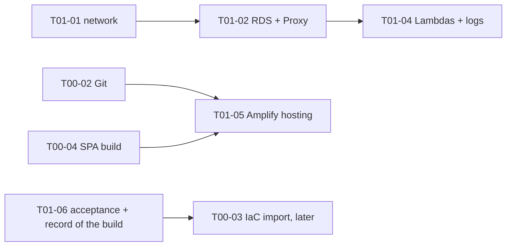
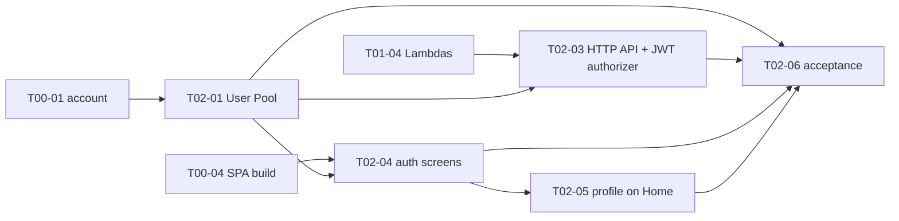
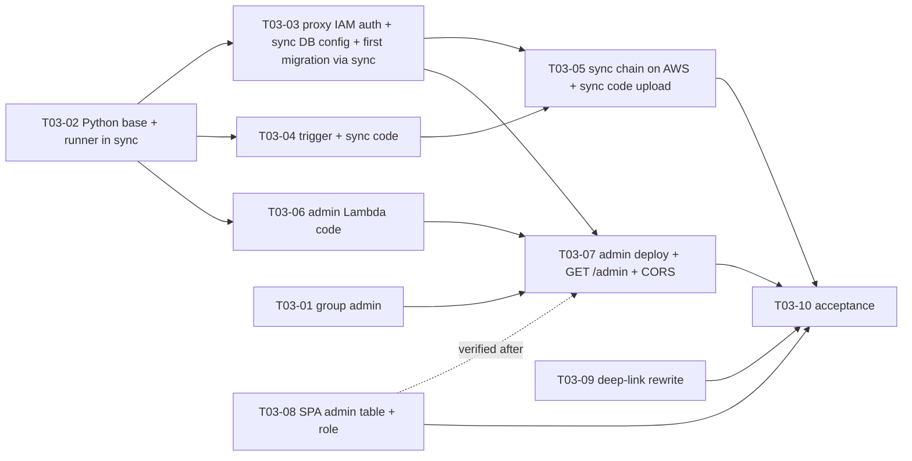

# PLAN.md — Delivery Plan

Related: [CLAUDE.md](../CLAUDE.md) · [ARCHITECTURE.md](ARCHITECTURE.md) · [RISKS.md](RISKS.md) ·
[requirements/](requirements/) · [design/](design/) · [specs/](specs/) · [tasks/](tasks/)
Last updated: 2026-11-17

## How the plan works

- **Flow per curriculum week:** requirements export (`requirements/`) → feature design doc (`design/`, Accepted by the
  owner) → specs (`specs/NN-name.md`) → tasks (`tasks/P<n>-<phase>/T<nn>-<mm>-<name>.md`) → this index.
  Only the current week is planned; nothing is written for weeks whose requirements have not arrived.
- **Task file** = YAML front matter (`id`, `title`, `phase`, `status`, `agent`, `skills`, `depends_on`, `blocked_by`,
  `design`, `spec`, `acceptance`) + three layers `// BUSINESS CONTEXT`, `// TECHNICAL CONSTRAINTS`, `// SCOPE`
  + Definition of Done + Notes. The front matter is the source of truth; this index mirrors it.
- **Statuses:** `Todo` · `In progress` · `Review` · `Done` · `Blocked`. `Blocked` only for an open item in
  [RISKS.md](RISKS.md); waiting for a dependency is `Todo`.
- **Start gate:** a task starts when its `blocked_by` is empty, all `depends_on` are `Done` and its design doc is
  `Accepted`. The `agent` named in the task does the work with the listed `skills`; `architect` reviews every
  `devops` and `backend` result before `Done`.
- **AWS changes** are made only by the owner in the console from a devops console runbook in the task; agents have
  no AWS access and AWS evidence comes from the owner (Q-12 C, CLAUDE.md §3.11); IaC comes with T00-03.
- A status change goes to the task file and this index in the same commit. New work = new task file + a row here.

## Phases

| Phase | Week | Outcome | Design | Specs |
|---|---|---|---|---|
| **P0-foundation** | 1 | account and local access, Git repository, SPA that builds and renders without config; later: IaC import (T00-03) | [spa-hosting](design/spa-hosting.md), [backend-foundation](design/backend-foundation.md) | [01](specs/01-spa-delivery.md), [02](specs/02-database-connectivity.md), [03](specs/03-local-aws-access.md) |
| **P1-environment** | 1 | SPA on Amplify/CloudFront; VPC, RDS, RDS Proxy; three Python Lambdas with logs; `SELECT 1` through the proxy — built manually by the owner, accepted 2026-11-12 | same | same |
| **P2-authorization** | 2 | Curriculum topic only (owner, 2026-11-13): Cognito User Pool + own Amplify Auth screens, personal page from Cognito attributes, HTTP API with JWT authorizer (built by the owner). `admin` group, Admin Lambda code, `/api/...` endpoints and the role line moved to Week 3 | [authentication](design/authentication.md), [api-gateway-auth](design/api-gateway-auth.md) | [04](specs/04-user-registration-and-sign-in.md), [05](specs/05-protected-api.md) |
| **P3-rest-api-data** | 3 | Curriculum topic: Admin Lambda ↔ RDS Proxy; sync chain Cognito → EventBridge → Lambda. Users table + migrations, DB access without secrets, group `admin`, `GET /admin` (users list; ADR-018), admin table and role line (from the token) in the SPA, handler logs (API access log: Week 6); deep-link fix | [user-sync](design/user-sync.md), [admin-api](design/admin-api.md) | [06](specs/06-users-table-and-migrations.md), [07](specs/07-user-sync.md), [08](specs/08-admin-api.md), [09](specs/09-admin-page-and-role.md) |
| P4+ | 4+ | planned when the next week's requirements arrive (curriculum overview: ARCHITECTURE §1.1) | — | — |

Week 1 (built manually; accepted by the owner 2026-11-12):

Week 2:

Lanes: **devops** T02-01 → T02-03 · **frontend** T02-04 → T02-05 · **tester** T02-06 at the end.

Week 3 (no open blockers since 2026-11-13):

Lanes: **backend** T03-02 (rework) → T03-04, T03-06 · **devops** T03-01, T03-09 (startable now), T03-03 (step 2 now; upload after T03-02) → T03-05, T03-07 ·
**frontend** T03-08 (startable now) · **tester** T03-10 at the end.

## Current state (2026-11-16)

**Week 1** is `Done`: built manually in the AWS console by the owner and accepted on 2026-11-12 (T00-01, T00-02,
T00-04, T01-01, T01-02, T01-04, T01-05, T01-06; design docs spa-hosting and backend-foundation `Accepted`). The known
facts of the build (region `eu-west-1`, VPC, subnets) are in [ARCHITECTURE §4](ARCHITECTURE.md#4-network); no NAT
gateway is shown ([R-09](RISKS.md#2-risk-register), not blocking Week 2). IaC ACs (AC-01.4, AC-02.9) stay with
T00-03 (`Blocked` by Q-02). Agents have no AWS access (CLAUDE.md §3.11).

**Week 2** (authorization, 5 tasks in P2-authorization) is **`Done`** — closed by the owner on 2026-11-13. Scope:
the curriculum topic (User Pool + Amplify Auth, HTTP API with JWT authorizer); pool, app client and HTTP API built by
the owner (identifiers in [ENVIRONMENT.md](ENVIRONMENT.md)); the deployed SPA signs up, signs in and shows the
profile; acceptance report in T02-06. Known issue: Amplify deep links 301 → 404 (AC-01.2, follow-up for T01-05).
**Week 3** (REST API + data, 10 tasks in P3-rest-api-data) is **planned** (2026-11-13). Requirements derived from the
topic line ([week-03](requirements/week-03-rest-api-data.md)); design docs user-sync and admin-api `Accepted` by the
owner (2026-11-13). Decisions taken: [Q-16](RISKS.md#q-16) A (ADR-017), [Q-17](RISKS.md#q-17) A (ADR-016),
[Q-18](RISKS.md#q-18) A (ADR-006 revised; R-16 accepted), [Q-19](RISKS.md#q-19) A — all ADRs `Accepted`. No Week 3
task is `Blocked`; the Q-18 owner facts F1–F5 are step 1 of the T03-03 runbook. Start gate holds now for **T03-01**
(group `admin`), **T03-02** (Python base + migrations), **T03-08** (SPA admin page) and **T03-09** (deep-link fix);
the others wait for their dependencies.
**2026-11-16 (owner decisions):** only the curriculum's functions `admin`, `chatbot`, `sync` plus the trigger
`post-confirmation` (no `aws-challenge-migrate`; the migration runner lives in `sync` — ADR-017 revised, Q-16
amended); runtime Python 3.12 for all functions (ADR-015 revised). T03-02 re-opened (`Todo`) to move the runner into
`lambdas/sync/`; T03-03 re-scoped to proxy IAM auth + `sync` DB configuration + first migration through `sync`
(step 1 done, step 2 executable now; upload waits for T03-02 `Done`); T03-05 only uploads the upsert version of
`sync`.

## Task index

### P0-foundation

| ID | Task | Agent | Skills | Depends on | Blocked by | Design | Spec | Status |
|---|---|---|---|---|---|---|---|---|
| [T00-01](tasks/P0-foundation/T00-01-aws-account-and-local-access.md) | AWS account, budget and local CLI/SDK access | devops | cloud-architect | — | — | — | 03 | Done |
| [T00-02](tasks/P0-foundation/T00-02-git-repository.md) | Put the project under Git and push to the remote | devops | devops-engineer | — | — | spa-hosting | 01 | Done |
| [T00-03](tasks/P0-foundation/T00-03-iac-skeleton.md) | Codify the manually built resources in IaC | devops | cloud-architect, devops-engineer | T01-06 | Q-02 | backend-foundation | 01, 02 | Blocked |
| [T00-04](tasks/P0-foundation/T00-04-spa-build.md) | SPA builds and renders without Cognito/API configuration | frontend | react-expert | — | — | spa-hosting | 01 | Done |

### P1-environment

| ID | Task | Agent | Skills | Depends on | Blocked by | Design | Spec | Status |
|---|---|---|---|---|---|---|---|---|
| [T01-01](tasks/P1-environment/T01-01-network.md) | Network stack: VPC, subnets, NAT, security groups | devops | cloud-architect | — | — | backend-foundation | 02 | Done |
| [T01-02](tasks/P1-environment/T01-02-database-and-proxy.md) | Data stack: RDS PostgreSQL, secret, RDS Proxy | devops | cloud-architect, postgres-pro | T01-01 | — | backend-foundation | 02 | Done |
| [T01-04](tasks/P1-environment/T01-04-lambda-functions.md) | Compute: three functions, roles, log groups | devops | cloud-architect | T01-02 | — | backend-foundation | 02 | Done |
| [T01-05](tasks/P1-environment/T01-05-spa-hosting.md) | Hosting stack: Amplify app connected to Git | devops | cloud-architect, devops-engineer | T00-02, T00-04 | — | spa-hosting | 01 | Done |
| [T01-06](tasks/P1-environment/T01-06-week-1-acceptance.md) | Week 1 acceptance check and record of the manual build | tester | test-master | — | — | — | 01, 02, 03 | Done |

### P2-authorization

| ID | Task | Agent | Skills | Depends on | Blocked by | Design | Spec | Status |
|---|---|---|---|---|---|---|---|---|
| [T02-01](tasks/P2-authorization/T02-01-cognito-user-pool.md) | Cognito User Pool and SPA app client | devops | cloud-architect, cognito-user-pool | T00-01 | — | authentication | 04 | Done |
| [T02-03](tasks/P2-authorization/T02-03-http-api-jwt.md) | HTTP API with Cognito JWT authorizer (built by the owner) | devops | cloud-architect, http-api-jwt | T01-04, T02-01 | — | api-gateway-auth | 05 | Done |
| [T02-04](tasks/P2-authorization/T02-04-auth-screens.md) | Amplify Auth config, sign-up / confirm / sign-in / sign-out screens, route guard | frontend | react-expert | T00-04, T02-01 | — | authentication | 04 | Done |
| [T02-05](tasks/P2-authorization/T02-05-personal-page.md) | Personal page (profile on Home) from Cognito attributes | frontend | react-expert | T02-04 | — | authentication | 04 | Done |
| [T02-06](tasks/P2-authorization/T02-06-week-2-acceptance.md) | Week 2 acceptance check | tester | test-master | T02-01, T02-03, T02-04, T02-05 | — | — | 04, 05 | Done |

### P3-rest-api-data

| ID | Task | Agent | Skills | Depends on | Blocked by | Design | Spec | Status |
|---|---|---|---|---|---|---|---|---|
| [T03-01](tasks/P3-rest-api-data/T03-01-admin-group.md) | Cognito group `admin` and the first administrator | devops | cloud-architect, cognito-user-pool | — | — | admin-api | 08 | Done |
| [T03-02](tasks/P3-rest-api-data/T03-02-migrations-and-python-lambda-base.md) | Python Lambda base and migrations runner in sync with V1 users table | backend | postgres-pro, test-master | — | — | user-sync | 06 | Done |
| [T03-03](tasks/P3-rest-api-data/T03-03-database-access-and-first-migration.md) | RDS Proxy IAM auth, sync DB configuration, first migration via sync | devops | cloud-architect, postgres-pro | T03-02 | — | user-sync | 06 | Done |
| [T03-04](tasks/P3-rest-api-data/T03-04-sync-and-trigger-lambdas.md) | Post-confirmation trigger and Sync Lambda code | backend | postgres-pro, test-master | T03-02 | — | user-sync | 07 | Done |
| [T03-05](tasks/P3-rest-api-data/T03-05-sync-chain.md) | Sync chain on AWS: bus, rule, trigger, sync code upload | devops | cloud-architect, cognito-user-pool | T03-03, T03-04 | — | user-sync | 07 | Done |
| [T03-06](tasks/P3-rest-api-data/T03-06-admin-lambda.md) | Admin Lambda: `GET /admin` users list | backend | postgres-pro, test-master, http-api-jwt, admin-api | T03-02 | — | admin-api | 08 | Done |
| [T03-07](tasks/P3-rest-api-data/T03-07-api-routes-and-admin-deploy.md) | Admin deploy, `GET /admin` route check, CORS | devops | cloud-architect, http-api-jwt | T03-01, T03-03, T03-06 | — | admin-api | 06, 08 | Done |
| [T03-08](tasks/P3-rest-api-data/T03-08-admin-page-and-role.md) | SPA: admin users table, role line, admin-only nav | frontend | react-expert, spa-api-client, amplify-auth | — | — | admin-api | 09 | Done |
| [T03-09](tasks/P3-rest-api-data/T03-09-amplify-deep-link-rewrite.md) | Amplify SPA rewrite fix (deep links) | devops | cloud-architect, devops-engineer | — | — | spa-hosting | 01 | Done |
| [T03-10](tasks/P3-rest-api-data/T03-10-week-3-acceptance.md) | Week 3 acceptance check | tester | test-master | T03-01, T03-02, T03-03, T03-04, T03-05, T03-06, T03-07, T03-08, T03-09 | — | — | 01, 06, 07, 08, 09 | Done |

## Change log

| Date | Change |
|---|---|
| 2026-10-22 | First version with 48 tasks inline |
| 2026-10-23 | One file per task in `docs/tasks/`, open questions moved to RISKS.md |
| 2026-11-05 | Restructured to the Agentic Coding layout (requirements → design → specs → phased tasks). Only Week 1 is planned: 10 tasks in P0/P1. The 48 speculative tasks for later milestones were deleted; backup of the old `docs/` in `%TEMP%\aws_challenge_backup_2026-11-05\docs-before-restructure.zip` |
| 2026-11-12 | Week 2 (Authorization) planned: design docs authentication, api-gateway-auth; specs 04–06; 9 tasks in P2-authorization; Q-12…Q-14, R-11…R-13, ADR-013, ADR-014 added |
| 2026-11-12 | Owner decisions applied. **D1** ADR-015 (Accepted): Python 3.13 Lambdas, no backend application; ADR-002 superseded; Q-10, Q-13 closed. **D2** backend draft deleted by the owner; R-04 closed; CLAUDE.md, README, agents updated. **D3** Q-12 = C (AWS CLI runbooks, IaC later in T00-03); Week 1 recorded as built manually: Q-01, Q-03, Q-04, Q-07, Q-08, Q-09, Q-10, Q-11 closed "decided by the build" (values recorded by T01-06), Q-02 deferred; Week 1 build tasks → `Review`; T01-03 deleted; T00-03 re-scoped to the IaC import. **D4** curriculum Weeks 3–6 recorded in ARCHITECTURE §1.1; ADR-011 rejected (EventBridge required), ADR-010 superseded, Q-06 closed; Q-15 (1536 dims) and Q-16 (migrations) added; R-14, R-15 added. **D5** Week 2 re-scoped: spec 06 and the sync/migrate/schema tasks deleted (moved to Week 3); tasks renumbered T02-01…T02-06; ADR-003, ADR-013 (revised), ADR-014 Accepted |
| 2026-11-12 | Owner decisions applied. Q-14 answered with option C (custom attributes without min/max in Cognito, validation only in the SPA, ranges unchanged) and closed; the field table's single home is spec 04 §Inputs (AC-04.1 and AC-04.4 updated, edge case for out-of-range stored values added); R-11, R-12 reworded. Design docs authentication and api-gateway-auth `Accepted`; ADR-004 Accepted. T02-01, T02-04 unblocked → `Todo` |
| 2026-11-12 | Owner decisions applied. **Week 1 accepted:** T00-01, T00-02, T00-04, T01-01, T01-02, T01-04, T01-05, T01-06 → `Done` (owner); design docs spa-hosting, backend-foundation `Accepted`; T00-03 unchanged (`Blocked`, Q-02). **No AWS access for agents:** CLAUDE.md §3.11 added; Q-12 C amended (owner executes devops console runbooks, AWS evidence from the owner); devops/tester agents, T02-01, T02-02, T02-03, T02-06, specs 04/05 updated. **Facts of the build** recorded once in ARCHITECTURE §4 (region `eu-west-1`, VPC, subnets, route tables, IGW, S3 endpoint); Q-03 value set (ADR-009); R-09 reworded (no NAT gateway shown). **Naming** `aws-challenge-<name>` (CLAUDE.md §7); Week 2 names aligned (`aws-challenge-users`, `aws-challenge-frontend-spa`, `aws-challenge-api`, `aws-challenge-admin`). Start gate holds for T02-01, T02-02 |
| 2026-11-12 | On the owner's request, before the start gate held (T02-01 In progress, T02-03 Todo): T02-04 → `Review` (auth screens, env names aligned to `VITE_USER_POOL_ID` / `VITE_USER_POOL_CLIENT_ID`, `@aws-amplify/ui-react` removed, Vitest added); T02-05 → `In progress` (personal page without the API part); skills `amplify-auth`, `spa-api-client` added |
| 2026-11-12 | `docs/ENVIRONMENT.md` added as the single home of the as-built resource identifiers (moved from ARCHITECTURE §4.1); Cognito pool and app client ids recorded; `lambdas/admin`, `lambdas/chatbot`, `lambdas/sync` created for the function code. T02-01 → `In progress` |
| 2026-11-13 | Owner decisions after testing the deployed SPA: **no code confirmation in the SPA** (the owner confirms new users in the Cognito console; `/confirm` removed; sign-up shows "activated by an administrator", unconfirmed sign-in shows "not activated yet"); **profile on Home `/`** (`/me` and "My page" removed); **no API request without `VITE_API_URL`** (draft health/claims blocks removed from Home, `/chat` and `/admin` show "Not available yet", Chat/Admin links only when signed in). Spec 04, design authentication, ARCHITECTURE §3.1, skills `amplify-auth` and `spa-api-client`, T02-04 and T02-05 Notes updated. Statuses unchanged: T02-04 `Review`, T02-05 `In progress` |
| 2026-11-13 | Owner requests: **layout** (centered header/main, card layout for profile, sign-in, sign-up and the Home intro; plain CSS, values once as custom properties in `index.css`, responsive to 360px); **Admin/Chat placeholders** ("Not available yet — coming in a later week", no request whatever `VITE_API_URL` is — fixes "Failed to fetch" from the non-existent `GET /api/admin/users`); draft client endpoints `health`, `search`, `users` removed. T02-04, T02-05 Notes, skill `spa-api-client`, design authentication updated; spec 04 unchanged. Statuses unchanged |
| 2026-11-13 | **Owner decision: Week 2 = the curriculum topic only** (Cognito User Pool + Amplify Auth; HTTP API with a Cognito JWT authorizer, built by the owner in the console — ENVIRONMENT.md §HTTP API). Moved to Week 3: W2-G4, S5, S7 (requirements marked), group `admin`, Admin Lambda code with `GET /api/me` / `GET /api/admin/ping`, problem+json, role line (removed from the SPA by the owner), access log. **T02-02 deleted** (Week 3 planning recreates the Admin Lambda task). Spec 05 reduced to the authorizer (AC-05.1…05.6, renumbered); spec 04 AC-04.3, AC-04.7 withdrawn, AC-04.1 (no e-mail verification check) and AC-04.2 (`ALLOW_USER_AUTH` accepted) amended; design api-gateway-auth amended to the as-built API (`/api` prefix and explicit routes: open point for Week 3), design authentication amended; ARCHITECTURE §3.2–3.4, §5.1, §6, ADR-013 note, §12; R-09, R-15 reworded. T02-03 rewritten ("built by the owner") → `Review`; T02-05 → `Review` (AC-04.6 from the owner's screenshot); T02-04 owner evidence added (`Review`); T02-01 stays `In progress` (Lambda-triggers screenshot, skill file); T02-06 rewritten to the reduced scope |
| 2026-11-13 | Week 2 acceptance (T02-06) → `Review`: all spec 04/05 ACs pass or are waived by the owner (AC-05.4 tampered/expired cases); regression AC-01.2 (Amplify deep links 301 → 404) accepted as a known issue, follow-up for T01-05. AC-04.1 Lambda-triggers evidence received → T02-01 complete pending review |
| 2026-11-13 | **Week 2 closed by the owner:** T02-01, T02-03, T02-04, T02-05, T02-06 → `Done`. Next: plan Week 3 when the owner starts it |
| 2026-11-13 | **Week 3 planned** (REST API + data; requirements derived from the topic line): design docs user-sync, admin-api (`Draft`); specs 06–09; 10 tasks in P3-rest-api-data (T03-01, T03-09, T03-10 `Todo`; the rest `Blocked`). RISKS: Q-16 refined, Q-17, Q-18 (with owner facts F1–F5), Q-19 added; R-02, R-09, R-11, R-12, R-14, R-15 updated; R-16 added. ARCHITECTURE v0.7: §1.1, §2, §3.2–3.5, §5.1, §6, §7, §8, §12; ADR-006 revision, ADR-016, ADR-017 Proposed. Notes added to specs 01, 04, 05; week-02 and week-03 traceability. Owner-only follow-up: CLAUDE.md §1/§2/§4/§9 (new functions `migrate`, `post-confirmation`; Week 3 planned; local PostgreSQL 14) |
| 2026-11-13 | **Owner decisions ("ok, let's go"):** Q-16 A, Q-17 A, Q-18 A (R-16 accepted), Q-19 A — closed in RISKS.md; ADR-006 (revised), ADR-016, ADR-017 `Accepted`; ADR-008 superseded by ADR-017. Design docs user-sync and admin-api `Accepted`; specs 06–09 headers updated (no content change). Q-18 facts F1–F5 moved to T03-03 as runbook step 1 (owner evidence, not a blocker); T03-05/T03-07 reuse them from ENVIRONMENT.md. T03-02 … T03-08 unblocked → `Todo`. CLAUDE.md §1, §2, §4, §9 edited with the owner's approval (functions `migrate`, `post-confirmation`; now Week 3; local PostgreSQL major 14 — image switch stays in T03-02). ARCHITECTURE v0.8. Startable now: T03-01, T03-02, T03-08, T03-09 |
| 2026-11-16 | **Owner decisions:** (1) no function `aws-challenge-migrate` — the runner is a module of `aws-challenge-sync`, which dispatches on the event (`action` → runner, `UserConfirmed` → upsert, else `UNSUPPORTED_EVENT`); ADR-017 revised (still Accepted), Q-16 amended. (2) Functions: `admin`, `chatbot`, `sync` + trigger `post-confirmation` (ADR-016 kept, ADR-015 list amended). (3) Runtime Python 3.12 for all functions, local tests on 3.13 with 3.12-compatible code (ADR-015 revised; every "switch to 3.13" step removed). (4) T03-03 step 1 done (`aws-challenge-db-sg` outbound all traffic to `0.0.0.0/0`, ENVIRONMENT.md); old steps 3–5 (migrate log group, role, function) dropped, not executed. (5) Re-cut: T03-02 re-opened `Review` → `Todo` (move runner to `lambdas/sync/`, dispatcher, pip `--python-version 3.12`; exact list in its Notes); T03-03 re-scoped (proxy IAM auth + TLS, sync DB config, first migration via sync's Test tab; AC-06.6 sync part added); T03-04 extends the T03-02 dispatcher; T03-05 sync step reduced to the code upload, AC-06.6 and spec 06 removed; T03-07 runtime 3.12. Spec 06 (dispatch table, `UNSUPPORTED_EVENT`, AC-06.1/06.2/06.3/06.4/06.5/06.6 reworded), spec 07 header + Behaviour 4, spec 08 AC-08.9; design user-sync (revised, Accepted kept as owner decision) and admin-api; ARCHITECTURE v0.9 (§2, §3.2, §10, ADR-015/016/017); RISKS Q-13, Q-16, R-15, R-16; skills `python-lambda`, `postgres-migrations`. CLAUDE.md §1/§4/§7/§8 and `.claude/agents/backend.md` still say 3.13 / `migrate` — owner edit pending |
| 2026-11-17 | **Owner decision — API routes strictly per the curriculum diagram (ADR-018):** only `GET /admin` (users list for the group `admin`, 403 otherwise; `{items,page,size,total}`, page/size/sort, problem+json) and `POST /chat` (Week 5); no `/api` prefix, no `/api/me`, no `/api/admin/users` (deleted by the owner); the SPA reads the role from the access token's `cognito:groups`. API access log and stage throttling deferred to Week 6. CLAUDE.md §6 (owner-approved edit); ARCHITECTURE v0.10 (§2, §3.2, §3.3, §6, §10, §12, ADR-013 note, ADR-018); design admin-api amended (Accepted kept); spec 08 rewritten for `GET /admin` (AC ids kept; AC-08.7 handler log only, AC-08.8 CORS + resource policy only); spec 09 role from the token; spec 05 note; T03-06/T03-07 titles and scope, T03-07 runbook steps 4–6 re-cut (steps 1–3 done; new admin zip `2Cu/mq0f…`; AC-08.4 evidence received); T03-01, T03-08, T03-10 notes; RISKS Q-19 amendment note; skill `http-api-jwt`. Statuses unchanged |
| 2026-11-17 | **Week 3 closed by the owner:** T03-01 … T03-10 → `Done`. Acceptance (T03-10): 18 pass, 8 accepted on the owner statement, 1 waived (AC-07.5), 0 fail. Next: plan Week 4 (vectorisation) when the owner starts it |
