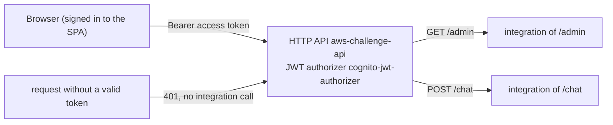

# Design — Protected API (HTTP API + Cognito JWT authorizer)

Status: **Accepted** (2026-11-12, owner), with ADR-004. Amended 2026-11-13 by owner decision: Week 2 = the curriculum
topic only; the API is the one the owner built in the console; the `admin` handler, `/api/me`, `/api/admin/ping` and
the group check moved to Week 3 (see "Moved to Week 3" below).
Requirements: [week-02](../requirements/week-02-authorization.md) W2-G3, S4 ·
Spec: [05-protected-api](../specs/05-protected-api.md)
Architecture: [ARCHITECTURE.md](../ARCHITECTURE.md) §3.3, §5.2, §6, ADR-003, ADR-004, goal G4
Related design: [authentication](authentication.md) (User Pool, SPA)

## Problem Statement

Requests to the functions in the VPC must be accepted only with a valid Cognito token of the project's User Pool and
app client; requests without one must be rejected by API Gateway before any function runs (curriculum Week 2: "HTTP
API Gateway with JWT authorizer"). What the functions return, database access and role checks belong to Week 3
("REST API + data: Admin Lambda ↔ RDS Proxy").

## Proposed Solution

Built by the owner in the console on 2026-11-13 (CLAUDE.md §3.11). Identifiers and exact values live only in
[ENVIRONMENT.md](../ENVIRONMENT.md#http-api-week-2); this table states the design intent.

| Setting | Week 2 (as built) |
|---|---|
| API | HTTP API (ADR-003), stage `$default` |
| Authorizer | JWT; identity source `Authorization` header; issuer = the User Pool; audience = the SPA app client id (matched against `aud` of ID tokens and `client_id` of access tokens, ADR-004) |
| Routes | `GET /admin`, `POST /chat` (no `ANY`: it captures the CORS preflight), both with the JWT authorizer, no scopes; no route without the authorizer, no `$default` route |
| CORS | the Amplify origin only; headers `authorization`, `content-type`; no credentials |
| Integrations | whatever the owner attached; not specified in Week 2 (the request only has to pass the authorizer, spec 05) |

The SPA makes no API call in Week 2 (spec 04); `VITE_API_URL` is set in Amplify Hosting for Week 3. The proof that a
valid token passes is a call from the browser console of the deployed, signed-in SPA (spec 05 AC-05.5).

**Moved to Week 3** (designed again when Week 3 is planned; this list is input, not a design): `lambdas/admin/` in Git
(R-15); routes for real endpoints (`GET /api/me`, admin routes) with the handler's `token_use` check, `admin` group
check (403) and problem+json errors; first administrator in the group `admin`; role line in the SPA; API access log
and handler log lines (S7); Lambda invoke permission scoped by `SourceArn`; stage throttling.

## Alternatives Considered

| Topic | Option | Pros | Cons | Verdict |
|---|---|---|---|---|
| API type | HTTP API + JWT authorizer (ADR-003) | native Cognito JWT validation, cheaper, curriculum wording | no gateway responses (401 body fixed), no request validation | **accepted (ADR-003)** |
| API type | REST API + Cognito authorizer | gateway responses, usage plans, WAF | ~3.5× price, more config | rejected |
| Week 2 scope | A: authorizer at the edge only, routes as built by the owner (`GET /admin`, `POST /chat`; `ANY` replaced 2026-11-13) | matches the curriculum topic; already built; no code | no endpoint contract yet; no `/api` prefix differ from CLAUDE.md §6 | **accepted** (owner, 2026-11-13) |
| Week 2 scope | B: A + `admin` handler with `GET /api/me`, `GET /api/admin/ping`, group check | proves claims and the role in code | Lambda code, packaging and tests before the Week 3 data work; beyond the topic | moved to Week 3 |
| Week 2 scope | C: B + role line in the SPA | visible end-to-end proof | depends on B | moved to Week 3 |
| Proof of a valid token | Browser console `fetch` from the signed-in deployed SPA (status only) | no new code; real token from a real sign-in | manual, evidence is a screenshot | **accepted** |
| Proof of a valid token | `curl` with a token copied out of the browser | scriptable | token handled outside the browser (leak risk in shell history) | alternative |

## API Design

Week 2 defines no endpoint contract. The routes `GET /admin` and `POST /chat` exist only to prove the authorizer:
without a valid token → 401 `{"message":"Unauthorized"}` (fixed HTTP API body, ARCHITECTURE §3.3); with a valid access
token → whatever the integration returns. The `/api` prefix, explicit `METHOD /path` routes, request/response fields
and problem+json errors (CLAUDE.md §6) apply to the endpoints Week 3 defines. No Week 2 route creates or updates data.

## Affected Components

New (built by the owner, T02-03): HTTP API `aws-challenge-api` with the authorizer, two routes, stage and CORS;
Amplify Hosting env var `VITE_API_URL` (unused by Week 2 code). Skill file `http-api-jwt` (T02-03, skills ownership
rule). No Lambda code changes in Week 2.

## Security Considerations

- Authentication at the edge: both routes have the JWT authorizer; signature, `iss`, `exp`, `aud`/`client_id` are
  checked by API Gateway. Neither route is reachable without a token.
- Both token types of the app client pass the authorizer (ADR-004); Week 2 has no handler that rejects ID tokens.
  Acceptable while the integrations return no user data; the Week 3 handler must check `token_use = access`.
- `ANY` routes forward every method to the integration once authorized; the Week 3 handler must reject methods it
  does not serve (or Week 3 replaces them with explicit routes).
- No group-based authorisation exists in Week 2; any confirmed user of the pool passes. Since the owner confirms every
  account manually, the set of users who can reach the integrations is controlled by the owner.
- CORS allows only the Amplify origin; CORS is not an access control (non-browser clients ignore it) — the authorizer
  is.
- No API access log in Week 2: rejected requests are not traceable (S7 moved to Week 3).
- Evidence never contains token values (the console snippet prints only status codes).

## Cost

No always-on resources. HTTP API: per-request pricing (about $1 per million requests in eu-west-1; learning volume
≈ $0). Unchanged Week 1 always-on cost (RDS, Proxy, NAT if any — R-09).

## Open Questions

None blocking. Open points for Week 3 planning (not blockers, not `Q-xx`):
- `/api` prefix and (CLAUDE.md §6) vs the built `GET /admin`, `POST /chat`.
- Which integration `/admin` has (ENVIRONMENT.md records one only for `/chat`).
- CORS for `http://localhost:5173` (local development against the dev API) and a non-zero preflight max age.
- API access log, throttling, invoke permission by `SourceArn` (from the original Week 2 design).
