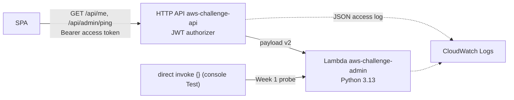

# Design — Protected API (HTTP API + Cognito JWT authorizer)

Status: **Accepted** (2026-11-12, owner), with ADR-004.
Requirements: [week-02](../requirements/week-02-authorization.md) W2-G3, W2-G4, S4, S5, S7 ·
Spec: [05-protected-api](../specs/05-protected-api.md)
Architecture: [ARCHITECTURE.md](../ARCHITECTURE.md) §3.2, §3.3, §5.2, §6, §8, §9, ADR-003, ADR-004, ADR-015,
goals G4, G8
Related design: [authentication](authentication.md) (User Pool, SPA)

## Problem Statement

Signed-in users must reach the Lambda functions in the VPC only with a valid Cognito token; requests without one must
be rejected before any Lambda runs. One route must be restricted to the `admin` group. Today there is no API: the
Week 1 `admin` function is a `SELECT 1` probe written in the AWS console, and its code is not in Git
([R-15](../RISKS.md#2-risk-register)). Database access through the API is Week 3 (curriculum).

## Proposed Solution

All AWS changes are made by the owner in the console from a devops runbook in the task (Q-12 C, CLAUDE.md §3.11).
Code per ADR-015.

**HTTP API** `aws-challenge-api` (ADR-003):

| Setting | Value |
|---|---|
| Stage | `$default`, auto-deploy, throttling as in ARCHITECTURE §3.3 |
| Authorizer | JWT, identity source `$request.header.Authorization`, issuer `https://cognito-idp.<region>.amazonaws.com/<userPoolId>`, audience `[<appClientId>]` |
| Routes | `GET /api/me` → `admin`; `GET /api/admin/ping` → `admin`; both with the JWT authorizer, no scopes. No `ANY`/`$default` route |
| Integration | Lambda proxy, payload format 2.0, unqualified function, timeout 29 s (ARCHITECTURE §3.3) |
| CORS | origins `https://main.<appId>.amplifyapp.com`, `http://localhost:5173`; methods `GET`; headers `authorization`, `content-type`; max age 600 s; no credentials |
| Access log | log group `/aws/apigateway/aws-challenge-api`, retention 14 days, one JSON line: `requestId`, `routeKey`, `status`, `responseLatency`, `integrationError`, `authorizerError`, `sub` (`$context.authorizer.claims.sub`) |
| Invoke permission | `lambda:InvokeFunction` for `apigateway.amazonaws.com`, `SourceArn` = this API's ARN (no wildcard account/API) |

**`admin` function — Python handler (ADR-015).** The current console code is exported by the owner (console:
Actions → Export function → Download deployment package) and copied into the repository under `lambdas/admin/` first, so the probe is preserved and the code is
in Git from now on. The handler dispatches on the event shape:

- event with `requestContext.http` → API request, dispatched on `routeKey`;
- otherwise → the existing Week 1 probe, unchanged (spec 02);
- claims are read only from `requestContext.authorizer.jwt.claims` (never from headers);
- `token_use ≠ access` → 401 problem+json (ADR-004: both token types pass the authorizer);
- `GET /api/me` → 200 with `id`, `username`, `groups`, `expiresAt` from the claims; no database or AWS call;
- `GET /api/admin/ping` → `admin` in `cognito:groups` → 200, else 403 problem+json. HTTP API passes the array claim
  as a string such as `[admin users]`; the handler parses both that form and a JSON array;
- one JSON log line per API request (standard library, ADR-012) with `awsRequestId`, `apiRequestId`
  (`requestContext.requestId`), `userSub`, `routeKey`, `status`, `durationMs`; no token, e-mail or profile values;
- no new third-party dependency; function settings (memory, timeout, VPC, role, env vars) unchanged.

**Configuration of the SPA:** `VITE_API_URL` = the API's invoke URL, set in Amplify Hosting and in the developer's
`.env.local`. Local development calls the dev API directly (CORS allows `http://localhost:5173`); the Vite `/api`
proxy to `:8080` belonged to the deleted Spring backend and is removed by T02-05.

## Alternatives Considered

| Topic | Option | Pros | Cons | Verdict |
|---|---|---|---|---|
| API type | HTTP API + JWT authorizer (ADR-003) | native Cognito JWT validation, cheaper, curriculum wording (G4, Week 2) | no gateway responses (401 body fixed), no request validation | **accepted (ADR-003)** |
| API type | REST API + Cognito authorizer (Week 3 wording, owner's diagram) | gateway responses, usage plans, WAF | ~3.5× price, more config | rejected |
| Admin check | `cognito:groups` checked in the handler | no OAuth scopes needed; works with SRP tokens | authorisation in code — must be unit-tested | **proposed** |
| Admin check | Route scopes (resource server + custom scope) | enforced by API Gateway | custom scopes only in tokens from the OAuth flow (hosted UI), not from SRP sign-in; per-user scopes need a PreTokenGeneration trigger (Essentials plan) | rejected for Week 2 |
| Admin check | Lambda authorizer reading groups | enforced at the edge | one more function and cold start per request | rejected |
| Function for the API | Extend the Week 1 `admin` function (probe kept for direct invokes) | curriculum names Admin Lambda as the API target (Week 3); no new function | two entry shapes in one handler | **proposed** |
| Function for the API | New function `aws-challenge-api` | single responsibility | a fourth function the curriculum does not have | rejected |
| `/api/me` content | Token claims only | no database (Week 3), proves the authorizer and claims path | not the profile | **proposed** (owner decision D5) |
| Local dev | Direct calls to the dev API with CORS for localhost | no local backend exists (ADR-015) | needs the deployed API | **proposed** |
| Local dev | Vite proxy `/api` → dev API URL | no CORS locally | hides CORS problems until deployment | alternative |

## API Design

| Method | Path | Auth | Request | Success | Errors |
|---|---|---|---|---|---|
| GET | `/api/me` | JWT (access token) | no body, no query parameters | 200 `{id, username, groups, expiresAt}` (spec 05 §Outputs) | 401, 500 |
| GET | `/api/admin/ping` | JWT + group `admin` | no body, no query parameters | 200 `{"status":"ok"}` | 401, 403, 500 |

Errors from the handler are RFC 9457 `application/problem+json` (CLAUDE.md §6). 401 produced by the authorizer itself
has the body `{"message":"Unauthorized"}` (ARCHITECTURE §3.3). No Week 2 endpoint creates or updates data.

## Affected Components

New: HTTP API `aws-challenge-api` with authorizer, routes, stage, access log group (T02-03); `lambdas/admin/` in the
repository with the handler and pytest tests (T02-02); skill files `python-lambda` (T02-02) and `http-api-jwt`
(T02-03). Changed: code of `aws-challenge-admin` (settings unchanged); Amplify env var `VITE_API_URL`.

## Security Considerations

- Authentication at the edge: every Week 2 route has the JWT authorizer; signature, `iss`, `exp`, `aud`/`client_id`
  are checked by API Gateway; `token_use` and the group in the handler.
- Claims are trusted only from `requestContext.authorizer.jwt.claims`.
- Least privilege: the `admin` role gets no new permission; the invoke permission is scoped by `SourceArn`.
- The function stays in private subnets; the API is the only public entry point; CORS only for the two origins.
- Logs carry only `sub` (CLAUDE.md §7); `/api/me` returns no personal data beyond the Cognito ids and groups.
- Downloading the console code may pull in a hard-coded value: the backend task checks the code for secrets before
  it is committed (CLAUDE.md §7).

## Cost

No always-on resources. HTTP API: per-request pricing (about $1 per million requests; learning volume ≈ $0).
Lambda and CloudWatch Logs: within the existing usage. The Week 1 always-on cost (RDS, Proxy, NAT if any — R-09) is unchanged. No outbound
AWS call from the function is added, so the missing-NAT question (R-09) does not affect this design.

## Open Questions

None. ADR-004 (access token to the API) Accepted by the owner 2026-11-12.
