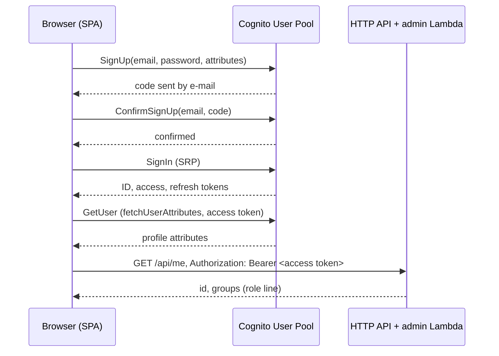

# Design — Authentication (Cognito User Pool + Amplify Auth + SPA screens)

Status: **Draft** — waiting for the owner's acceptance and the answer to Q-14.
Requirements: [week-02](../requirements/week-02-authorization.md) W2-G1, W2-G2, W2-G4 (role), S1–S3 ·
Spec: [04-user-registration-and-sign-in](../specs/04-user-registration-and-sign-in.md)
Architecture: [ARCHITECTURE.md](../ARCHITECTURE.md) §3.1, §3.4, §5.1, ADR-004, ADR-013, ADR-014, goal G3
Related design: [api-gateway-auth](api-gateway-auth.md) (HTTP API, `/api/me`)

## Problem Statement

A visitor must register with eight profile fields (first and last name, e-mail, gender `F`/`M`, date of birth
`DD/MM/YYYY`, country of living, height in cm, weight in kg), confirm the e-mail, sign in and see a read-only
personal page with that data. An administrator role must exist. Today the SPA only has a draft that wraps everything
in the Amplify `Authenticator` with the e-mail field only; it adds ~317 kB of CSS
(T00-04 Notes). No User Pool exists, and its attribute schema cannot be changed after creation. Copying users into
PostgreSQL is Week 3 (curriculum), so this week Cognito is the only store of the profile (ADR-013).

## Proposed Solution

**User Pool** (`awsch-dev-users`; created with recorded AWS CLI commands, Q-12 C):

| Setting | Value |
|---|---|
| Feature plan | Lite (no managed login, no threat protection needed); confirm the plan name and price at creation |
| Sign-in | e-mail is the username attribute (`UsernameAttributes=[email]`), case-insensitive |
| Self sign-up | enabled; verification of `email` by code (`AutoVerifiedAttributes=[email]`) |
| Password policy | Cognito default (ARCHITECTURE §3.4) |
| Attributes | schema and validation rules per [Q-14](../RISKS.md#q-14) (proposed option A); field list in spec 04 §Inputs |
| E-mail sender | Cognito default sender ([R-13](../RISKS.md#2-risk-register)) |
| MFA, social logins, hosted UI | off (out of scope, ARCHITECTURE §1) |
| Deletion protection | on (the schema is immutable; an accidental delete loses every user) |
| Group | `admin` |
| Lambda triggers | none in Week 2 (the sync chain is Week 3) |

**App client** `awsch-dev-spa`: public (no secret); auth flows `ALLOW_USER_SRP_AUTH`, `ALLOW_REFRESH_TOKEN_AUTH`;
prevent user existence errors on; token validity per ARCHITECTURE §3.4; read and write permission on every
registration attribute (write is needed by `SignUp`, read by `fetchUserAttributes`; consequence
[R-12](../RISKS.md#2-risk-register)).

**First administrator:** the owner signs up through the SPA (or `aws cognito-idp sign-up` + `confirm-sign-up` if the
screens are not ready yet), then the devops agent runs `aws cognito-idp admin-add-user-to-group --group-name admin`
with profile `awsch` (T02-03). The group appears in tokens after the next sign-in or token refresh.

**SPA (ADR-014):** own screens on `aws-amplify/auth`; `@aws-amplify/ui-react` removed. No styling beyond semantic
HTML until the design system exists (CLAUDE.md §5).

| Route | Access | Content |
|---|---|---|
| `/` | public | home page (existing) |
| `/sign-up` | anonymous only | form with the 8 fields + password + password confirmation; client-side validation per spec 04 |
| `/confirm` | anonymous only | e-mail (pre-filled) + 6-digit code; "resend code" |
| `/sign-in` | anonymous only | e-mail + password; an unconfirmed user is sent to `/confirm` |
| `/me` | signed in | personal page: the 8 fields from `fetchUserAttributes`, date shown as `DD/MM/YYYY`, role line from `GET /api/me`, read-only |
| other existing routes (`/chat`, `/admin`) | unchanged in Week 2 | — |

- Amplify is configured once at start-up from `VITE_AWS_REGION`, `VITE_COGNITO_USER_POOL_ID`,
  `VITE_COGNITO_USER_POOL_CLIENT_ID`; with empty values auth routes are hidden and the home page still renders
  (spec 01).
- A route guard checks the session (`fetchAuthSession` / `getCurrentUser`); an anonymous visit to `/me` redirects to
  `/sign-in` and back after sign-in. After sign-in the user lands on `/me`.
- The date of birth is entered as `DD/MM/YYYY` and sent to Cognito as `YYYY-MM-DD`; the country is a select of
  ISO 3166-1 alpha-2 codes, names via `Intl.DisplayNames` (no hand-written name list).
- The API client sends the **access** token (ADR-004); `fetchUserAttributes` and `/api/me` are read through
  TanStack Query. The role line is the visible proof of the chain SPA → API Gateway → Lambda.

## Alternatives Considered

| Topic | Option | Pros | Cons | Verdict |
|---|---|---|---|---|
| Auth UI | Own screens on `aws-amplify/auth` (ADR-014) | small bundle; full control of date/country/number fields | more code than the Authenticator | **accepted (ADR-014)** |
| Auth UI | `Authenticator` without its stylesheet | little code | unstyled, custom fields via `formFields`/`services.handleSignUp` workarounds | rejected |
| Auth UI | Cognito managed login (hosted UI) + OAuth code flow | no form code | needs a domain and redirect flow; custom date format impossible | rejected |
| Personal page data | `fetchUserAttributes` (Cognito `GetUser` with the access token) | always current; standard Amplify API; no backend needed | one Cognito call per page load | **proposed** |
| Personal page data | ID token claims (`fetchAuthSession().tokens.idToken.payload`) | no network call | values frozen until the token is refreshed; custom attributes as strings | alternative |
| Personal page data | `GET /api/me` from a PostgreSQL copy | one read path for user and admin | the copy is Week 3 (curriculum) | moved to Week 3 (ADR-013) |
| Role on the personal page | `groups` from `GET /api/me` | exercises the protected API from the SPA | page depends on the API for one line | **proposed** |
| Role on the personal page | `cognito:groups` from the access token in the SPA | no API call | the SPA never calls the API in Week 2 | alternative |
| Server-side field validation | Q-14 A / B / C | — | — | owner decides in Q-14 |
| Country attribute | `custom:country` (ISO alpha-2) | simple, constrained length | custom attribute, immutable | **proposed** |
| Country attribute | standard `address` (JSON `country` field) | standard claim | JSON string, no length constraint | rejected |

## API Design

No HTTP endpoint is defined here (see [api-gateway-auth](api-gateway-auth.md)). Cognito operations used by the SPA
through `aws-amplify/auth`: `signUp`, `confirmSignUp`, `resendSignUpCode`, `signIn`, `signOut`, `fetchAuthSession`,
`getCurrentUser`, `fetchUserAttributes`. Field names, types, ranges and the mapping to Cognito attributes: spec 04
§Inputs. Amplify Hosting environment variables: `VITE_AWS_REGION`, `VITE_COGNITO_USER_POOL_ID`,
`VITE_COGNITO_USER_POOL_CLIENT_ID`, `VITE_API_URL` (public identifiers, no secrets).

## Affected Components

New: Cognito User Pool, app client, group `admin` (T02-01); skill files `cognito-user-pool`, `amplify-auth`,
`spa-api-client`. Changed: `frontend/src` (Amplify config, routes, auth screens, personal page, API client),
`frontend/package.json` (remove `@aws-amplify/ui-react`), `frontend/vite.config.ts` (remove the `/api` proxy to the
deleted local backend), Amplify Hosting environment variables.

## Security Considerations

- Public app client without secret; SRP — the password never leaves the browser in clear.
- Tokens are held by Amplify in browser storage (default `localStorage`): any XSS can read them. Mitigation in Week 2:
  no `dangerouslySetInnerHTML`, no third-party scripts; CSP is a later item.
- Client-side validation is a convenience, not a control; server-side guarantees per Q-14.
- Profile data (name, gender, birth date, country, height, weight) is personal data: it stays in Cognito and the
  browser; the SPA never logs tokens or profile data to the console.
- `admin` membership only via the AWS CLI by the owner; the SPA never decides authorisation (the API does; the role
  line is display only).
- User existence errors are suppressed for sign-in; sign-up still reports an existing e-mail (Cognito behaviour) —
  accepted.
- Deletion protection on the pool.

## Cost

No always-on resources. Cognito Lite: free up to 10 000 monthly active users (AWS pricing page, to be re-checked at
creation); the learning workload stays far below. Default e-mail sender: no charge.

## Open Questions

| ID | Question | Recommendation |
|---|---|---|
| [Q-14](../RISKS.md#q-14) | Attribute schema and validation ranges (immutable) | option A with the table in Q-14 |
| ADR-004 | Access token for the API (Proposed) | accept together with this design |
