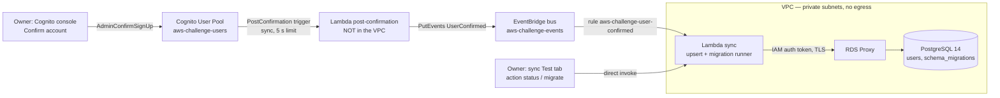

# Design — User data: users table, migrations, database access and the sync chain

Status: **Accepted** (owner, 2026-11-13). Decisions: [Q-16](../RISKS.md#q-16) A, [Q-17](../RISKS.md#q-17) A,
[Q-18](../RISKS.md#q-18) A (owner, 2026-11-13); the proposed solution below is the accepted one.
**Revised 2026-11-16 (owner decisions):** no function `aws-challenge-migrate` — the runner is a module of
`aws-challenge-sync`, dispatched by event shape (ADR-017 revised, Q-16 amended); runtime Python 3.12 for all functions
(ADR-015 revised). Sections §2, §3, §5 and the tables below reflect the revision.
Requirements: [week-03](../requirements/week-03-rest-api-data.md) W3-G1, W3-G5, S1, S2, S5, S8 ·
Specs: [06-users-table-and-migrations](../specs/06-users-table-and-migrations.md),
[07-user-sync](../specs/07-user-sync.md)
Architecture: [ARCHITECTURE.md](../ARCHITECTURE.md) §3.2, §3.5, §7, §8, ADR-006 (revised), ADR-016, ADR-017
(Accepted 2026-11-13), ADR-015, goals G3, G5, G8
Related design: [admin-api](admin-api.md) (reads the table), [backend-foundation](backend-foundation.md) (network,
proxy), [authentication](authentication.md) (attributes, Q-14 C)

## Problem Statement

Week 3 (curriculum: "Sync chain Cognito → EventBridge → Lambda") must copy every user confirmed in Cognito into
PostgreSQL, so that the Admin Lambda can list users from the database. Four things are missing:

1. **Schema and migrations.** No table exists; Q-16 is open; the database is private (reachable only from the VPC
   through RDS Proxy) and there is no host in the VPC to run a migration tool from.
2. **Event source.** Cognito has no native EventBridge event for "user confirmed"; the curriculum requires
   EventBridge (ADR-011 rejected). In this project the owner confirms users in the console (`AdminConfirmSignUp`).
3. **Credentials and network (R-09).** The private subnets have no NAT gateway and no interface endpoint shown, so a
   VPC Lambda cannot call Secrets Manager, Cognito or EventBridge. How the Week 1 probe reached its password is not
   known (Q-18 F1–F2).
4. **Dirty input.** Registration values are validated only in the SPA (Q-14 C); Cognito stores whatever a direct
   `SignUp` call sends, so the copy must tolerate missing, unparsable and out-of-range values (R-11, R-12).

## Proposed Solution

### 1. Database access (Q-18 option A → ADR-006 revision)

- **IAM authentication to RDS Proxy.** Each VPC function builds a 15-minute auth token with
  `boto3.client("rds").generate_db_auth_token(host, 5432, user)` — a local SigV4 signature, **no network call** — and
  connects to the proxy endpoint with `pg8000` over TLS (certificate verified, never plain text). The proxy keeps its
  Secrets Manager secret towards RDS; no function reads a secret.
- Proxy setting changed by the owner: IAM authentication **required** for the registered secret's user. Password
  logins to the proxy stop; the Week 1 probe is replaced by the Week 3 `admin` code (T03-07).
- Role permission per VPC function: `rds-db:connect` on
  `arn:aws:rds-db:eu-west-1:<account>:dbuser:<proxy resource id>/<db user>` only, plus
  `AWSLambdaVPCAccessExecutionRole`. `secretsmanager:GetSecretValue` is removed from `admin` and `sync`.
- DB user: the one registered with the proxy (master user as built) — accepted for Week 3 as [R-16](../RISKS.md#2-risk-register).
- The as-built facts (proxy resource id, DB user, `DB_NAME`, subnets/security group, current function settings —
  F1–F5) are read and reported by the owner in step 1 of the T03-03 runbook and recorded in ENVIRONMENT.md; they fill
  in values, they do not change this design.
- Environment variables (names only; values in ENVIRONMENT.md): `DB_PROXY_ENDPOINT`, `DB_NAME`, `DB_USER`.
  `DB_SECRET_ARN` is removed. One connection per invocation, opened lazily, closed in `finally` (ARCHITECTURE §3.5).
- Result: **no VPC function needs egress in Week 3** (the event carries the attributes, see 3). Bedrock (Week 4)
  decides NAT vs endpoint then.

### 2. Users table and migrations (Q-16 option A → ADR-017)

- Migration files `lambdas/sync/migrations/V<n>__<description>.sql` (Flyway naming); applied by the runner module
  `lambdas/sync/migrator.py` inside the existing function `aws-challenge-sync` (Python 3.12, VPC, private subnets + the
  Lambda security groups as built in ENVIRONMENT.md, timeout **60 s**), which the owner invokes from the console Test
  tab with `{"action":"migrate"}` (or `{"action":"status"}`). No separate migrate function (owner, 2026-11-16).
- **Dispatch** in the sync handler (contract: spec 06 §Inputs): event with a top-level `action` key → runner;
  EventBridge event with `source` `aws-challenge.cognito` and `detail-type` `UserConfirmed` → upsert (§3); anything
  else → function error `UNSUPPORTED_EVENT`, no DB connection. An EventBridge envelope never has a top-level `action`,
  and the rule only matches `UserConfirmed`, so EventBridge cannot start a migration.
- Runner rules: files sorted by version; versions must be 1..n without gaps or duplicates; each pending file runs in
  **one transaction** together with its row in `schema_migrations` (version, description, SHA-256 checksum,
  applied_at); a transaction-level advisory lock (`pg_try_advisory_xact_lock`) stops parallel runs; a changed
  checksum of an applied file stops the run before anything is applied. No down-migrations (fix forward).
- `V1__create_users.sql` creates `users`; column list, types and rules: [spec 06](../specs/06-users-table-and-migrations.md)
  §Outputs (single home). Key = Cognito `sub` (`uuid`); typed nullable columns for every registration field (so
  Week 4/5 can query them); **no CHECK constraints** on the registration values (the copy mirrors Cognito, Q-14 C);
  no `embedding` column (Week 4, Q-15).
- PostgreSQL 14 syntax only (R-14); `docker-compose.yml` moves to a PostgreSQL 14 image for the optional local
  migration test.

### 3. Sync chain (Q-17 option A → ADR-016)

| Part | Setting |
|---|---|
| Trigger function | `aws-challenge-post-confirmation`, Python 3.12, **not in a VPC**, memory 256 MB, timeout 5 s; code `lambdas/post-confirmation/` |
| Cognito | PostConfirmation trigger of `aws-challenge-users` = that function (console adds the invoke permission scoped to the pool) |
| Trigger behaviour | only `PostConfirmation_ConfirmSignUp`: one `PutEvents` entry, source `aws-challenge.cognito`, detail-type `UserConfirmed`, detail = pool id, `sub`, `email`, the seven registration attributes as raw strings (allow-list; no `email_verified`, status or other attributes), `confirmedAt`; returns the Cognito event unchanged. **Never raises**: a failed `PutEvents` is logged (`outcome=publish_failed`, `userSub`) and the confirmation still succeeds (re-sync runbook, R-11). Other trigger sources are returned untouched |
| Trigger role | `events:PutEvents` on the bus ARN only + basic logging |
| Bus | custom bus `aws-challenge-events`; no archive, no replay (personal data not retained) |
| Rule | `aws-challenge-user-confirmed`, pattern `{"source":["aws-challenge.cognito"],"detail-type":["UserConfirmed"]}`, target `aws-challenge-sync`; retry policy: max event age 1 h, 5 retries |
| Sync function | `aws-challenge-sync` (exists, VPC), Python 3.12, timeout 60 s (migration runner, §2; the upsert path is bounded by the 10 s DB socket timeout); code `lambdas/sync/`; async invoke config: 2 retries (default) |
| Sync behaviour | validates the envelope (`sub` is a UUID, `email` present) — invalid → `outcome=rejected`, no write, no error (a retry cannot fix it); parses each attribute (unparsable → NULL, field **name** logged); **one idempotent upsert** `INSERT … ON CONFLICT (id) DO UPDATE` (all registration columns and `updated_at` overwritten, `created_at` kept); database error → raise (Lambda async retry) |
| Re-sync / back-fill | owner runbook: EventBridge console → *Event buses* → `aws-challenge-events` → *Send events* with the same source, detail-type and a detail built from the user's Cognito attributes (spec 07 §Inputs). Used for users confirmed before the trigger existed and after a failure |

Event detail fields, parsing rules and log fields: [spec 07](../specs/07-user-sync.md) (single home).

Attribute changes after confirmation (`UpdateUserAttributes`) are **not** synced: Cognito has no trigger for them;
the SPA has no edit feature; drift is accepted ([R-12](../RISKS.md#2-risk-register)).

### 4. Logging (W3-G5, S8; ADR-012 unchanged)

Until Week 6 (Powertools) every function prints **one JSON line per invocation** with the standard library:
`level`, `message`, `function`, `awsRequestId`, `userSub` (where known), `outcome`, `durationMs`, `errorClass`
(on failure), plus function-specific fields from the specs. Never: tokens, passwords, the auth token, e-mail, names,
birth date or any attribute **value** (field names only). Log groups `/aws/lambda/<function>`, retention 14 days.

### 5. Code layout and packaging (ADR-015)

`lambdas/<function>/lambda_function.py` (handler `lambda_function.lambda_handler`), pinned `requirements.txt`
(`pg8000` and its pure-Python dependencies; `boto3` from the runtime), `tests/` with pytest and test doubles for
`boto3` and the database. The small DB helper (IAM token + TLS connect) is shared by `admin` and `sync`:
one source file `lambdas/shared/db.py`, copied into each zip by the packaging script (no Lambda layer). The script,
test commands and conventions are the `python-lambda` skill (created by T03-02). Zips are uploaded by the owner
(Lambda console → *Upload from .zip file*); no console code edits afterwards (R-15).

## Alternatives Considered

| Topic | Option | Pros | Cons | Verdict |
|---|---|---|---|---|
| Event source (Q-17) | A: PostConfirmation trigger → `PutEvents` → custom bus → rule → Sync | data in the event; no egress for Sync; ~100 ms | extra function; PII in the event | **recommended** |
| Event source (Q-17) | B: CloudTrail trail → default bus rule on `AdminConfirmSignUp` → Sync + `AdminGetUser` | no trigger code | trail needed (docs: required for "via CloudTrail" events); minutes of delay; Sync needs Cognito API → NAT/endpoint cost | rejected |
| Event source (Q-17) | C: trigger → SQS → Pipes → Sync | durable buffer | more parts, bus without a rule | rejected |
| Event source | Trigger invokes Sync directly (ADR-011) | simplest | no EventBridge (curriculum) | rejected 2026-11-12 |
| Trigger in the VPC | trigger as a VPC function | one network zone | needs egress for `PutEvents` (NAT/endpoint) and ENI cold start against the 5 s limit (R-02) | rejected |
| Trigger failure | raise → confirmation fails | no silent gap | owner's *Confirm account* fails on an EventBridge hiccup; state after a failed post-confirmation trigger is not documented clearly (re-check) | rejected; log + re-sync instead |
| Credentials (Q-18) | A: IAM auth to RDS Proxy | $0, no secret in code | proxy change; one DB user (R-16) | **recommended** |
| Credentials (Q-18) | B: Secrets Manager interface endpoint | ADR-006 as written | ≈ $8–16/month always on | alternative |
| Credentials (Q-18) | C: NAT gateway | covers Bedrock later | ≈ $39/month + data; internet egress | alternative |
| Migrations (Q-16) | A: SQL files + runner in a separate `migrate` Lambda | no tool, Flyway naming, $0; DDL isolated in its own function | own runner code; a function, role and log group beyond the curriculum | accepted 2026-11-13; **replaced by A′** (owner, 2026-11-16) |
| Migrations (Q-16) | A′: same runner as a module of `sync`, direct invoke `{"action":…}` | no extra function, role or log group; `sync` already has VPC + `rds-db:connect` | sync timeout 60 s; dispatch code in the event handler; migrations ship with every sync zip (applied only on invoke) | **chosen** (owner, 2026-11-16) |
| Migrations (Q-16) | B: runner as a direct-invoke action of `admin` | no new function | DDL path in the API-facing function | rejected |
| Migrations (Q-16) | C/D: Flyway from CloudShell; Alembic | standard tools | no egress for downloads; heavy dependency | rejected |
| Value tolerance | typed nullable columns; unparsable → NULL, out-of-range stored | queryable types for Week 4/5; never loses the row | an unparsable value is lost from the copy (still in Cognito) | **recommended** |
| Value tolerance | all columns `text` (raw copy) | lossless | every consumer parses; Week 5 NL→SQL on strings | rejected |
| Value tolerance | CHECK constraints with the SPA ranges | clean data | the upsert fails for a directly signed-up user → row missing (R-11) | rejected |
| Shared DB helper | `lambdas/shared/db.py` copied into each zip | one source | packaging step | **recommended** |
| Shared DB helper | Lambda layer | standard | layer versions to manage by runbook | rejected |
| Shared DB helper | copy per function | trivial packaging | duplicated code | rejected |

## API Design

No HTTP endpoint (the users list is in [admin-api](admin-api.md)). Contracts:

| Interface | Contract (single home) |
|---|---|
| EventBridge event `aws-challenge.cognito` / `UserConfirmed` | [spec 07](../specs/07-user-sync.md) §Inputs |
| `aws-challenge-post-confirmation` (Cognito PostConfirmation event in → same event out) | spec 07 §Behaviour |
| `aws-challenge-sync` direct invoke `{"action":"migrate"\|"status"}` → result; event dispatch | [spec 06](../specs/06-users-table-and-migrations.md) §Inputs/§Outputs |
| Table `users`, table `schema_migrations` | spec 06 §Outputs |

## Affected Components

- **New AWS resources (owner, runbooks):** function `aws-challenge-post-confirmation` (no VPC) with its role;
  EventBridge bus `aws-challenge-events` and rule `aws-challenge-user-confirmed`; PostConfirmation trigger on the pool.
- **Changed AWS resources:** RDS Proxy (IAM authentication required, Require TLS); `aws-challenge-sync` (runtime stays
  3.12, code from Git, env vars, role: `rds-db:connect` instead of any Secrets Manager permission, timeout 60 s); log
  retention 14 days.
- **Repository:** `lambdas/shared/`, `lambdas/sync/` (dispatcher, runner module `migrator.py`,
  `migrations/V1__create_users.sql`, upsert), `lambdas/post-confirmation/`, packaging script, `docker-compose.yml`
  (PostgreSQL 14).
- **Skills (skills ownership rule):** `python-lambda` (new, T03-02), `postgres-migrations` (new, T03-02),
  `user-sync` (new, T03-04), `cognito-user-pool` (trigger section, T03-05).
- **Docs:** ENVIRONMENT.md (new identifiers), ARCHITECTURE §3.2/§3.5/§7, ADR-006/016/017.
- **CLAUDE.md** §1, §4 (functions `migrate`, `post-confirmation`) and §9 (local PostgreSQL major 14) updated on
  acceptance with the owner's approval (2026-11-13); §1, §4, §7, §8 to be updated for the 2026-11-16 revision (no
  `migrate`, Python 3.12) — owner edit.

## Security Considerations

- **No secret in any function:** IAM tokens are short-lived (15 min) and never logged; TLS to the proxy is required
  and verified.
- **Least privilege:** one role per function; `rds-db:connect` on one `dbuser` ARN; `events:PutEvents` on one bus
  ARN; Cognito may invoke the trigger only for this pool (`SourceArn`); EventBridge may invoke Sync only for this
  rule. Shared DB user across functions is accepted risk R-16.
- **Personal data in transit:** the `UserConfirmed` event contains e-mail and profile values. The custom bus is
  account-private (default bus policy), encrypted at rest by AWS; no archive, no replay, no other targets; the
  events are not logged (EventBridge rule logging off).
- **Logs:** attribute values never logged — only `userSub`, field names and outcomes (CLAUDE.md §7).
- **SQL:** parameterised upsert; migrations are repository files only, applied by an explicit owner invoke.
- **Migration entry point in `sync`:** only principals allowed to invoke the function reach the runner — the owner's
  console session and EventBridge (resource policy scoped to the rule's `SourceArn`); EventBridge delivers only
  `UserConfirmed` envelopes, which the dispatcher never routes to the runner (no top-level `action`). An unknown event
  shape → `UNSUPPORTED_EVENT` without a DB connection.
- **Dirty input:** a value from a direct `SignUp` call is stored typed or NULL, never interpolated; the admin table
  renders it as text (React escapes it).
- **Trigger safety:** the trigger cannot block or alter a confirmation (returns the event unchanged).
- **No egress:** the VPC functions keep no route to the internet (unchanged).

## Cost

No new always-on resource with the recommended options. EventBridge custom events about $1.00 per million, Lambda
and CloudWatch Logs within the learning volume ≈ $0. Alternatives with always-on cost (Q-18, eu-west-1, re-check):
Secrets Manager interface endpoint ≈ $8 per AZ-month; NAT gateway ≈ $35 + ≈ $3.6 public IPv4 per month + data.
Unchanged Week 1 always-on cost: [backend-foundation](backend-foundation.md) §Cost.

## Open Questions

None open. Answered by the owner on 2026-11-13:

| ID | Question | Decision |
|---|---|---|
| [Q-16](../RISKS.md#q-16) | Migration approach | A — SQL files + runner (ADR-017); amended 2026-11-16: runner inside `aws-challenge-sync` (A′) |
| [Q-17](../RISKS.md#q-17) | Sync chain wiring | A — PostConfirmation trigger → custom bus → rule → Sync (ADR-016) |
| [Q-18](../RISKS.md#q-18) | DB credentials / network path | A — IAM auth to RDS Proxy, no egress (ADR-006 revised); facts F1–F5 in T03-03 step 1 |

To re-check during the tasks (not blockers): the console *Confirm account* calls `AdminConfirmSignUp` and fires the
trigger (AC-07.3 proves it); RDS Proxy IAM-auth console wording; `pg8000` call that runs a multi-statement SQL file
(simple-query protocol).
