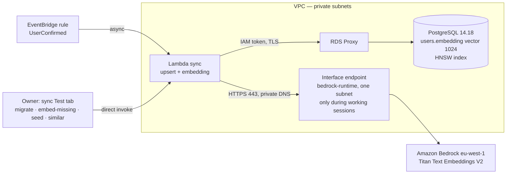

# Design — Data vectorisation: pgvector, embeddings from Bedrock in the Sync Lambda, similarity check

Status: **Accepted** (owner, 2026-11-18). Drafted 2026-11-17; on acceptance the owner answered
[Q-15](../RISKS.md#q-15) (Titan Text Embeddings V2, 1024 — ADR-019) and [Q-20](../RISKS.md#q-20) (`bedrock-runtime`
interface endpoint created on demand, no raise on Bedrock failure — ADR-020), with the priority "as cheap as
possible".
Requirements: [week-04](../requirements/week-04-vectorisation.md) W4-G1…W4-G3, S1…S4 ·
Specs: [10-embeddings](../specs/10-embeddings.md), [11-similarity-check](../specs/11-similarity-check.md)
Architecture: [ARCHITECTURE.md](../ARCHITECTURE.md) §2 (deviations), §3.5, §3.6, §7, ADR-017 (migrations), ADR-019,
ADR-020, goals G6, G7
Related design: [user-sync](user-sync.md) (the upsert and the runner this feature extends),
[backend-foundation](backend-foundation.md) (network, cost)

## Problem Statement

Week 4 asks for: the pgvector extension (W4-G1, S1), 1536-dimensional vectors of the users' text fields computed with
Amazon Bedrock by the Sync Lambda on insert/update and stored in `users.embedding` (W4-G2, S2), an `ivfflat` or
`hnsw` index (S3), the example query `ORDER BY embedding <-> $1 LIMIT 5` (W4-G3) and its latency on 1000 records
(S4). Five facts make this more than a column:

1. **Model vs dimension.** The curriculum names "Titan Embeddings or Claude 3.5 Sonnet" and 1536 dimensions. Claude
   models do not produce embeddings (text generation only), so Claude is not an option. The only 1536-dimension Titan
   model, *Titan Embeddings G1 – Text* (`amazon.titan-embed-text-v1`), is **not offered in eu-west-1** (Bedrock
   regional availability, checked 2026-11-17: us-east-1, us-west-2, eu-central-1, ap-northeast-1; in-region only, no
   cross-region inference). *Titan Text Embeddings V2* is in eu-west-1 and outputs 256/512/1024. *Cohere Embed v4*
   is in eu-west-1 and outputs up to 1536, but is a third-party Marketplace model. → decided by the owner: Titan V2,
   1024 (§1).
2. **No egress.** `aws-challenge-sync` runs in the private subnets with no NAT and only an S3 gateway endpoint
   ([R-09](../RISKS.md#2-risk-register)); a Bedrock call from it times out today. → decided: interface endpoint on
   demand (§2).
3. **Extension rights.** `CREATE EXTENSION vector` (the extension is called `vector`; the curriculum writes
   `pgvector`) needs `rds_superuser`; the proxy's DB user is the master `postgres`, which has it. RDS PostgreSQL
   14.18 ships pgvector **0.8.0** (RDS extension table, checked 2026-11-17): `vector(1024)`, HNSW (≥ 0.5.0) and
   IVFFlat are available.
4. **Existing rows.** The users already in the table (and every future row whose Bedrock call failed, e.g. while the
   endpoint is absent) have no vector.
5. **1000 records.** The table holds a handful of real users; the owner decided (T03-05 Notes, 2026-11-17) that Week
   4 seeds its 1000 rows by script. The database is reachable only from the VPC, so the "script" must run in a VPC
   function — and only `admin`, `chatbot`, `sync` (+ trigger) may exist (ADR-015).

## Proposed Solution

### 1. Model and vector settings (ADR-019, Accepted)

| Setting | Value |
|---|---|
| Model | Amazon Titan Text Embeddings V2 on Bedrock, eu-west-1, in-region (`bedrock-runtime` `InvokeModel`); model id `amazon.titan-embed-text-v2:0` (confirmed in the owner's console by T04-01); Amazon model, no Marketplace subscription |
| Request | one text per call: `{"inputText": <text>, "dimensions": 1024, "normalize": true, "embeddingTypes": ["float"]}` |
| Column | `users.embedding vector(1024)`, nullable |
| Normalisation | the model returns unit-length vectors (`normalize` true); the handler checks length and rescales defensively, so L2 distance (`<->`, the curriculum's operator) ranks exactly like cosine distance |
| Index | `CREATE INDEX users_embedding_hnsw_idx ON users USING hnsw (embedding vector_l2_ops)` with the pgvector defaults (`m` 16, `ef_construction` 64) |
| Query | the curriculum's `ORDER BY embedding <-> $1 LIMIT 5` |

**Deviation from W4-G2:** the curriculum asks for 1536 dimensions; this design stores **1024**. Reason (owner,
2026-11-18): G7 names Titan Text Embeddings; the only 1536-dim Titan model is not offered in eu-west-1 and would need a
NAT gateway plus a cross-region call (≈ $39/month); Titan V2 is the cheapest in-region option. The dimension has no
effect on the rest of the week (index, query, latency check). 1024 is the value ADR-007 originally proposed.

HNSW over IVFFlat: HNSW can be built on an empty table and needs no `lists` tuning; an IVFFlat index built before
the data exists has poor recall (its centroids come from the rows present at build time) and would have to be
rebuilt after the seed. The ops class must match the operator: `vector_l2_ops` serves `<->` only.

### 2. Network path to Bedrock (ADR-020, Accepted — on demand)

One **interface VPC endpoint** `com.amazonaws.eu-west-1.bedrock-runtime` named `aws-challenge-vpce-bedrock-runtime`,
in **one** private subnet (`…private1-eu-west-1a`), **private DNS on** (the VPC has DNS resolution and hostnames
enabled, so boto3's default endpoint resolves to the endpoint's private IP — no code change, no endpoint URL in
configuration), security group `aws-challenge-vpce-sg` with inbound TCP 443 from the Lambda default security group
only (ids: ENVIRONMENT.md §Compute), endpoint policy *Full access* (the function role is the limit). A Lambda ENI in
`eu-west-1b` reaches the endpoint across AZs inside the VPC.

**On demand:** the security group, the IAM permission and the model access are permanent (free); the endpoint itself
is **created by the owner at the start of a working session that needs Bedrock and deleted at its end** (create and
delete procedures in the T04-01 runbook). While it is absent, private DNS is gone, the Bedrock host name resolves to
public addresses that the private subnets cannot reach, and the call fails at connect time (§4). Week 5's `chatbot`
(same subnets and security groups) can use the same endpoint for `InvokeModel`; Bedrock Agent needs a second endpoint
(`bedrock-agent-runtime`) — decided when Week 5 is planned.

### 3. Embedding text

"Text fields" is read as a short, deterministic **profile description without e-mail and names**, built from the
row's mapped values in this order, missing values left out:

`gender: <gender>; birth year: <YYYY>; country: <country>; height: <n> cm; weight: <n> kg`

- E-mail and names are excluded: they identify a person but say nothing about the profile, so "similar users"
  (Week 5) would match on names; leaving them out also keeps the most identifying data out of the vector.
- Birth **year**, not age: the text and the vector do not go stale as time passes.
- A row with none of the five values gets no embedding (`embedding` stays NULL, outcome `skipped`).
- The template lives once in code and once in spec 10 §Inputs; changing it means re-embedding (`embed-missing`
  after a NULL reset is a later task, not this week).

### 4. Where the vector is computed, failure behaviour

- **Insert/update (S2):** the `UserConfirmed` path of `sync` (spec 07) builds the text from the mapped values, calls
  Bedrock **before** opening the DB connection (no idle connection during the call), then runs the existing upsert
  with one more column `embedding` (`CAST(:embedding AS vector)`, value the text form `[x1,…,x1024]`; NULL when
  skipped or failed). The upsert overwrites `embedding` on conflict (a re-sync recomputes it; a failed re-sync sets
  NULL, so a stale vector never survives a profile change, and `embed-missing` refills it).
- **Bedrock failure** (endpoint absent, throttling, access denied, timeout, wrong dimension): the row is still
  upserted with `embedding` NULL (the copy is never lost to Bedrock), the log line records `embedding: "failed"` and
  `errorClass`, and the function **returns normally — no raise**. Rows that stay NULL are filled by `embed-missing`
  in the next session. Raising would make Lambda retry the async event twice (with back-off delays), and every retry
  would fail the same way while the endpoint is off — time, log noise, no benefit.
- **Fail fast:** Bedrock client created lazily once per environment with `connect_timeout` **2 s**, `read_timeout`
  5 s and `retries` `{"mode": "standard", "total_max_attempts": 1}` (no retry). With the endpoint absent the call
  ends at the connect timeout (expected 2–6 s, depending on how many addresses the public name resolves to), far
  below the 60 s sync timeout.

### 5. Owner actions on the sync Test tab (spec 06 dispatch extended; no new function, route or resource)

| Event | Effect | Needs the endpoint | Spec |
|---|---|---|---|
| `{"action":"migrate"}` / `{"action":"status"}` | unchanged (V2 applied by `migrate`) | no | 06 |
| `{"action":"embed-missing"}` | embeds rows with `embedding IS NULL` one by one (one Titan call each) until none is left, the function's remaining time drops below 10 s, or Bedrock fails with a non-row error (the run stops at the first such error — with the endpoint absent this costs one connect timeout); returns `{"embedded","skipped","failed","remaining","stopped"}`; the owner repeats until `remaining` is 0 — back-fill of existing users and of seeded rows | yes | 10 |
| `{"action":"seed","count":N}` | inserts synthetic users up to N in total (1…1000), deterministic (fixed generator seed, ids `uuid5`, e-mail `seed-0001@seed.invalid` …), `ON CONFLICT DO NOTHING`, **without** vectors (then `embed-missing`), returns `{"inserted":n,"seeded":total}` | no | 11 |
| `{"action":"similar","userId":"<uuid>"}` | the curriculum query with that user's stored vector as `$1`: top-5 `id` + `distance`, plus `EXPLAIN (ANALYZE, FORMAT JSON)` of the query twice — with the planner's default and with `SET LOCAL enable_seqscan = off` — reporting the scan node and execution time of each (proves the HNSW index and gives the S4 latency even if the planner prefers a sequential scan on 1000 rows) | no | 11 |

The dispatcher sends these three actions to a new module (`vectors.py`); every other `action` still goes to the
migration runner (so unknown actions keep `MIGRATION_BAD_REQUEST`); `UserConfirmed` and `UNSUPPORTED_EVENT` are
unchanged. Seeding and the check are owner-invoked only (EventBridge never sends a top-level `action`).

With one call per row, 1000 rows take roughly 1–3 minutes of Bedrock time, i.e. a few `embed-missing` runs of ≤ 50 s
each (sequential; no thread pool — simpler, and well inside the default Bedrock request quota).

Synthetic users are kept after the check (Week 5's "users similar to …" needs a populated table); they are visible in
the admin table and identified by the `seed.invalid` e-mail domain ([R-17](../RISKS.md#2-risk-register)).

### 6. Migration `V2__add_users_embedding.sql`

`CREATE EXTENSION IF NOT EXISTS vector;` · `ALTER TABLE users ADD COLUMN embedding vector(1024);` · the HNSW index of
§1. PostgreSQL 14 syntax; runs in the runner's single transaction (all three statements are transactional);
applied by the owner's `{"action":"migrate"}` (no endpoint needed). The local image `pgvector/pgvector:0.8.7-pg14`
covers the integration test (RDS has 0.8.0; no 0.8.1+ feature is used).

### 7. Logging

The sync upsert line gains `embedding` (`stored` / `skipped` / `failed`), `bedrockMs`, and on failure `errorClass`;
the action lines carry counts and timings. Never the embedding text, the vector or any attribute value
(CLAUDE.md §7). `similar` logs only counts and timings, not the result ids.

## Alternatives Considered

| Topic | Option | Pros | Cons | Verdict |
|---|---|---|---|---|
| Model (Q-15) | c: Titan Text Embeddings V2, 1024, eu-west-1 | Titan as named by G7; in-region (endpoint works); cheapest ($0.02 per 1 M tokens); no Marketplace | deviates from W4-G2 (1536); one text per call | **chosen** (owner, 2026-11-18) |
| Model (Q-15) | a: Cohere Embed v4, 1536, eu-west-1 | meets 1536; in-region; 96 texts per call | not Titan; third-party model (Marketplace subscription); ≈ 6× the token price | rejected |
| Model (Q-15) | b: Titan Embeddings G1 – Text, 1536, eu-central-1 | model and dimension exactly as named | cross-region call, only a NAT gateway reaches it (≈ $39/month) | rejected (cost) |
| Model | Claude 3.5 Sonnet | named by the curriculum | not an embedding model | rejected |
| Network (Q-20) | A on demand: `bedrock-runtime` interface endpoint, one subnet, created per working session | cents per month; private; no route to the internet; reusable by `chatbot` | owner creates/deletes it each session; rows confirmed in between get their vector late (R-18) | **chosen** (owner, 2026-11-18) |
| Network (Q-20) | A always on | vectors always immediate; no session routine | ≈ $8/month | rejected (cost) |
| Network (Q-20) | B: NAT gateway | any region and service (also Week 5 Agent) | ≈ $39/month + data; internet egress from the private subnets | rejected (cost) |
| Network (Q-20) | C: embedding in `post-confirmation` (outside the VPC), vector in the event | $0 | contradicts S2 (Sync Lambda calls Bedrock); a Bedrock call inside Cognito's 5 s limit (R-02); back-fill/seed still need Bedrock from `sync` | rejected |
| Network | `sync` outside the VPC | free egress | RDS Proxy is reachable only inside the VPC | impossible |
| Index | HNSW, `vector_l2_ops` | buildable on an empty table; good recall; matches `<->` | slower build, more memory (irrelevant at 1000 rows) | **chosen** |
| Index | IVFFlat | faster build | needs data before building, `lists`/`probes` tuning; rebuild after the seed | rejected |
| Distance | L2 on unit-normalised vectors | curriculum operator; ranking = cosine | — (Titan normalises) | **chosen** |
| Distance | cosine `<=>` with `vector_cosine_ops` | usual for text | not the curriculum's query | rejected |
| Text | profile description without e-mail and names | meaningful "similar users"; least identifying | names not searchable by meaning | **chosen** |
| Text | text columns only (names, gender, country) | literal "text fields" | similarity driven by names; height/age ignored | alternative |
| Text | all fields incl. names | most information | name dominates; more personal data in the vector | rejected |
| Bedrock failure | upsert with NULL, log `failed`, **no raise**, fail fast (1 attempt, 2 s connect); `embed-missing` later | row never lost; invocation ends in seconds; no useless retries while the endpoint is off | no automatic retry — repair is the owner's `embed-missing` | **chosen** (owner, 2026-11-18) |
| Bedrock failure | upsert with NULL, then raise (async retry, 2 retries) | automatic retry of transient errors | every retry fails while the endpoint is off; retry delays and error noise | rejected |
| Bedrock failure | raise before the upsert | — | Bedrock outage loses the copy | rejected |
| 1000 records | `seed` action in `sync` (synthetic profiles, real embeddings) | no new function; realistic vectors for Week 5 | synthetic rows in the admin table (R-17) | **chosen** |
| 1000 records | migration with synthetic data | one invoke | test data in schema history, checksummed forever | rejected |
| 1000 records | random vectors only | no Bedrock | meaningless for Week 5 TOP-5 | rejected |
| Latency check | `similar` action with `EXPLAIN ANALYZE` (default plan + forced index) | proves index use and latency in one Test-tab click | small extra code | **chosen** |
| Latency check | owner runs SQL by hand | no code | no SQL client can reach the private DB | impossible |

## API Design

No HTTP endpoint (ADR-018; `POST /chat` gets its contract in Week 5). Contracts:

| Interface | Contract (single home) |
|---|---|
| Dispatch of `aws-challenge-sync` (new actions) | [spec 06](../specs/06-users-table-and-migrations.md) §Inputs |
| Column `users.embedding`, index | spec 06 §Outputs (column list) |
| Embedding on upsert, Bedrock request, text template, `embed-missing`, failure behaviour, log fields | [spec 10](../specs/10-embeddings.md) |
| `seed`, `similar`, latency evidence | [spec 11](../specs/11-similarity-check.md) |

## Affected Components

- **New AWS resources (owner, runbook T04-01):** security group `aws-challenge-vpce-sg` (permanent); interface
  endpoint `aws-challenge-vpce-bedrock-runtime` (on demand, per session); Bedrock model access check for Titan V2.
- **Changed AWS resources:** `aws-challenge-sync` — new code (zip from Git), inline policy `bedrock:InvokeModel` on
  the model ARN; no change of timeout, memory, env or VPC. Database: extension `vector`, column, index (migration V2).
- **Repository:** `lambdas/sync/` (`embeddings.py` Bedrock client + text template, `vectors.py` actions, `user_sync.py`
  upsert, dispatcher, `migrations/V2__add_users_embedding.sql`, tests). No new dependency (`boto3` `bedrock-runtime`
  is in the Lambda Python 3.12 runtime; the backend checks the runtime's boto3 version in the AWS docs and the local
  `requirements-dev.txt` pin supports `bedrock-runtime`).
- **Skills (ownership rule):** new `bedrock-embeddings` (model, request, normalisation, client config, failure
  behaviour, IAM, on-demand endpoint); `postgres-migrations` (V2, `vector` extension rights), `user-sync` (embedding
  in the upsert), `python-lambda` (layout).
- **Docs:** spec 06 (dispatch, column), spec 07 (note), ENVIRONMENT.md (SG, policy, endpoint procedure), ARCHITECTURE
  §2, §3.5, §3.6, §7, §12, ADR-019/020.

## Security Considerations

- **Least privilege:** the sync role gets `bedrock:InvokeModel` on the one foundation-model ARN
  `arn:aws:bedrock:eu-west-1::foundation-model/amazon.titan-embed-text-v2:0`; no `bedrock:*`, no other function gets
  Bedrock rights in Week 4.
- **No public exposure:** the endpoint has no public address; its security group admits TCP 443 only from the Lambda
  security group; the private subnets keep no route to the internet (no NAT, also while the endpoint is absent).
- **Personal data:** the embedding text (gender, birth year, country, height, weight — no e-mail, no names) is sent to
  Bedrock in eu-west-1 over TLS through the endpoint; Bedrock does not store prompts or use them for training (AWS
  Bedrock data protection; re-check wording). Neither text nor vector is logged.
- **Synthetic data:** seeded rows use `*.invalid` e-mail addresses and fictitious values (no real person).
- **SQL:** vectors passed as parameters (`CAST(:embedding AS vector)`), never formatted into SQL; `similar` validates
  `userId` as a UUID; `SET LOCAL` only inside its own transaction.
- **Entry points:** the new actions are reachable only by a direct invoke (owner's console session); EventBridge
  cannot reach them (no top-level `action`).

## Cost

eu-west-1, re-check on the AWS pricing pages before executing:

| Item | Cost |
|---|---|
| Interface endpoint, one AZ, **on demand** (ADR-020): ≈ $0.011/h while it exists (+ $0.01/GB, negligible) | ≈ $0.03 per 3-hour session; a few sessions ≈ **< $0.50/month** |
| Same endpoint always on (rejected) | ≈ $8/month |
| Bedrock Titan V2: ~1 000 seeded + a few real users × ~30 tokens ≈ 30 k tokens at ≈ $0.02 per 1 M input tokens | ≈ $0.001 one-off |
| Security group, IAM policy, model access | $0 |
| Lambda, CloudWatch Logs | ≈ $0 (learning volume) |
| Rejected NAT gateway: ≈ $0.048/h + public IPv4 ≈ $0.005/h | ≈ $39/month + $0.048/GB |

The biggest running costs of the environment remain the RDS instance and RDS Proxy ([R-06](../RISKS.md#2-risk-register)).

## Open Questions

None blocking. Q-15 and Q-20 were answered by the owner on 2026-11-18 (ADR-019, ADR-020).

To re-check during the tasks (not blockers): model id and access status in the owner's console (T04-01); the Lambda
runtime's boto3 version (T04-02); the connect-timeout duration with the endpoint absent (T04-03, AC-10.7).
