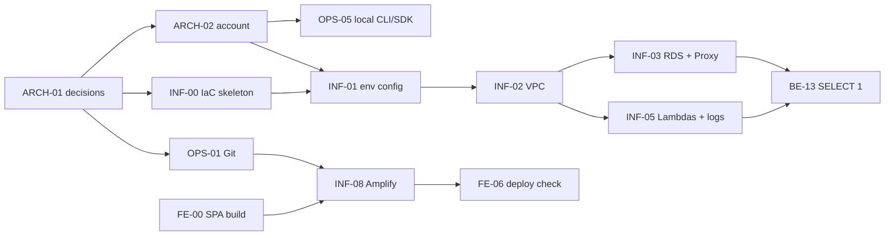

# Week 1 — Environment setup (spec)

Related: [PLAN.md](../PLAN.md) · [RISKS.md](../RISKS.md) · [ARCHITECTURE.md](../ARCHITECTURE.md)
Source: challenge curriculum, "Week 1: Environment setup" (Alex Ramasheuski, 2025-09-02).
Status: **draft (2026-11-05)** — blocked on owner decisions, see §5.

This file records the external assignment as a spec and maps it to tasks. It does not replace task files:
scope and Definition of Done live in `docs/tasks/<ID>.md`.

## 1. Assignment (as given)

**Task.** Deploy a minimal but working cloud skeleton: Amplify Hosting + CloudFront for the React SPA, a VPC with
private subnets for Lambda, Amazon RDS PostgreSQL and RDS Proxy.

**Week goals**

| # | Goal |
|---|---|
| W1-G1 | The SPA opens over HTTPS through CloudFront |
| W1-G2 | VPC with private subnets is configured; a test Lambda successfully pings RDS PostgreSQL through RDS Proxy |
| W1-G3 | AWS CLI and AWS SDK v3 are configured locally |

**Implementation steps**

| # | Step |
|---|---|
| S1 | Create a new Amplify project and connect the SPA Git repository |
| S2 | Set a custom build output in `amplify.yml`, deploy and check the CloudFront distribution |
| S3 | Create the VPC: 1 public subnet, 2 private subnets + NAT Gateway |
| S4 | Create RDS PostgreSQL 14 and RDS Proxy (target group = the database); allow access only from the private subnets |
| S5 | Scaffold three empty Lambda functions (Admin, Chatbot, Sync) in the private subnets; give them a role with access to Secrets Manager / RDS Proxy |
| S6 | Check the connection: run `SELECT 1` from the Admin Lambda |
| S7 | Configure CloudWatch log groups for all functions (retention ≥ 7 days) |

**Materials:** Amplify Hosting User Guide; SPA on S3 + CloudFront step by step; VPC concept for Lambda (private
subnets); Using Amazon RDS Proxy with Lambda.

## 2. Acceptance criteria (verifiable)

| ID | Criterion | Evidence |
|---|---|---|
| AC-1 | `https://<branch>.<appId>.amplifyapp.com` returns the SPA `index.html` over HTTPS; a deep link (e.g. `/chat`) also returns the SPA | `curl -I` output: `200`, CloudFront headers (`via`, `x-cache`, `x-amz-cf-id`) |
| AC-2 | A push to `main` triggers an Amplify build that deploys the new version | Amplify build log, commit hash in the build |
| AC-3 | VPC has the subnet layout decided in Q-08; Lambda and RDS have no public IPs | `aws ec2 describe-subnets`, `describe-route-tables`; synthesised template |
| AC-4 | RDS (version per Q-09) is reachable only through RDS Proxy, and the proxy only from the Lambda security group | SG rules in the template; RDS `PubliclyAccessible=false` |
| AC-5 | Functions `admin`, `chatbot`, `sync` exist in the private subnets, each with its own role (Secrets Manager read on the DB secret, `AWSLambdaVPCAccessExecutionRole`) | `aws lambda get-function-configuration` → `VpcConfig` |
| AC-6 | Invoking `admin` runs `SELECT 1` through the proxy endpoint over TLS and returns `1` | `aws lambda invoke` response + JSON log line; proxy `ClientConnections` metric > 0 |
| AC-7 | Every function has a log group created by IaC with retention ≥ 7 days (project standard: 14) | `aws logs describe-log-groups` |
| AC-8 | `aws sts get-caller-identity --profile awsch` succeeds; the SDK check from Q-11 succeeds with the same profile | console output in the task notes |
| AC-9 | All infrastructure is created by IaC (Q-02); nothing is clicked in the console except steps the IaC tool cannot do | IaC code in Git; exceptions listed in task notes |

## 3. Mapping to tasks

| Step / goal | Task(s) | Comment |
|---|---|---|
| Decisions for this week | [ARCH-01](../tasks/ARCH-01.md) | resolves Q-01…Q-04, Q-07 and the new Q-08…Q-11 |
| W1-G3, AWS account | [ARCH-02](../tasks/ARCH-02.md), [OPS-05](../tasks/OPS-05.md) | account, profile, budget; local SDK check |
| S1 (Git) | [OPS-01](../tasks/OPS-01.md) | repository must exist before Amplify can connect |
| IaC base | [INF-00](../tasks/INF-00.md), [INF-01](../tasks/INF-01.md) | skeleton, account/region/env config |
| S1, S2, W1-G1 | [FE-00](../tasks/FE-00.md), [INF-08](../tasks/INF-08.md), [FE-06](../tasks/FE-06.md) | green SPA build, Amplify app, deploy check |
| S3 | [INF-02](../tasks/INF-02.md) | layout depends on Q-08 |
| S4 | [INF-03](../tasks/INF-03.md) | pulled forward from M3 into Week 1; version depends on Q-09 |
| S5, S7 | [INF-05](../tasks/INF-05.md) | Week 1 needs 3 functions; `migrate` stays for M3; code depends on Q-10 |
| S6, W1-G2 | [BE-13](../tasks/BE-13.md) | `SELECT 1` probe through the proxy |

Not needed in Week 1 (stay in their milestones): Cognito (INF-04), HTTP API (INF-06), Bedrock (INF-07), CI (OPS-02).
Note: INF-08 currently depends on INF-04 and INF-06 only for the `VITE_*` values; for Week 1 the SPA can be deployed
without them (see INF-08 notes).

## 4. Delegation and order

| Lane | Owner role | Tasks (in order) | Can start when |
|---|---|---|---|
| Decisions | OWNER + ARCH | ARCH-01 | now |
| Account | OWNER | ARCH-02 → OPS-05 | Q-03, Q-11 answered |
| A — infrastructure | OPS | INF-00 → INF-01 → INF-02 → INF-03 ∥ INF-05 | Q-02, Q-03, Q-07, Q-08, Q-09, Q-10 answered |
| B — backend | BE | BE-13 (code can be written in parallel with INF-03; verified after INF-03 + INF-05) | Q-10 answered |
| C — frontend / hosting | FE + OPS | FE-00 → OPS-01 → INF-08 → FE-06 | Q-01, Q-04 answered |

Lanes A, B and C are independent after ARCH-01 and can be given to different people or agents.
ARCH reviews every INF and BE result before it becomes `Done`.

## 5. Conflicts with the current architecture

The curriculum and ARCHITECTURE.md differ in four places. Each is an open decision in RISKS.md and blocks the
affected tasks until the owner answers.

| Topic | Curriculum | ARCHITECTURE.md | Decision |
|---|---|---|---|
| Network | 1 public subnet + NAT Gateway, 2 private subnets | isolated subnets only, no NAT, interface endpoints (ADR-005) | [Q-08](../RISKS.md#q-08) |
| PostgreSQL version | 14 | newest major supported by RDS Proxy (R-07); local Docker uses 17 | [Q-09](../RISKS.md#q-09) |
| Lambda functions | 3 "empty" functions now | 4 functions from one Spring Boot artifact with SnapStart (ADR-002); draft not compiled yet (R-04) | [Q-10](../RISKS.md#q-10) |
| Local SDK | "AWS SDK v3" | backend uses AWS SDK for Java 2.x (there is no Java v3) | [Q-11](../RISKS.md#q-11) |

Already open and also blocking Week 1: [Q-01](../RISKS.md#q-01) (CloudFront), [Q-02](../RISKS.md#q-02) (IaC),
[Q-03](../RISKS.md#q-03) (region), [Q-04](../RISKS.md#q-04) (Git hosting), [Q-07](../RISKS.md#q-07) (environments).

## 6. Cost note

Week 1 starts paid resources that run 24/7: RDS instance, RDS Proxy, and NAT Gateway or interface endpoints
(depending on Q-08). ARCH-02 (budget alert) must be `Done` before the first `deploy`; the stack should be destroyed
or stopped when not in use ([R-06](../RISKS.md#2-risk-register), [OPS-04](../tasks/OPS-04.md)).
